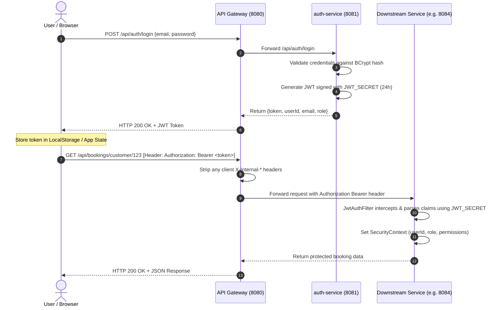
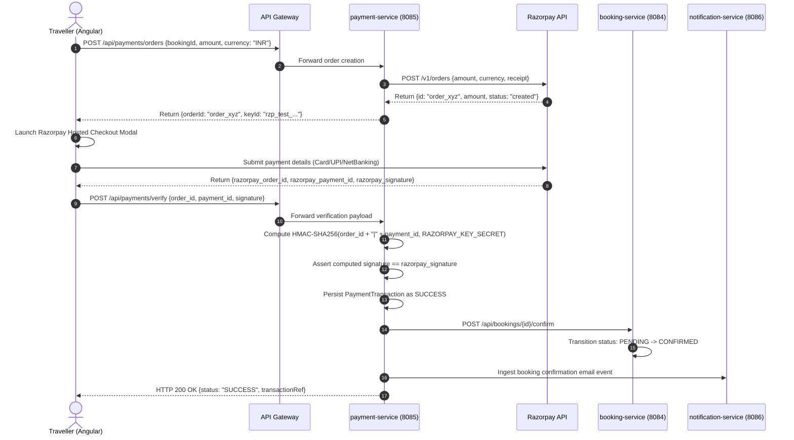
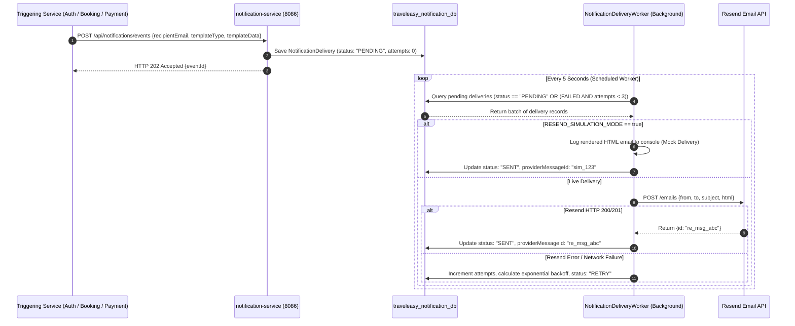

# TravelEasy — Bus & Hotel Booking Platform

[](https://www.oracle.com/java/)
[](https://spring.io/projects/spring-boot)
[](https://angular.io/)
[](https://www.mysql.com/)
[]()

TravelEasy is a full-stack, enterprise-grade travel coordination and booking platform designed to streamline transit ticketing and hotel accommodations. Built on a resilient **microservices architecture** using **Spring Boot 3.2**, **Angular 17**, and **MySQL 8.0**, TravelEasy unifies bus ticket discovery, real-time seat reservation, hotel room booking, payment processing via Razorpay, transactional email notifications via Resend, and post-travel customer reviews under a single cohesive platform.

---

## Table of Contents

- [1. Project Introduction](#1-project-introduction)
  - [Overview](#overview)
  - [Problem Statement](#problem-statement)
  - [Main Objectives](#main-objectives)
  - [Target Users & User Roles](#target-users--user-roles)
- [2. Features and Functional Modules](#2-features-and-functional-modules)
  - [Core Functional Modules](#core-functional-modules)
  - [Implementation Status](#implementation-status)
- [3. System Architecture](#3-system-architecture)
  - [High-Level Architecture](#high-level-architecture)
  - [Mermaid Architecture Diagram](#mermaid-architecture-diagram)
  - [Service-to-Service Communication](#service-to-service-communication)
  - [Database Architecture (Database-per-Service)](#database-architecture-database-per-service)
  - [Authentication Flow](#authentication-flow)
  - [Payment Lifecycle](#payment-lifecycle)
  - [Notification Delivery Flow](#notification-delivery-flow)
- [4. Microservices Documentation](#4-microservices-documentation)
  - [Service Registry & Port Allocation](#service-registry--port-allocation)
  - [Microservice Breakdown](#microservice-breakdown)
- [5. Technology Stack](#5-technology-stack)
- [6. Repository Structure](#6-repository-structure)
- [7. Prerequisites](#7-prerequisites)
- [8. Environment Configuration](#8-environment-configuration)
  - [Environment Variables Overview](#environment-variables-overview)
  - [Configuration Dictionary](#configuration-dictionary)
  - [Setting Up `.env`](#setting-up-env)
  - [Exporting Environment Variables](#exporting-environment-variables)
- [9. Database Setup](#9-database-setup)
  - [Schema Initialization](#schema-initialization)
  - [DDL Execution & Table Creation](#ddl-execution--table-creation)
  - [Seeding Demo Data](#seeding-demo-data)
- [10. Running the Application Locally](#10-running-the-application-locally)
  - [Sequential Local Development Startup](#sequential-local-development-startup)
  - [Frontend Development Server](#frontend-development-server)
  - [Docker Compose Deployment](#docker-compose-deployment)
- [11. API Documentation](#11-api-documentation)
  - [API Gateway Ingress](#api-gateway-ingress)
  - [Core Endpoint Catalog](#core-endpoint-catalog)
- [12. Security Architecture & Hardening](#12-security-architecture--hardening)
- [13. Troubleshooting & FAQ](#13-troubleshooting--faq)

---

## 1. Project Introduction

### Overview
Modern travel planning is frequently hindered by fragmented systems where travellers must navigate separate applications for intercity transit and lodging accommodations. **TravelEasy** bridges this divide by providing an integrated ecosystem that handles end-to-end trip planning: from discovering bus schedules and selecting individual seats to reserving hotel suites, executing secure payments, and receiving immediate booking vouchers.

### Problem Statement
- **Fragmented User Experience:** Disjointed booking portals force users to juggle multiple credentials, payment sessions, and booking references.
- **Inventory Inconsistencies:** High-concurrency seat and room booking requires strict consistency to prevent double-booking without introducing platform-wide bottlenecks.
- **Provider Silos:** Bus operators and hotel managers require specialized administrative tooling to manage fleets, routes, segment pricing, and room allocations without technical complexity.

### Main Objectives
1. **Unified Booking Workflow:** Seamless discovery and checkout for both transit (bus) and lodging (hotel) within a single customer account.
2. **Resilient Microservices:** Domain-driven service boundaries with dedicated databases to ensure high availability and independent scaling.
3. **Optimistic Locking & State Management:** Granular segment-based seat blocking and transactional booking state machines (`PENDING`, `CONFIRMED`, `CANCELLED`, `EXPIRED`, `REFUNDED`).
4. **Hardened Security & Confidentiality:** Zero hardcoded credentials, HMAC-SHA256 stateless JWT authentication, fail-secure key validation, and gateway-level internal header sanitization.

### Target Users & User Roles

| Role | Description | Key Capabilities |
| :--- | :--- | :--- |
| `TRAVELLER` | End consumer booking transit and lodging | Search buses/hotels, view interactive seat layouts, reserve rooms, pay via Razorpay, manage booking history, download tickets, maintain profile/preferences/favourites, submit reviews, open support tickets. |
| `BUS_OPERATOR` | Commercial transit provider | Register buses (sleeper/seater/semi-sleeper), configure multi-stop routes and stops, set up schedules, define dynamic stop-to-stop segment fare override matrices, monitor seat reservations, trigger schedule cancellations with cascade refunds. |
| `HOTEL_MANAGER` | Hospitality accommodations partner | Onboard hotel properties, configure room types (Deluxe, Suite, Standard), manage dynamic pricing and room inventory, set amenities and house policies, view reservation calendars, respond to guest reviews. |
| `ADMIN` | Platform operator and system administrator | Review and verify pending bus operator and hotel manager onboarding applications, monitor platform-wide booking metrics, review transaction and refund logs, maintain audit trails. |

---

## 2. Features and Functional Modules

### Core Functional Modules

#### 1. Authentication & Identity Management (`auth-service`)
- User registration and login with role-based assignment (`TRAVELLER`, `BUS_OPERATOR`, `HOTEL_MANAGER`, `ADMIN`).
- Password security via BCrypt salt hashing.
- Stateless authentication using HMAC-SHA256 signed JSON Web Tokens (24-hour expiration).
- Email verification workflow with time-limited tokens.
- Secure self-service password recovery flow (forgot password -> token generation -> transactional email -> token verification -> password reset).
- Provider verification and approval workflow for bus operators and hotel managers by platform administrators.

#### 2. Bus Discovery & Inventory Management (`bus-service`)
- Intercity bus search filtered by origin stop, destination stop, and travel date.
- Dynamic bus fleet registration supporting multiple coach layouts (2+1 Sleeper, 2+2 Seater, AC / Non-AC, Multi-Axle).
- Route builder supporting ordered stops with scheduled arrival/departure offsets.
- Multi-tier fare engine: base fare, per-kilometer pricing, and granular stop-to-stop fare override matrices.
- Interactive seat map selection with real-time seat locking and segment-aware conflict detection (preventing seat overlap along journey sub-segments).
- Schedule cancellation coordinator: automatically triggers refund cascades and passenger notification broadcasts when an operator cancels a trip.

#### 3. Hotel Accommodations & Manager Portal (`hotel-service`)
- Property discovery filtered by city, stay dates, guest count, and room capacity.
- Comprehensive hotel profiles: room categories, base pricing, photos, check-in/out policies, and property amenities (WiFi, Pool, Breakfast, Parking).
- Hotel Manager Portal: dedicated dashboard for hotel onboarding, room inventory adjustments, pricing updates, and reservation monitoring.
- Real-time room availability calculation based on overlapping booking date ranges.

#### 4. Unified Booking Coordination (`booking-service`)
- Consolidated booking engine supporting both `BUS` and `HOTEL` reservations under single or multiple booking references.
- Resilient state machine lifecycle: `PENDING` &rarr; `CONFIRMED` &rarr; `CANCELLED` &rarr; `EXPIRED` &rarr; `REFUNDED`.
- Background reconciliation worker (`BookingExpiryReconciliationService`) running every 60 seconds to automatically release unpaid pending bookings older than the expiration threshold (default: 10 minutes).
- Passenger manifest storage with individual seat mappings and contact details.
- Self-service booking cancellation with automated refund eligibility calculation.

#### 5. Payment Gateway Integration (`payment-service`)
- Direct integration with **Razorpay** payment infrastructure.
- Server-side Razorpay order generation with currency validation (INR) and receipt tracking.
- Client-side checkout modal orchestration followed by cryptographic signature verification (`HMAC-SHA256` of `order_id|payment_id` against `RAZORPAY_KEY_SECRET`).
- Mock payment mode for local development and integration testing without requiring live banking credentials.
- Transactional outbox pattern: publishes payment confirmation events to downstream booking and notification services.
- Automated and manual refund processing with Razorpay refund ID tracking.

#### 6. Transactional Notifications (`notification-service`)
- Multi-channel notification pipeline integrated with **Resend** email delivery API.
- Responsive HTML transactional email templates for:
  - Account registration and email verification.
  - Password recovery instructions with secure one-time links.
  - Bus and hotel booking confirmation vouchers with itemized pricing.
  - Trip cancellation and refund receipt alerts.
- Offline simulation mode (`RESEND_SIMULATION_MODE=true`): logs formatted email payloads to the console during local development without depleting Resend API quotas.
- Resilient delivery worker with exponential backoff and dead-letter handling.

#### 7. Customer Reviews & Ratings (`review-service`)
- Verified customer reviews for completed bus trips and hotel stays.
- Granular rating metrics (cleanliness, punctuality, service quality, value for money).
- Automatic recalculation of aggregate scores and rating distributions.
- Operator response capability allowing managers to address customer feedback.
- Community helpfulness voting on published reviews.

#### 8. Traveller Profile & Preferences (`traveller-service`)
- Personal profile management and emergency contact information.
- Travel preference defaults (window/aisle seat preference, AC preference, dietary preferences, floor level).
- Frequent traveller / co-passenger address book for one-click checkout.
- Favourites bookmarks for frequently booked bus routes and preferred hotels.
- Customer support ticket creation and inquiry resolution tracking.

---

### Implementation Status

| Feature / Capability | Subsystem | Status | Notes |
| :--- | :--- | :---: | :--- |
| JWT Authentication & Role Authorization | `auth-service` | **Implemented** | BCrypt hashing, 24h JWT, fail-secure validation |
| Password Recovery & Email Verification | `auth-service` | **Implemented** | Secure token generation & Resend email delivery |
| Provider Application & Approval Flow | `auth-service` | **Implemented** | Admin portal review of bus/hotel partners |
| Bus Search, Route & Segment Fares | `bus-service` | **Implemented** | Dynamic stop-to-stop fare matrix calculation |
| Interactive Seat Picker & Segment Locks | `bus-service` / Frontend | **Implemented** | Prevents overlapping segment reservations |
| Schedule Cancellation Cascade | `bus-service` / `booking-service` | **Implemented** | Cancels bookings & triggers refund workflow |
| Hotel Search, Room Inventory & Policies | `hotel-service` | **Implemented** | Date range overlap availability calculation |
| Hotel Manager Portal | `hotel-service` / Frontend | **Implemented** | Property, room type, and amenity management |
| Unified Booking State Machine | `booking-service` | **Implemented** | PENDING &rarr; CONFIRMED &rarr; CANCELLED/EXPIRED |
| Background Booking Auto-Expiry Worker | `booking-service` | **Implemented** | Scheduled task cleans up expired unpaid locks |
| Razorpay Order Creation & Verification | `payment-service` | **Implemented** | HMAC-SHA256 signature verification |
| Mock Payment Mode | `payment-service` | **Implemented** | Local testing without live credentials |
| Resend Email Notification Pipeline | `notification-service` | **Implemented** | HTML templates, outbox pattern, retry worker |
| Notification Simulation Mode | `notification-service` | **Implemented** | Offline console logging for local testing |
| Reviews & Ratings Aggregate Engine | `review-service` | **Implemented** | Bus and hotel verified reviews & aggregates |
| Traveller Preferences & Support Tickets | `traveller-service` | **Implemented** | Profile, preferences, favourites, ticketing |
| Reverse Proxy API Gateway | `api-gateway` | **Implemented** | Header sanitization, multipart forwarding |
| SMS Notification Delivery (Twilio) | `notification-service` | *Planned* | Architecture prepared; email currently primary |
| Social OAuth2 Sign-In (Google / GitHub)| `auth-service` | *Planned* | Planned for future release |
| Real-time WebSocket Seat Updates | `bus-service` | *Planned* | Currently uses optimistic locking + polling |

---

## 3. System Architecture

### High-Level Architecture
TravelEasy is structured according to the **Microservices Architecture Pattern**. The user accesses the single-page application via an **Angular 17** frontend running in the browser. All client requests are dispatched through a centralized **API Gateway** running on port `8080`, which routes traffic to the appropriate downstream microservice based on URL path prefixes while enforcing security policies and sanitizing internal headers.

Each microservice maintains its own dedicated MySQL database schema (**Database-per-Service pattern**), guaranteeing complete domain isolation and preventing direct cross-database coupling.

---

### Mermaid Architecture Diagram

```mermaid
flowchart TD
    subgraph ClientLayer["Frontend Layer"]
        UI["Angular 17 Single Page Application\n(Port 4200)"]
    end

    subgraph GatewayLayer["API Gateway Layer"]
        GW["API Gateway (Port 8080)\n• Reverse Proxy & Routing\n• Header Sanitization (strips X-Internal-*)\n• 502 Fault Tolerance"]
    end

    subgraph ServiceLayer["Spring Boot Microservices Layer (Java 21)"]
        AUTH["auth-service\n(Port 8081)\n• User & Role Management\n• JWT Token Generation\n• Password Recovery"]
        BUS["bus-service\n(Port 8082)\n• Bus & Route Inventory\n• Seat Layouts & Segment Fares\n• Trip Scheduling"]
        HOTEL["hotel-service\n(Port 8083)\n• Hotel & Room Catalog\n• Dynamic Availability\n• Manager Portal"]
        BOOK["booking-service\n(Port 8084)\n• Unified State Machine\n• Booking Expiry Worker\n• Ticket Generation"]
        PAY["payment-service\n(Port 8085)\n• Razorpay Orders & Verification\n• Mock Checkout Engine\n• Transaction Outbox"]
        NOTIF["notification-service\n(Port 8086)\n• Resend Email Delivery\n• HTML Email Templates\n• Delivery Worker & Outbox"]
        REV["review-service\n(Port 8087)\n• Bus & Hotel Reviews\n• Rating Aggregates\n• Helpfulness Votes"]
        TRAV["traveller-service\n(Port 8088)\n• Traveller Profiles\n• Travel Preferences\n• Support Inquiries"]
    end

    subgraph DatabaseLayer["Data Persistence Layer (MySQL 8.0)"]
        DB_AUTH[("traveleasy_auth_db")]
        DB_BUS[("traveleasy_bus_db")]
        DB_HOTEL[("traveleasy_hotel_db")]
        DB_BOOK[("traveleasy_booking_db")]
        DB_PAY[("traveleasy_payment_db")]
        DB_NOTIF[("traveleasy_notification_db")]
        DB_REV[("traveleasy_review_db")]
        DB_TRAV[("traveleasy_traveller_db")]
    end

    subgraph ExternalServices["External Infrastructure & SaaS APIs"]
        RAZORPAY["Razorpay Payment Gateway\n(Orders, Signatures, Refunds)"]
        RESEND["Resend Email API\n(Transactional Delivery)"]
    end

    %% Client to Gateway
    UI -->|REST /api/** (Port 8080)| GW

    %% Gateway to Services
    GW -->|/api/auth/**, /api/users/**| AUTH
    GW -->|/api/buses/**, /api/bus-operators/**| BUS
    GW -->|/api/hotels/**, /api/hotel-managers/**| HOTEL
    GW -->|/api/bookings/**| BOOK
    GW -->|/api/payments/**| PAY
    GW -->|/api/notifications/**, /api/newsletter/**| NOTIF
    GW -->|/api/reviews/**| REV
    GW -->|/api/traveller/**| TRAV

    %% Services to Databases
    AUTH --> DB_AUTH
    BUS --> DB_BUS
    HOTEL --> DB_HOTEL
    BOOK --> DB_BOOK
    PAY --> DB_PAY
    NOTIF --> DB_NOTIF
    REV --> DB_REV
    TRAV --> DB_TRAV

    %% Inter-service Orchestration
    BOOK -.->|Validate & Lock Seats| BUS
    BOOK -.->|Confirm Room Allocation| HOTEL
    BOOK -.->|Trigger Transaction| PAY
    BOOK -.->|Ingest Notification Event| NOTIF
    PAY -.->|Update Payment Status| BOOK
    PAY -.->|Send Receipt Event| NOTIF
    AUTH -.->|Dispatch Verification Email| NOTIF

    %% External Integrations
    PAY -->|REST API / Webhooks| RAZORPAY
    NOTIF -->|HTTPS REST API| RESEND
```

---

### Service-to-Service Communication
1. **Synchronous HTTP/REST:** Synchronous workflows (such as checking seat availability or verifying room capacity before booking creation) execute via Spring `RestTemplate` / Apache `HttpClient5`.
2. **Internal Header Contracts:** When services communicate with one another internally, they transmit trust metadata via headers (`X-Internal-Caller-ID`, `X-Internal-User-Id`, `X-Internal-User-Role`, `X-Internal-User-Email`).
3. **Gateway Protection Boundary:** The `api-gateway` actively inspects all incoming requests from the public internet and strips any incoming `X-Internal-*` headers, preventing client-side spoofing of trusted service roles.
4. **Transactional Outbox Pattern:** High-reliability operations (such as payment confirmations and notification delivery) utilize an outbox table in the respective local database. A dedicated background worker polls the outbox and delivers messages with automated retries and exponential backoff.

---

### Database Architecture (Database-per-Service)
TravelEasy strictly avoids shared database schemas. Each microservice manages its own independent MySQL database:

| Database Name | Owning Microservice | Core Entities Stored |
| :--- | :--- | :--- |
| `traveleasy_auth_db` | `auth-service` | Users, roles, password reset tokens, email verification tokens |
| `traveleasy_bus_db` | `bus-service` | Buses, routes, route stops, schedules, seats, segment reservations, fare overrides |
| `traveleasy_hotel_db` | `hotel-service` | Hotels, room types, hotel rooms, amenities, policies, managers |
| `traveleasy_booking_db` | `booking-service` | Bookings, booking items, passenger details, booking outbox events |
| `traveleasy_payment_db` | `payment-service` | Payment transactions, payment outbox events, refund audit logs |
| `traveleasy_notification_db` | `notification-service`| Notification delivery records, newsletter subscriptions, delivery audit history |
| `traveleasy_review_db` | `review-service` | Reviews, rating category aggregates, helpfulness vote tallies |
| `traveleasy_traveller_db` | `traveller-service` | Traveller profiles, travel preferences, favourite items, support tickets |

---

### Authentication Flow



---

### Payment Lifecycle



---

### Notification Delivery Flow



---

## 4. Microservices Documentation

### Service Registry & Port Allocation

| Service | Port | Database Schema | Primary Responsibility |
| :--- | :---: | :--- | :--- |
| **`api-gateway`** | `8080` | *None* | Central reverse proxy, route routing, header sanitization, 502 error mapping |
| **`auth-service`** | `8081` | `traveleasy_auth_db` | Authentication, JWT signing, password recovery, email verification, provider approval |
| **`bus-service`** | `8082` | `traveleasy_bus_db` | Bus fleets, routes, stops, schedules, segment fare matrices, seat reservations |
| **`hotel-service`** | `8083` | `traveleasy_hotel_db` | Hotel directory, room inventory, amenities, house policies, manager administration |
| **`booking-service`** | `8084` | `traveleasy_booking_db` | Unified booking lifecycle, expiry reconciliation worker, passenger manifests |
| **`payment-service`** | `8085` | `traveleasy_payment_db` | Razorpay order generation & signature verification, mock payments, refund audit |
| **`notification-service`** | `8086` | `traveleasy_notification_db` | Resend email dispatch, HTML templating, simulation mode, retry worker |
| **`review-service`** | `8087` | `traveleasy_review_db` | Customer reviews, rating aggregate calculation, helpfulness tallies, manager replies |
| **`traveller-service`** | `8088` | `traveleasy_traveller_db` | Traveller profiles, travel preferences, favourite routes/hotels, support tickets |

---

### Microservice Breakdown

#### 1. API Gateway (`api-gateway`)
- **Port:** `8080`
- **Database:** None (Stateless)
- **Key Responsibilities:**
  - Single public entry point for all frontend API calls.
  - Reverse proxies requests to downstream microservices using Spring `RestTemplate`.
  - Sanitizes requests by stripping client-supplied `X-Internal-*` headers to protect internal security boundaries.
  - Transparently proxies `multipart/form-data` requests for bus and hotel image uploads.
  - Translates downstream service outages (`ResourceAccessException`) into clean `502 Bad Gateway` JSON responses.

#### 2. Auth Service (`auth-service`)
- **Port:** `8081`
- **Database:** `traveleasy_auth_db`
- **Key Responsibilities:**
  - Issues stateless HMAC-SHA256 JWT tokens with 24-hour validity upon successful authentication.
  - Manages password hashing using Spring Security's `BCryptPasswordEncoder`.
  - Implements the complete password reset lifecycle with token expiration.
  - Exposes administrative endpoints for verifying and approving bus operator and hotel manager onboarding applications.

#### 3. Bus Service (`bus-service`)
- **Port:** `8082`
- **Database:** `traveleasy_bus_db`
- **Key Responsibilities:**
  - Manages bus specifications: registration numbers, total capacity, layout configurations (sleeper, semi-sleeper, seater).
  - Configures transit routes with sequential stops and time offsets.
  - Powers a dynamic segment fare matrix engine supporting base fares and stop-to-stop overrides.
  - Enforces seat locking with segment-aware conflict resolution to prevent double-booking.
  - Coordinates schedule cancellations: deactivates schedules and notifies booking services for refund processing.

#### 4. Hotel Service (`hotel-service`)
- **Port:** `8083`
- **Database:** `traveleasy_hotel_db`
- **Key Responsibilities:**
  - Catalogues hotel properties, star ratings, addresses, check-in/out policies, and amenities.
  - Manages room types (Standard, Deluxe, Executive Suite) with maximum guest limits and base rates.
  - Dynamically calculates room availability by evaluating active reservations across requested check-in and check-out dates.
  - Provides a Hotel Manager Portal API for hoteliers to configure rooms, amenities, and view reservation calendars.

#### 5. Booking Service (`booking-service`)
- **Port:** `8084`
- **Database:** `traveleasy_booking_db`
- **Key Responsibilities:**
  - Coordinates end-to-end booking transactions across both `BUS` and `HOTEL` verticals.
  - Manages the lifecycle state machine: `PENDING` &rarr; `CONFIRMED` &rarr; `CANCELLED` &rarr; `EXPIRED` &rarr; `REFUNDED`.
  - Executes a background scheduled task (`BookingExpiryReconciliationService`) every 60 seconds to release seats/rooms for unpaid bookings exceeding 10 minutes.
  - Calculates cancellation fees and initiates refund requests to `payment-service`.

#### 6. Payment Service (`payment-service`)
- **Port:** `8085`
- **Database:** `traveleasy_payment_db`
- **Key Responsibilities:**
  - Interfaces with the Razorpay API to generate server-side checkout orders.
  - Validates client-side Razorpay signatures using HMAC-SHA256 cryptographic verification.
  - Provides a mock checkout mode for rapid local development and automated CI testing.
  - Implements a transactional outbox pattern to guarantee payment event dispatch.
  - Tracks refund lifecycle states and links refunds to original Razorpay payment IDs.

#### 7. Notification Service (`notification-service`)
- **Port:** `8086`
- **Database:** `traveleasy_notification_db`
- **Key Responsibilities:**
  - Asynchronously dispatches transactional emails using the **Resend** REST API.
  - Provides rich HTML email templates for registration, verification, booking vouchers, and cancellations.
  - Features an offline simulation mode (`RESEND_SIMULATION_MODE=true`) that outputs email content directly to standard logs.
  - Maintains a delivery worker with automated retry logic, exponential backoff, and dead-letter handling.

#### 8. Review Service (`review-service`)
- **Port:** `8087`
- **Database:** `traveleasy_review_db`
- **Key Responsibilities:**
  - Stores verified customer reviews and star ratings (1–5) for bus schedules and hotel stays.
  - Computes weighted aggregate ratings and category distributions (cleanliness, punctuality, staff, value).
  - Supports helpfulness voting (`helpfulCount`) by other travellers.
  - Enables bus operators and hotel managers to submit official responses to reviews.

#### 9. Traveller Service (`traveller-service`)
- **Port:** `8088`
- **Database:** `traveleasy_traveller_db`
- **Key Responsibilities:**
  - Stores extended traveller profiles, dietary needs, and emergency contact details.
  - Manages travel preferences (e.g. window vs aisle, AC preference, preferred floor).
  - Tracks user favourites (bookmarked routes, operators, and hotels).
  - Handles customer support tickets and status updates.

---

## 5. Technology Stack

### Frontend
- **Framework:** Angular 17.2.0 (Standalone Components & Modules)
- **Language:** TypeScript 5.3
- **Reactive Programming:** RxJS 7.8
- **Styling:** CSS3, Tailwind CSS utilities, Responsive Grid & Flexbox
- **Build & Dev Tooling:** Angular CLI 17.2, Vite development server

### Backend
- **Runtime:** Java 21 LTS (Source / Target compatibility: Java 17+)
- **Framework:** Spring Boot 3.2.3
- **Security:** Spring Security 6.2 with stateless `OncePerRequestFilter` chains
- **Data Access:** Spring Data JPA / Hibernate 6.4 ORM
- **HTTP Client:** Apache HttpClient5 / Spring `RestTemplate`
- **Utilities:** Project Lombok, Jackson JSON Processor

### Database & Storage
- **Relational Database:** MySQL 8.0
- **Database Schema Pattern:** Database-per-service (8 isolated schemas)
- **Connection Pool:** HikariCP (Spring Boot default)

### Security & Cryptography
- **Token Format:** JSON Web Token (JWT)
- **Token Libraries:** `io.jsonwebtoken:jjwt-api` (0.11.5 / 0.12.3)
- **Signing Algorithm:** HMAC using SHA-256 (`HS256`, 256-bit key requirement)
- **Password Hashing:** BCrypt with standard salt rounds
- **Boundary Protection:** API Gateway internal header stripping (`X-Internal-*`)

### Third-Party Integrations
- **Payment Gateway:** Razorpay Java SDK 1.4.3 & Razorpay Checkout JS
- **Email Delivery:** Resend REST API (via Java 11+ `HttpClient`)

### Build & Containerization
- **Build Automation:** Apache Maven 3.8+
- **Package Manager:** npm 10+ / Node.js 18+
- **Containerization:** Docker & Docker Compose v2

---

## 6. Repository Structure

```
TravelEasy/
├── .env.example                               # Root environment configuration template
├── .gitignore                                 # Git exclusion rules (protects credentials & build artifacts)
├── docker-compose.yml                         # Docker Compose multi-container configuration
├── init-db.sql                                # MySQL database initialization script (8 schemas)
├── README.md                                  # Comprehensive project documentation
│
├── api-gateway/                               # Port 8080: Central Reverse Proxy & Header Sanitizer
│   ├── pom.xml
│   └── src/main/java/com/traveleasy/gateway/
│
├── auth-service/                              # Port 8081: Identity, JWT & Provider Approval
│   ├── pom.xml
│   └── src/main/java/com/traveleasy/auth/
│
├── bus-service/                               # Port 8082: Buses, Routes, Stops & Segment Fares
│   ├── pom.xml
│   └── src/main/java/com/traveleasy/bus/
│
├── hotel-service/                             # Port 8083: Hotels, Rooms, Amenities & Manager Portal
│   ├── pom.xml
│   └── src/main/java/com/traveleasy/hotel/
│
├── booking-service/                           # Port 8084: Unified Bookings & Expiry Worker
│   ├── pom.xml
│   └── src/main/java/com/traveleasy/booking/
│
├── payment-service/                           # Port 8085: Razorpay Checkout & Signature Verification
│   ├── pom.xml
│   └── src/main/java/com/traveleasy/payment/
│
├── notification-service/                      # Port 8086: Resend Email Pipeline & Delivery Worker
│   ├── pom.xml
│   └── src/main/java/com/traveleasy/notification/
│
├── review-service/                            # Port 8087: Reviews, Ratings & Aggregates
│   ├── pom.xml
│   └── src/main/java/com/traveleasy/review/
│
├── traveller-service/                         # Port 8088: Traveller Profiles & Support Tickets
│   ├── pom.xml
│   └── src/main/java/com/traveleasy/traveller/
│
├── frontend/                                  # Port 4200: Angular 17 Single Page Application
│   ├── package.json
│   ├── angular.json
│   ├── tsconfig.json
│   └── src/
│       ├── app/
│       │   ├── components/                    # Dashboards, auth screens, account pending
│       │   ├── features/                      # Feature modules (bus booking, hotel booking)
│       │   ├── services/                      # Angular HTTP services calling /api/**
│       │   └── models/                        # TypeScript domain interfaces
│       └── index.html
│
└── scripts/                                   # Automation & verification scripts
    ├── export-env.ps1                         # PowerShell script to export .env to session env vars
    ├── export-env.sh                          # Bash script to export .env to shell env vars
    ├── seed-demo-data.js                      # Node.js seed script for complete demo datasets
    ├── seed-current-dates.js                  # Updates demo schedule dates to current calendar
    └── verify-*.js                            # End-to-end integration verification test scripts
```

---

## 7. Prerequisites

Before setting up TravelEasy locally, ensure the following software is installed and available in your system path:

| Prerequisite | Minimum Version | Recommended Version | Verification Command |
| :--- | :---: | :---: | :--- |
| **Java Development Kit (JDK)** | 17 | **21 LTS** | `java -version` |
| **Apache Maven** | 3.8.0 | **3.9+** | `mvn -version` |
| **Node.js** | 18.0.0 | **20.x or 24.x** | `node -v` |
| **npm** | 9.0.0 | **10.x or 11.x** | `npm -v` |
| **MySQL Server** | 8.0.0 | **8.0+** | `mysql --version` |
| **Docker & Docker Compose** *(Optional)* | 20.10+ / 2.0+ | Latest | `docker compose version` |

---

## 8. Environment Configuration

### Environment Variables Overview
To guarantee security and confidentiality, **no sensitive credentials, passwords, or API keys are committed to the codebase**. All microservices read sensitive configuration dynamically from environment variables at startup.

### Configuration Dictionary

| Variable Name | Required | Default Value | Description |
| :--- | :---: | :--- | :--- |
| `MYSQL_ROOT_PASSWORD` | **Yes** | *None* | Root password for the local or containerized MySQL server. |
| `MYSQL_USER` | No | `root` | MySQL username used by Spring Boot datasources. |
| `MYSQL_PASSWORD` | No | `${MYSQL_ROOT_PASSWORD}` | MySQL password used by Spring Boot datasources. |
| `JWT_SECRET` | **Yes** | *None* | Base64 or plain string for signing JWT tokens. **Must be at least 32 characters (256 bits)**. |
| `RAZORPAY_KEY_ID` | Optional | `rzp_test_placeholder` | Razorpay public key ID. In mock mode, any test string is accepted. |
| `RAZORPAY_KEY_SECRET` | Optional | `placeholder_secret` | Razorpay secret key used for verifying payment signatures. |
| `RESEND_API_KEY` | Optional | `re_placeholder_key` | Resend API key for live email delivery. |
| `RESEND_FROM_EMAIL` | No | `onboarding@resend.dev` | Verified sender address for transactional emails. |
| `RESEND_SIMULATION_MODE` | No | `true` | When `true`, logs email content to the console without calling Resend API. |
| `APP_FRONTEND_URL` | No | `http://localhost:4200` | URL of the Angular frontend (used in password reset links). |
| `GATEWAY_URL` | No | `http://localhost:8080` | Internal gateway endpoint used for inter-service callbacks. |

---

### Setting Up `.env`

1. Navigate to the root directory of the repository.
2. Copy the supplied template `.env.example` to create a local `.env` file:
   ```bash
   # On Linux / macOS / Git Bash:
   cp .env.example .env

   # On Windows PowerShell:
   Copy-Item .env.example .env
   ```
3. Open `.env` in an editor and set your actual local values:
   ```dotenv
   # MySQL Configuration
   MYSQL_ROOT_PASSWORD=YourStrongDatabasePassword123!
   MYSQL_USER=root
   MYSQL_PASSWORD=YourStrongDatabasePassword123!

   # JWT Signing Secret (Must be >= 32 characters)
   JWT_SECRET=MySuperSecureTravelEasySigningKeyForProduction2026!

   # Payment Gateway (Razorpay)
   RAZORPAY_KEY_ID=rzp_test_yourKeyHere
   RAZORPAY_KEY_SECRET=yourRazorpaySecretHere

   # Email Service (Resend)
   RESEND_API_KEY=re_yourResendApiKeyHere
   RESEND_FROM_EMAIL=onboarding@resend.dev
   RESEND_SIMULATION_MODE=true

   # Application URLs
   APP_FRONTEND_URL=http://localhost:4200
   GATEWAY_URL=http://localhost:8080
   ```

> [!WARNING]
> Never commit `.env` to Git. The `.gitignore` file is configured to exclude all `.env` files except `.env.example`.

---

### Exporting Environment Variables

Because standard Spring Boot applications run from Maven do not automatically read root `.env` files, utility scripts are provided to export `.env` variables into your active shell session before launching services.

#### Option A: Windows PowerShell
```powershell
# Set process execution policy and load variables
Set-ExecutionPolicy -Scope Process Bypass
. .\scripts\export-env.ps1
```

#### Option B: Linux / macOS / Git Bash
```bash
# Source the script into the current shell session
source scripts/export-env.sh
```

---

## 9. Database Setup

### Schema Initialization
TravelEasy requires 8 dedicated schemas in MySQL. An automated initialization script `init-db.sql` is provided at the repository root.

Log in to MySQL and execute the script:
```bash
mysql -u root -p < init-db.sql
```
Or execute it inside the MySQL interactive shell:
```sql
SOURCE /path/to/TravelEasy/init-db.sql;
```

This creates the following databases:
- `traveleasy_auth_db`
- `traveleasy_bus_db`
- `traveleasy_hotel_db`
- `traveleasy_booking_db`
- `traveleasy_payment_db`
- `traveleasy_notification_db`
- `traveleasy_review_db`
- `traveleasy_traveller_db`

---

### DDL Execution & Table Creation
All microservices use Hibernate's schema update mechanism:
```properties
spring.jpa.hibernate.ddl-auto=update
```
When each Spring Boot microservice boots up for the first time, Hibernate inspects the entity models and automatically creates or updates the required database tables, indexes, and foreign keys. **No manual DDL script execution is necessary.**

---

### Seeding Demo Data
To populate the database with realistic sample data (bus operators, routes, buses, seat layouts, schedules, hotels, room types, reviews, and test user accounts):

Ensure Node.js is installed, then run the provided seed script:
```bash
node scripts/seed-demo-data.js
```

To update schedule dates to the current upcoming calendar days:
```bash
node scripts/seed-current-dates.js
```

Default demo accounts created:
- **Admin:** `admin@traveleasy.com` / `Admin@123`
- **Bus Operator:** `operator@traveleasy.com` / `Operator@123`
- **Hotel Manager:** `hotelmanager@traveleasy.com` / `Manager@123`
- **Traveller:** `traveller@traveleasy.com` / `Traveller@123`

---

## 10. Running the Application Locally

### Sequential Local Development Startup

Follow this sequence to start the backend microservices.

#### Step 1: Ensure MySQL is running
Verify MySQL is active on `localhost:3306`.

#### Step 2: Export Environment Variables in each terminal
Before running a service, ensure environment variables from `.env` are exported:
```powershell
# In PowerShell:
. .\scripts\export-env.ps1
```

#### Step 3: Build all microservices (Optional / One-time)
You can compile and package all microservices at once:
```bash
mvn clean compile -DskipTests
```

#### Step 4: Start Microservices in Order
Open separate terminal windows for each service or use IDE run configurations.

Recommended launch sequence:

1. **Auth Service (Port 8081):**
   ```bash
   cd auth-service
   mvn spring-boot:run
   ```
2. **Bus Service (Port 8082):**
   ```bash
   cd bus-service
   mvn spring-boot:run
   ```
3. **Hotel Service (Port 8083):**
   ```bash
   cd hotel-service
   mvn spring-boot:run
   ```
4. **Traveller Service (Port 8088):**
   ```bash
   cd traveller-service
   mvn spring-boot:run
   ```
5. **Booking Service (Port 8084):**
   ```bash
   cd booking-service
   mvn spring-boot:run
   ```
6. **Payment Service (Port 8085):**
   ```bash
   cd payment-service
   mvn spring-boot:run
   ```
7. **Notification Service (Port 8086):**
   ```bash
   cd notification-service
   mvn spring-boot:run
   ```
8. **Review Service (Port 8087):**
   ```bash
   cd review-service
   mvn spring-boot:run
   ```
9. **API Gateway (Port 8080):**
   ```bash
   cd api-gateway
   mvn spring-boot:run
   ```

---

### Frontend Development Server

1. Open a new terminal and navigate to the `frontend/` directory:
   ```bash
   cd frontend
   ```
2. Install npm dependencies (first time only):
   ```bash
   npm install
   ```
3. Start the Angular development server:
   ```bash
   npm start
   ```
   *(Or run `npx ng serve --port 4200`)*
4. Access the web application at:
   ```
   http://localhost:4200
   ```

> [!NOTE]
> The Angular frontend automatically routes all `/api/**` calls to the API Gateway at `http://localhost:8080/api` when running on port 4200.

---

### Docker Compose Deployment

To run the entire TravelEasy ecosystem including MySQL, all 9 Spring Boot microservices, and the Angular frontend in a containerized environment:

1. Configure your `.env` file at the root.
2. Build and run all containers:
   ```bash
   docker compose up --build -d
   ```
3. Check status of all containers:
   ```bash
   docker compose ps
   ```
4. View aggregate logs:
   ```bash
   docker compose logs -f
   ```
5. Stop and clean up containers:
   ```bash
   docker compose down
   ```

---

## 11. API Documentation

### API Gateway Ingress
The **API Gateway** running on `http://localhost:8080` routes external HTTP requests to internal microservices based on request path prefixes:

| Path Prefix | Destination Service | Internal Port | Description |
| :--- | :--- | :---: | :--- |
| `/api/auth/**` | `auth-service` | `8081` | User registration, login, email verification, password reset |
| `/api/users/**` | `auth-service` | `8081` | User administration & provider application approvals |
| `/api/buses/**` | `bus-service` | `8082` | Bus search, route details, seats, schedules |
| `/api/bus-operators/**`| `bus-service` | `8082` | Operator fleet management, route building, fare matrices |
| `/api/hotels/**` | `hotel-service` | `8083` | Hotel search, room details, amenities, availability |
| `/api/hotel-managers/**`| `hotel-service` | `8083` | Hotel manager portal, room inventory, policies |
| `/api/bookings/**` | `booking-service` | `8084` | Booking creation, status queries, tickets, cancellation |
| `/api/payments/**` | `payment-service` | `8085` | Razorpay orders, signature verification, refunds |
| `/api/notifications/**`| `notification-service`| `8086` | Notification events, delivery history, test emails |
| `/api/newsletter/**` | `notification-service`| `8086` | Newsletter subscription endpoints |
| `/api/reviews/**` | `review-service` | `8087` | Reviews submission, aggregates, helpfulness voting |
| `/api/traveller/**` | `traveller-service` | `8088` | Traveller profile, preferences, favourites, support tickets |

---

### Core Endpoint Catalog

#### Authentication & User Management (`auth-service`)
- `POST /api/auth/register` — Register a new account (`TRAVELLER`, `BUS_OPERATOR`, `HOTEL_MANAGER`).
- `POST /api/auth/login` — Authenticate with email/password; returns JWT and user profile.
- `GET /api/auth/verify-email?token={token}` — Complete email verification.
- `POST /api/auth/forgot-password` — Request a password reset email.
- `POST /api/auth/reset-password` — Reset password using a valid reset token.
- `GET /api/users/pending-providers` — (Admin) List pending bus operator and hotel manager applications.
- `PUT /api/users/{id}/approve` — (Admin) Approve a provider application.
- `PUT /api/users/{id}/reject` — (Admin) Reject a provider application.

#### Bus Discovery & Operator Operations (`bus-service`)
- `GET /api/buses/search?from={origin}&to={destination}&date={YYYY-MM-DD}` — Search available bus schedules.
- `GET /api/buses/{id}` — Get detailed bus specifications and layout.
- `GET /api/buses/schedules/{scheduleId}/seats` — Get seat map with current availability status.
- `POST /api/buses/schedules/{scheduleId}/lock-seats` — Temporarily block selected seats during checkout.
- `POST /api/bus-operators/buses` — (Operator) Register a new bus in the fleet.
- `POST /api/bus-operators/routes` — (Operator) Create a new transit route with sequential stops.
- `POST /api/bus-operators/schedules` — (Operator) Publish a new departure schedule.
- `POST /api/bus-operators/schedules/{id}/fare-overrides` — (Operator) Set segment-specific fare overrides.
- `POST /api/bus-operators/schedules/{id}/cancel` — (Operator) Cancel a scheduled trip and trigger refund cascade.

#### Hotel Discovery & Manager Operations (`hotel-service`)
- `GET /api/hotels/search?city={city}&checkIn={date}&checkOut={date}&guests={count}` — Search available hotels.
- `GET /api/hotels/{id}` — Retrieve hotel details, room categories, amenities, and policies.
- `GET /api/hotels/{id}/availability?checkIn={date}&checkOut={date}` — Check room type availability.
- `POST /api/hotel-managers/hotels` — (Manager) Onboard a new hotel property.
- `POST /api/hotel-managers/hotels/{id}/rooms` — (Manager) Add room types and inventory.
- `PUT /api/hotel-managers/hotels/{id}/policies` — (Manager) Update check-in/out rules and policies.

#### Booking Management (`booking-service`)
- `POST /api/bookings` — Create a new pending reservation (`BUS` or `HOTEL`).
- `GET /api/bookings/{id}` — Retrieve booking details, passengers, and payment status.
- `GET /api/bookings/reference/{reference}` — Lookup booking by unique reference code.
- `GET /api/bookings/customer/{customerId}` — List all past and active bookings for a customer.
- `POST /api/bookings/{id}/confirm` — Internal endpoint to confirm booking after payment verification.
- `POST /api/bookings/{id}/cancel` — Request booking cancellation and trigger refund evaluation.

#### Payment Gateway (`payment-service`)
- `POST /api/payments/orders` — Create a Razorpay order for an active booking.
- `POST /api/payments/verify` — Verify client-side Razorpay signature and finalize transaction.
- `POST /api/payments/mock` — Execute a mock payment for testing environments.
- `GET /api/payments/booking/{bookingId}` — Retrieve payment transaction details for a booking.
- `POST /api/payments/refund` — Initiate a full or partial refund for a cancelled booking.

#### Notifications (`notification-service`)
- `POST /api/notifications/events` — Ingest transactional notification event from another service.
- `GET /api/notifications/deliveries` — (Admin) Inspect notification delivery logs and statuses.
- `POST /api/notifications/test-email` — Send a test email to verify Resend configuration.
- `POST /api/newsletter/subscribe` — Subscribe an email address to platform updates.

#### Reviews & Ratings (`review-service`)
- `POST /api/reviews` — Submit a review and star ratings for a completed booking.
- `GET /api/reviews/entity/{entityType}/{entityId}` — Get paginated reviews and aggregate score for a bus/hotel.
- `POST /api/reviews/{id}/helpful` — Upvote a review as helpful.
- `POST /api/reviews/{id}/response` — (Operator/Manager) Post an official response to a review.

#### Traveller Experience (`traveller-service`)
- `GET /api/traveller/profile/{userId}` — Retrieve traveller profile details.
- `PUT /api/traveller/profile/{userId}` — Update traveller personal and contact details.
- `GET /api/traveller/preferences/{userId}` — Retrieve seat, floor, and travel preferences.
- `PUT /api/traveller/preferences/{userId}` — Update travel preferences.
- `GET /api/traveller/favourites/{userId}` — Get bookmarked bus routes and hotels.
- `POST /api/traveller/support-tickets` — Create a new customer support ticket.

---

## 12. Security Architecture & Hardening

TravelEasy implements a defense-in-depth security strategy designed for cloud-native deployment:

1. **Elimination of Hardcoded Credentials:**
   - No database passwords, JWT secrets, or third-party API keys are hardcoded in source code or committed property files.
   - All sensitive settings default to environment placeholders (`${MYSQL_ROOT_PASSWORD}`, `${JWT_SECRET}`).

2. **Fail-Secure Validation (`@PostConstruct`):**
   - Services performing cryptographic operations (`auth-service`, `traveller-service`, etc.) execute a startup sanity check on `JWT_SECRET`.
   - If `JWT_SECRET` is missing, blank, or less than 32 characters (256 bits), the service intentionally **aborts startup** with an explicit error message, preventing insecure execution.

3. **Stateless JWT Security Filters:**
   - Spring Security is configured with `SessionCreationPolicy.STATELESS`.
   - Each HTTP request passes through a custom `OncePerRequestFilter` (`JwtAuthFilter`) that verifies token integrity and builds the `SecurityContext` without server-side session overhead.

4. **Gateway Reverse Proxy Sanitization:**
   - The API Gateway explicitly strips all incoming `X-Internal-*` headers from external clients before forwarding requests downstream.
   - Downstream services can safely rely on internal headers injected by the Gateway or inter-service clients.

5. **Cryptographic Payment Signature Verification:**
   - Client payments are never trusted based solely on frontend callbacks.
   - `payment-service` recomputes the HMAC-SHA256 signature using the server's private `RAZORPAY_KEY_SECRET` before marking transactions as successful or notifying the booking engine.

---

## 13. Troubleshooting & FAQ

### 1. `Access denied for user 'root'@'localhost'`
- **Cause:** The `MYSQL_ROOT_PASSWORD` environment variable has not been exported in your shell session.
- **Resolution:** Run `. .\scripts\export-env.ps1` (PowerShell) or `source scripts/export-env.sh` (Bash) in the terminal before running `mvn spring-boot:run`.

### 2. `IllegalStateException: JWT Secret must be configured with at least 32 characters`
- **Cause:** `JWT_SECRET` is either missing or too short.
- **Resolution:** Ensure your `.env` contains a `JWT_SECRET` string of at least 32 characters (e.g., `MySuperSecureTravelEasySigningKeyForProduction2026!`), and re-export environment variables.

### 3. Port Conflict / `Address already in use`
- **Cause:** Another process is bound to the target service port (e.g., 8080 or 3306).
- **Resolution:**
  - Find the occupying process:
    ```powershell
    # Windows:
    netstat -ano | findstr :8080
    # Linux / macOS:
    lsof -i :8080
    ```
  - Terminate the conflicting process or change the port in `.env` / `application.properties`.

### 4. `Downstream service unavailable (502 Bad Gateway)`
- **Cause:** The API Gateway is running, but the specific microservice handling that route (e.g. `bus-service` on port 8082) is not yet running.
- **Resolution:** Check that all microservices corresponding to the endpoint prefix are booted up and listening on their respective ports.

### 5. `Razorpay checkout script failed to load`
- **Cause:** An ad-blocker or network firewall is blocking `https://checkout.razorpay.com/v1/checkout.js`.
- **Resolution:** Temporarily disable browser content blockers for `localhost:4200` or use mock checkout mode for local testing.

---

## License

This project is proprietary and confidential. Unauthorized copying, modification, distribution, or sharing of this repository or its source code via any medium is strictly prohibited without explicit written permission from the project maintainers.
