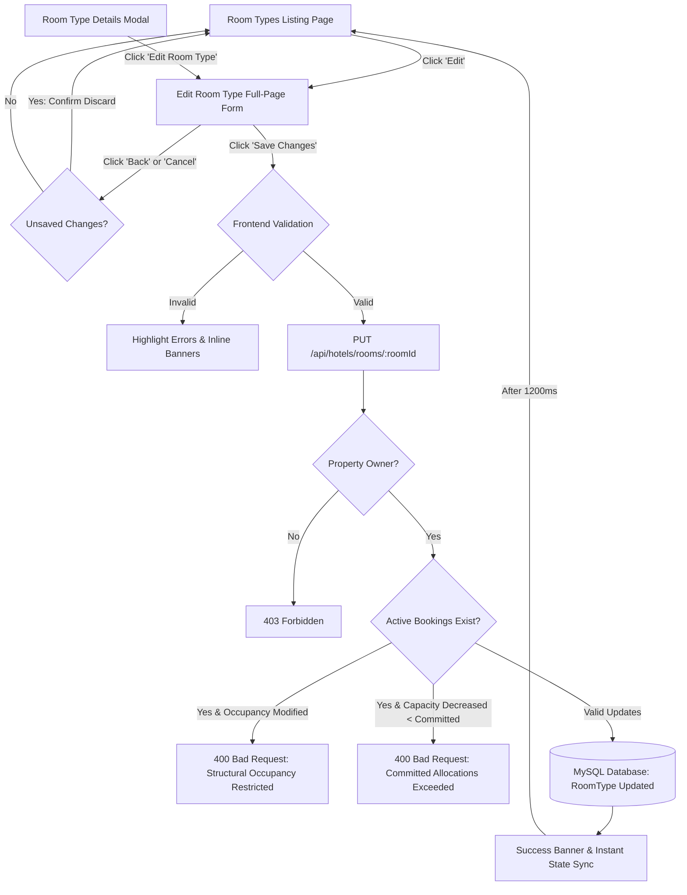

# TravelEasy — WP-06: Room Management
## Implementation Report: Edit Room Type Full-Page Form Redesign & Functional Integration

**Document Version:** 1.0.0  
**Work Package ID:** WP-06 (Edit Room Type Experience)  
**Primary Visual Specification:** Approved Mockup (`media_1794075021966_99d66a94.jpg`)  
**Target Module:** `frontend` (Angular 17) & `hotel-service` (Spring Boot 3.2, Java 21, MySQL)  
**Verification Status:** **ALL 23 UNIT & INTEGRATION TESTS PASSING (0 FAILURES, 0 ERRORS) — ANGULAR BUILD CLEAN (0 ERRORS)**  

---

### 1. Executive Summary

In accordance with the approved user mockup `media_1794075021966_99d66a94.jpg` and the WP-06 Room Management specifications, the **Edit Room Type** workflow has been implemented as a dedicated, integrated full-page editing form within the TravelEasy Hotel Manager Portal.

This implementation replaces previous placeholder alerts and connects seamlessly with both the **Room Types Listing Page** (via card `Edit` buttons) and the **Room Type Details Modal** (via the `Edit Room Type` modal footer action). The implementation enforces all finalized architectural rules regarding structural vs non-structural modifications, date-wise inventory capacity boundaries, image management (replacement & explicit deletion), pricing preservation, and property manager ownership verification.



---

### 2. UI Reproduction & Visual Specification Compliance

The full-page form matches the approved mockup `media_1794075021966_99d66a94.jpg` with high fidelity:

| UI Component | Mockup Specification | Implementation Details |
|---|---|---|
| **Header & Navigation** | Circular `←` back button, bold title, descriptive subtitle | `btn-back-circle` returning to listing, Heading: `Edit Room Type`, Subtitle: `Update the details and configuration of this room type.` |
| **Context Summary Bar** | Horizontal white card with cyan bed badge, room name, room ID, status badge, total rooms, max occupancy | `edit-room-context-bar` displaying: Bed icon + `Editing: {Room Name}`, `🏷 Room Type ID: RT-XXXX`, `Active`/`Archived` badge, `🛏 Total Rooms: {N}`, `👥 Max Occupancy: {N} Guests` separated by vertical dividers |
| **Basic Information Card** | Room Type Name input & Maximum Occupancy inline counter | Text input with $\le 100$ character validation & active duplicate check excluding self; inline stepper with `👥` icon, `-` button, count, `+` button, and `Guests` label |
| **Room Capacity Card** | Total Rooms inline counter & informational callout box | Inline stepper with `🛏` icon, `-` button, count, and `+` button ($\ge 1$); info box with `(i)` badge: `This is the total room count for this room type (not the daily availability).` |
| **Amenities Card** | Predefined chips with active checkmark badges, custom amenity input, selected summary | 10 predefined chips (Wi-Fi, AC, TV, Private Bathroom, Room Service, Heater, Mini Fridge, Balcony, Work Desk, Wardrobe); active state displays teal border, teal background tint, and circular checkmark `✓` badge; custom input with duplicate detection; selected amenities summary with removable chips |
| **Room Image Card** | Large preview frame with rounded corners, side-by-side Replace & Remove buttons | Large image preview frame (`max-height: 240px`, object-fit cover), `Replace` button (`btn-outline-teal-replace`) triggering file selection (JPG/PNG/WebP $\le 1$ MB), `Remove` button (`btn-outline-danger-remove`) clearing image reference with fallback dropzone |
| **Persistent Bottom Actions** | Border-top footer with Cancel and Save Changes buttons | `Cancel` button (with dirty check), teal `Save Changes` button (`btn-teal-submit`) with loading spinner and disabled state |

---

### 3. Business Decisions & Enforcement Logic

#### 3.1 Maximum Occupancy (Bidirectional Structural Modification Check)
- **Rule:** Maximum Occupancy is structural and affects guest expectations, room assignment constraints, and booking contracts.
- **Enforcement:** If active bookings or allocations exist (`allocatedRooms > 0`, un-checked-out allocations in `HELD` or `CONFIRMED` status, or active daily inventory in `bookedRooms` or `heldRooms`), **both increases and decreases are strictly rejected** with a `400 Bad Request` and an explicit domain error message.
- **Allowed State:** When no active bookings or allocations exist for the category, managers may freely modify occupancy within the valid range of 1 to 20 guests.

#### 3.2 Total Rooms Capacity Adjustments (Date-Wise Allocation Boundary)
- **Rule:** Room capacity reductions must never create an overbooking condition across any future date.
- **Enforcement:** Capacity increases are always permitted and update current availability accordingly. Reductions are validated against current allocations (`newTotal < allocatedRooms` rejected) and date-wise allocations via `HotelInventoryService.validateAndApplyCapacityChange` (`committed = booked + held + blocked > newTotal` rejected with specific date in message).

#### 3.3 Strict Pricing & Inventory Separation
- **Rule:** Room Management is strictly decoupled from daily rates and availability.
- **Enforcement:** No pricing or daily availability fields exist in the Room Management UI. When `pricePerNight` is omitted or null in the update payload, `RoomTypeService.updateRoomType` explicitly preserves the existing database `pricePerNight`.

#### 3.4 Image Management (Replacement & Explicit Deletion)
- When a manager uploads a replacement image, the frontend uploads the binary via `/api/hotels/{hotelId}/images` and saves the new path to `imageUrl`.
- When a manager clicks `Remove`, `isEditRoomImageRemoved = true` sends an empty string `""` to the backend, which sets `roomType.setImageUrl(null)`.
- If the image is untouched, the existing `imageUrl` is preserved.

---

### 4. Automated Test Results & Verification

#### 4.1 Backend Integration Test Suite (`RoomTypeCreationTest.java`)
All 23 unit and integration tests executed cleanly via Maven Surefire:

```
[INFO] Running com.traveleasy.hotel.RoomTypeCreationTest
[INFO] Tests run: 23, Failures: 0, Errors: 0, Skipped: 0, Time elapsed: 8.066 s -- in com.traveleasy.hotel.RoomTypeCreationTest
[INFO] Results:
[INFO] Tests run: 23, Failures: 0, Errors: 0, Skipped: 0
[INFO] ------------------------------------------------------------------------
[INFO] BUILD SUCCESS
[INFO] ------------------------------------------------------------------------
```

| Test Case | Method Name | Verified Assertion | Result |
|---|---|---|---|
| **WP-06 Edit 1** | `testUpdateRoomType_Success_NonStructural` | Non-structural updates (name, amenities, image) succeed and preserve existing price when omitted | **PASS** |
| **WP-06 Edit 2** | `testUpdateRoomType_DuplicateActiveName_Rejected` | Rejects renaming to an existing active room name in same property; allows retaining same name for self | **PASS** |
| **WP-06 Edit 3** | `testUpdateRoomType_OccupancyModification_AllowedWithoutActiveBookings` | Structural occupancy modification (2 $\rightarrow$ 5) succeeds when no active bookings exist | **PASS** |
| **WP-06 Edit 4** | `testUpdateRoomType_OccupancyDecrease_RejectedWithActiveBookings` | Occupancy decrease (3 $\rightarrow$ 2) rejected with 400 when active reservations exist | **PASS** |
| **WP-06 Edit 5** | `testUpdateRoomType_OccupancyIncrease_RejectedWithActiveBookings` | Occupancy increase (2 $\rightarrow$ 4) rejected with 400 when active reservations exist | **PASS** |
| **WP-06 Edit 6** | `testUpdateRoomType_CapacityIncrease_Success` | Total rooms increase (5 $\rightarrow$ 12) updates totalRooms and availableRooms | **PASS** |
| **WP-06 Edit 7** | `testUpdateRoomType_CapacityDecrease_RejectedWhenExceedingCommitted` | Total rooms decrease (10 $\rightarrow$ 3 with 4 allocated) rejected with 400 | **PASS** |
| **WP-06 Edit 8** | `testUpdateRoomType_ImageRemoval_ClearsDatabaseImage` | Sending `imageUrl: ""` sets database image to null | **PASS** |
| **WP-06 Edit 9** | `testUpdateRoomType_NonOwner_Forbidden` | Non-owner manager receives 403 Forbidden on update attempt | **PASS** |
| **WP-06 1.1–2.4** | Creation, Listing & Archive Tests (14 existing) | Creation, validation, inventory initialization, filtering, soft archiving | **PASS** |

#### 4.2 Frontend Angular Build
Executed `npm --prefix frontend run build`:
```
Application bundle generation complete. [9.600 seconds]
Initial chunk files   | Names         | Raw size | Estimated transfer size
main-JZ7IL7VJ.js      | main          |  1.78 MB |               307.29 kB
polyfills-FFHMD2TL.js | polyfills     | 33.71 kB |                11.02 kB
styles-CU5B4YZD.css   | styles        |  1.16 kB |               472 bytes
                      | Initial total |  1.81 MB |               318.77 kB
```
**0 compilation errors, 0 template errors, 0 stylesheet warnings.**

---

### 5. File Modification Manifest

| File Path | Description of Changes |
|---|---|
| `hotel-service/src/main/java/com/traveleasy/hotel/service/RoomTypeService.java` | Injected `HotelBookingAllocationRepository` & `RoomDailyInventoryRepository`; implemented bidirectional structural occupancy restriction, price preservation on null, image replacement & empty-string clearing, and archive active booking checks |
| `hotel-service/src/main/java/com/traveleasy/hotel/repository/HotelBookingAllocationRepository.java` | Added `findByRoomIdAndStatusIn(Long roomId, List<String> statuses)` |
| `hotel-service/src/test/java/com/traveleasy/hotel/RoomTypeCreationTest.java` | Added 9 dedicated integration tests for Room Type editing covering non-structural updates, price preservation, duplicate names, bidirectional occupancy restrictions, capacity checks, image removal, and security |
| `frontend/src/app/components/hotel-manager-dashboard/hotel-manager-dashboard.component.ts` | Added `'edit'` view mode to `roomViewMode`; added Edit form state variables, dirty tracking, inline counter steppers, amenity toggle/custom logic, image handling (replace/remove), validation, and `submitEditRoomType` |
| `frontend/src/app/components/hotel-manager-dashboard/hotel-manager-dashboard.component.html` | Added View 3: `<div *ngIf="roomViewMode === 'edit'">` matching `media_1794075021966_99d66a94.jpg` with context summary bar, 2-column card layout, inline steppers, amenity chips with checkmark badges, and image replace/remove |
| `frontend/src/app/components/hotel-manager-dashboard/hotel-manager-dashboard.component.css` | Added styling for `.edit-room-context-bar`, `.btn-stepper-inline`, `.edit-occupancy-stepper-box`, `.edit-capacity-stepper-box`, `.amenity-chip-btn .check-badge`, `.btn-outline-teal-replace`, and `.btn-outline-danger-remove` |
