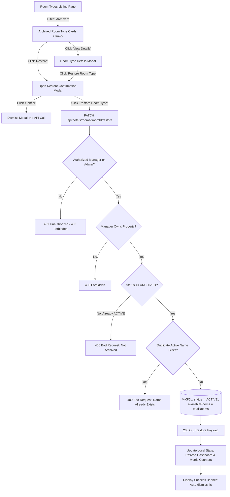

# TravelEasy — WP-06: Room Management
## Implementation Report: Restore Archived Room Type Functionality

**Document Version:** 1.0.0  
**Work Package ID:** WP-06 (Restore Archived Room Type Workflow)  
**Target Module:** `frontend` (Angular 17) & `hotel-service` (Spring Boot 3.2, Java 21, MySQL)  
**Verification Status:** **ALL 182 BACKEND UNIT & INTEGRATION TESTS PASSING (0 FAILURES, 0 ERRORS) — ANGULAR BUILD CLEAN (0 ERRORS)**  

---

### 1. Executive Summary

In response to the assignment for **WP-06 — Restore Archived Room Type Functionality**, the ability for Hotel Managers and System Admins to restore previously archived room categories has been implemented and verified.

The existing Room Type archival workflow remains intact and regression-free. The restoration operation preserves the original entity identity (`roomId`, `hotelId`, `roomTypeName`, `maxOccupancy`, `totalRooms`, `amenities`, `imageUrl`, `pricePerNight`), transitions status from `ARCHIVED` to `ACTIVE`, aligns scalar availability with physical capacity, prevents active-name collisions, and leaves date-wise inventory, daily rates, and historical reservations untouched.



---

### 2. Codebase Inspection & Baseline Architecture

Prior to implementing changes, the existing codebase was inspected:

| Component | File Inspected | Key Findings & Integration Decisions |
|---|---|---|
| **Service Layer** | `RoomTypeService.java` | `archiveRoomType` sets `status = "ARCHIVED"` and `availableRooms = 0`. Implemented `restoreRoomType` using the same transaction and ownership patterns. |
| **Controller** | `HotelController.java` | Standardized authentication via `validateManagerOrAdminAuth`. Added `@PatchMapping("/rooms/{roomId}/restore")`. |
| **Repository** | `RoomTypeRepository.java` | Utilized `findByHotelIdAndRoomTypeNameIgnoreCaseAndStatus` to detect duplicate active names before restoring. |
| **Security Service** | `HotelSecurityService.java` | Enforced `principal.isHotelManager()` property ownership match (`principal.userId().equals(hotel.getManagerId())`) while permitting `ROLE_ADMIN` access. |
| **Angular Service** | `hotel.service.ts` | Added `restoreRoomType(roomId: number): Observable<any>` pointing to `PATCH /api/hotels/rooms/${roomId}/restore`. |
| **Listing Component** | `hotel-manager-dashboard.component.ts` | Added Restore modal state, `openRestoreRoomModal`, `cancelRestoreRoom`, `confirmRestoreRoom`, and `onRestoreRoomFromModal`. |

---

### 3. Backend Implementation & Business Logic

#### 3.1 Restore API Endpoint
- **Method & Path:** `PATCH /api/hotels/rooms/{roomId}/restore`
- **Security:** Requires valid JWT in `Authorization: Bearer <token>`. Allows `ROLE_HOTEL_MANAGER` and `ROLE_ADMIN`.
- **Ownership:** Enforced by verifying `principal.userId().equals(hotel.getManagerId())` for managers; rejects non-owner managers with `403 Forbidden`.
- **Response Format (200 OK):**
  ```json
  {
    "message": "Room category restored successfully",
    "roomId": 1052,
    "status": "ACTIVE",
    "roomTypeName": "Penthouse Suite"
  }
  ```

#### 3.2 Business Rules & Validations in `RoomTypeService.restoreRoomType`
1. **Principal Validation:** Validates identity and manager/admin role.
2. **Entity Existence:** Throws `ResourceNotFoundException("Room category not found with ID: " + roomId)` (404) if the room does not exist.
3. **Parent Property Existence:** Throws `ResourceNotFoundException("Parent hotel property not found with ID: " + roomType.getHotelId())` (404) if parent property is missing.
4. **Current Status Guard:** Ensures the room is actually archived. If already `ACTIVE`, throws `DomainValidationException("Room category is not archived (current status: " + roomType.getStatus() + ")")` (400).
5. **Active-Name Collision Check:** Checks if another active room type in the same property currently has the same name (case-insensitive). If a conflict exists, throws `DomainValidationException` (400) preventing duplicate active category names.
6. **Data Preservation:** Retains the exact same entity instance without recreation. Flips `status = "ACTIVE"` and synchronizes `availableRooms = totalRooms`.

#### 3.3 Inventory and Pricing Boundaries
As mandated by architectural separation rules:
- Restoration does **NOT** alter date-wise inventory in `RoomDailyInventory`.
- Restoration does **NOT** create, delete, or override nightly pricing.
- Restoration does **NOT** alter historical booking prices or reservation allocations.
- The restored category immediately participates in normal room discovery and future booking validation according to existing rules.

---

### 4. Frontend UI Implementation

#### 4.1 Filter Toolbar & Listing Integration
- **Status Filter:** Retains `Active`, `Archived`, and `All`.
- **Card Presentation (Grid View):**
  - For `ACTIVE` room types: displays **View Details**, **Edit**, and **Archive** buttons.
  - For `ARCHIVED` room types: displays **View Details** and **Restore** (`btn-outline-teal` with rotate-left icon). The `Archive` and `Edit` actions are hidden for archived items.
- **Table Presentation (List View):**
  - Displays **Details**, **Edit**, and **Archive** for active rows.
  - Displays **Details** and **Restore** for archived rows.
- **Details Modal:**
  - For active rooms: displays **Edit Room Type**.
  - For archived rooms: displays **Restore Room Type** (`btn-teal-submit`), which closes the details modal and opens the Restore Confirmation Modal.

#### 4.2 Restore Confirmation Modal
Matches the approved modal layout with cyan icon badge:
- **Title:** `Restore Room Type?`
- **Body:** `"Are you sure you want to restore [Room Type Name]? This room type will become active again and may be included in room discovery and future reservations, subject to availability and pricing configuration."`
- **Actions:**
  - `Cancel`: Closes modal with no API call.
  - `Restore Room Type`: Calls `hotelService.restoreRoomType(id)`, shows loading spinner, and disables controls during transit.
- **Error Handling:** Displays inline alert on error.
- **Success Handling:** Closes modal, displays green success notification banner (`restoreRoomSuccess`), and calls `loadDashboardData()` to refresh cards, tables, and metric counts (Active count increments, Archived count decrements).

---

### 5. Automated Verification & Test Results

#### 5.1 Backend Integration Tests (`RoomTypeCreationTest.java`)
All 30 tests in `RoomTypeCreationTest` executed cleanly via Maven Surefire:

```
[INFO] Running com.traveleasy.hotel.RoomTypeCreationTest
[INFO] Tests run: 30, Failures: 0, Errors: 0, Skipped: 0, Time elapsed: 15.35 s -- in com.traveleasy.hotel.RoomTypeCreationTest
[INFO] Results:
[INFO] Tests run: 30, Failures: 0, Errors: 0, Skipped: 0
[INFO] ------------------------------------------------------------------------
[INFO] BUILD SUCCESS
[INFO] ------------------------------------------------------------------------
```

| Test Name | Method | Assertion Verified | Result |
|---|---|---|---|
| **WP-06 Restore 1** | `testRestoreRoomType_Success` | Archived room restored to `ACTIVE`; same ID, hotelId, price, occupancy, totalRooms, amenities, imageUrl preserved | **PASS** |
| **WP-06 Restore 2** | `testRestoreRoomType_AlreadyActive_Rejected` | Restoring already active room rejected with 400 Bad Request | **PASS** |
| **WP-06 Restore 3** | `testRestoreRoomType_Nonexistent_NotFound` | Nonexistent room ID returns 404 Not Found | **PASS** |
| **WP-06 Restore 4** | `testRestoreRoomType_NonOwner_Forbidden` | Non-owner manager receives 403 Forbidden; room remains `ARCHIVED` | **PASS** |
| **WP-06 Restore 5** | `testRestoreRoomType_Unauthorized_Rejected` | Request without JWT returns 401 Unauthorized | **PASS** |
| **WP-06 Restore 6** | `testRestoreRoomType_Admin_Success` | System Admin can restore room across any property | **PASS** |
| **WP-06 Restore 7** | `testRestoreRoomType_DuplicateActiveNameConflict_Rejected` | Rejected with 400 if another active room type in property has same name | **PASS** |
| **WP-06 Archive 1.1–2.4** | Archive Suite (4 tests) | Soft archive, active allocation checks, historical preservation, non-owner rejection | **PASS** |
| **WP-06 Edit 1–9** | Edit Suite (9 tests) | Bidirectional structural occupancy checks, capacity reduction, pricing preservation, image replace/remove | **PASS** |
| **WP-06 Creation 1–10** | Creation Suite (10 tests) | Validations, duplicate prevention, auto inventory initialization | **PASS** |

#### 5.2 Full Service Regression Test Suite
Executed `mvn test` across all 182 tests in `hotel-service`:
```
[INFO] Results:
[INFO] Tests run: 182, Failures: 0, Errors: 0, Skipped: 0
[INFO] ------------------------------------------------------------------------
[INFO] BUILD SUCCESS
[INFO] ------------------------------------------------------------------------
```
**182/182 tests passed with 0 failures, 0 errors, and 0 regressions.**

#### 5.3 Frontend Angular Build
Executed `npm --prefix frontend run build`:
```
Application bundle generation complete. [20.685 seconds]
Initial chunk files   | Names         | Raw size | Estimated transfer size
main-XZN7W5JM.js      | main          |  1.78 MB |               307.85 kB
polyfills-FFHMD2TL.js | polyfills     | 33.71 kB |                11.02 kB
styles-CU5B4YZD.css   | styles        |  1.16 kB |               472 bytes
                      | Initial total |  1.82 MB |               319.33 kB
```
**0 compilation errors, 0 template errors, 0 warnings.**

---

### 6. File Modification Manifest

| File Path | Description of Changes |
|---|---|
| `hotel-service/src/main/java/com/traveleasy/hotel/service/RoomTypeService.java` | Implemented `@Transactional public RoomType restoreRoomType(Long roomId, CallerPrincipal principal)` with ownership checks, current-status guard, active-name duplicate conflict detection, and entity preservation. |
| `hotel-service/src/main/java/com/traveleasy/hotel/controller/HotelController.java` | Added `@PatchMapping("/rooms/{roomId}/restore")` with `validateManagerOrAdminAuth` and consistent JSON response. |
| `hotel-service/src/test/java/com/traveleasy/hotel/RoomTypeCreationTest.java` | Added 7 dedicated tests for room type restoration covering success, attribute preservation, 400 on already active, 404 on nonexistent, 403 on non-owner, 401 on unauthenticated, Admin access, and active-name duplicate collision. |
| `frontend/src/app/services/hotel.service.ts` | Added `restoreRoomType(roomId: number): Observable<any>`. |
| `frontend/src/app/components/hotel-manager-dashboard/hotel-manager-dashboard.component.ts` | Added Restore modal state variables, `openRestoreRoomModal`, `cancelRestoreRoom`, `confirmRestoreRoom`, and `onRestoreRoomFromModal`. Updated `onEscapeKeyDown` to close modal. |
| `frontend/src/app/components/hotel-manager-dashboard/hotel-manager-dashboard.component.html` | Added `restoreRoomSuccess` banner, Restore buttons on archived grid cards and list table rows, Restore button in Details modal footer, and Restore Confirmation Modal. |
