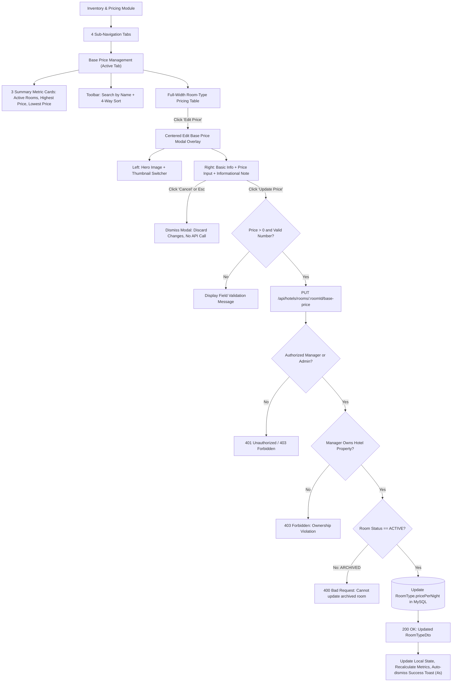

# TravelEasy — WP-07.2: Inventory & Pricing
## Implementation Report: Base Price Management (Listing & Centered Edit Modal)

**Document Version:** 1.0.0  
**Work Package ID:** WP-07.2 (Base Price Management)  
**Target Module:** `frontend` (Angular 17) & `hotel-service` (Spring Boot 3.2, Java 21, MySQL)  
**Verification Status:** **ALL 195 BACKEND UNIT & INTEGRATION TESTS PASSING (0 FAILURES, 0 ERRORS) — ANGULAR BUILD CLEAN (0 ERRORS)**  

---

### 1. Executive Summary

In fulfillment of **WP-07.2 — Base Price Management**, the complete end-to-end feature has been implemented within the TravelEasy Hotel Manager Portal according to the approved UI mockups:
- **Reference Image 1 (`media_1794121505130_243869ee.jpg`):** Base Price Management listing page.
- **Reference Image 2 (`media_1794121833441_393b4714.jpg`):** Centered Edit Base Price overlay modal.

The implementation preserves the established TravelEasy application shell, modular architecture, and core business invariants:
1. **Inventory & Pricing Sub-Navigation:** Provides 4 tabs (`Inventory Calendar`, `Pricing Calendar`, `Base Price Management`, `Room Blocks`), keeping `Base Price Management` active.
2. **Dynamic Metrics & Listing:** Computes active room count, highest base price, and lowest base price from real backend data. Supports instant search and 4-way sorting.
3. **Centered Edit Modal Overlay:** Matches the design language and proportions of the Room Type Details overlay, featuring two-column presentation, multi-angle thumbnails, currency-prefixed numeric inputs, validation feedback, and an informational note panel.
4. **Dedicated Backend Endpoint:** Implements `PUT /api/hotels/rooms/{roomId}/base-price` with role checks (`ROLE_HOTEL_MANAGER`, `ROLE_ADMIN`), manager property ownership validation, positive price validation, and archived room protection.
5. **Architectural & Pricing Boundaries:** Preserves date-specific price overrides (`RoomPriceOverride`), maintains base-price fallback logic, and guarantees historical booking price snapshots remain completely immutable.



---

### 2. Codebase Inspection & Baseline Architecture

Prior to implementing modifications, the existing codebase was inspected:

| Component | Inspected File | Findings & Implementation Decisions |
|---|---|---|
| **Room Type Model** | [`RoomType.java`](file:///c:/Users/reddy/Documents/Materials_and_Assignments/FALL%20SEM(26-27)/SAA/SAA_Project/hotel-service/src/main/java/com/traveleasy/hotel/model/RoomType.java) | Entity already contains `pricePerNight` column (`Double`). Configured as the authoritative base price. |
| **Room Type DTO** | [`RoomTypeDto.java`](file:///c:/Users/reddy/Documents/Materials_and_Assignments/FALL%20SEM(26-27)/SAA/SAA_Project/hotel-service/src/main/java/com/traveleasy/hotel/dto/RoomTypeDto.java) | Contains `id`, `hotelId`, `roomTypeName`, `maxOccupancy`, `pricePerNight`, `totalRooms`, `availableRooms`, `status`. Reused for response. |
| **Pricing Service** | [`HotelPricingService.java`](file:///c:/Users/reddy/Documents/Materials_and_Assignments/FALL%20SEM(26-27)/SAA/SAA_Project/hotel-service/src/main/java/com/traveleasy/hotel/service/HotelPricingService.java) | Contains `resolveEffectivePrice`, date-specific overrides, and `validateOwnershipAndGetRoom`. Extended with `updateBasePrice`. |
| **Controller** | [`HotelController.java`](file:///c:/Users/reddy/Documents/Materials_and_Assignments/FALL%20SEM(26-27)/SAA/SAA_Project/hotel-service/src/main/java/com/traveleasy/hotel/controller/HotelController.java) | Added `@PutMapping("/rooms/{roomId}/base-price")` in the Pricing section. |
| **Security Validation** | [`HotelSecurityService.java`](file:///c:/Users/reddy/Documents/Materials_and_Assignments/FALL%20SEM(26-27)/SAA/SAA_Project/hotel-service/src/main/java/com/traveleasy/hotel/security/HotelSecurityService.java) | Reused principal resolution and ownership enforcement pattern (`principal.userId().equals(hotel.getManagerId())`). |
| **Frontend Service** | [`hotel.service.ts`](file:///c:/Users/reddy/Documents/Materials_and_Assignments/FALL%20SEM(26-27)/SAA/SAA_Project/frontend/src/app/services/hotel.service.ts) | Added `updateBasePrice(roomId: number, basePrice: number): Observable<any>`. |
| **Dashboard Component** | [`hotel-manager-dashboard.component.ts`](file:///c:/Users/reddy/Documents/Materials_and_Assignments/FALL%20SEM(26-27)/SAA/SAA_Project/frontend/src/app/components/hotel-manager-dashboard/hotel-manager-dashboard.component.ts) | Implemented sub-navigation tabs, search filtering, 4-way sorting, summary metrics calculation, modal state machine, and update handler. |

---

### 3. Backend Implementation Details

#### 3.1 New Endpoint Specification
- **HTTP Method & Route:** `PUT /api/hotels/rooms/{roomId}/base-price`
- **Request Headers:** `Authorization: Bearer <JWT>`, `Content-Type: application/json`
- **Request Body DTO:** [`BasePriceUpdateRequestDto.java`](file:///c:/Users/reddy/Documents/Materials_and_Assignments/FALL%20SEM(26-27)/SAA/SAA_Project/hotel-service/src/main/java/com/traveleasy/hotel/dto/BasePriceUpdateRequestDto.java)
  ```json
  {
    "basePrice": 4500.00
  }
  ```
- **Response (200 OK):** [`RoomTypeDto`](file:///c:/Users/reddy/Documents/Materials_and_Assignments/FALL%20SEM(26-27)/SAA/SAA_Project/hotel-service/src/main/java/com/traveleasy/hotel/dto/RoomTypeDto.java)
  ```json
  {
    "id": 1052,
    "hotelId": 1,
    "roomTypeName": "Deluxe Double Room",
    "maxOccupancy": 2,
    "pricePerNight": 4500.0,
    "totalRooms": 10,
    "availableRooms": 10,
    "allocatedRooms": 0,
    "amenities": "Wi-Fi, AC, TV, Balcony",
    "imageUrl": "https://images.unsplash.com/...",
    "status": "ACTIVE"
  }
  ```

#### 3.2 Authorization & Ownership Validation
1. **Authentication Enforcement:** Validates Bearer token using `HotelSecurityService`. Rejects unauthenticated requests with `401 Unauthorized`.
2. **Role Verification:** Requires `ROLE_HOTEL_MANAGER` or `ROLE_ADMIN`. Rejects customer roles (`ROLE_CUSTOMER`, `ROLE_USER`) with `403 Forbidden`.
3. **Property Ownership:** Validates that the hotel associated with `roomType.getHotelId()` is owned by `principal.userId()`. Cross-property modification attempts by other managers return `403 Forbidden`.
4. **Room Existence:** Nonexistent room IDs return `404 Not Found` (`ResourceNotFoundException`).
5. **Active Status Verification:** If `roomType.getStatus()` is `"ARCHIVED"`, the request is rejected with `400 Bad Request` (`DomainValidationException("Cannot update base price for an archived room category")`).

#### 3.3 Base Price Validation & Precision
- Mandatory value (`@NotNull` in DTO and service check).
- Positive number strictly greater than zero (`@DecimalMin("0.01")`).
- Rejects zero (`0.0`), negative values, `Double.NaN`, `Double.isInfinite`, or non-numeric strings with `400 Bad Request`.
- Precision rounding: Rounds entered monetary value to 2 decimal places (`Math.round(dto.getBasePrice() * 100.0) / 100.0`).

#### 3.4 Pricing Business Invariants Preserved
- **Effective Price Resolution:**
  $$\text{EffectivePrice}(\text{date}) = \begin{cases} \text{OverridePrice}(\text{date}), & \text{if override exists} \\ \text{BasePrice}(\text{roomType}), & \text{otherwise} \end{cases}$$
- **Override Preservation:** Existing date-specific overrides in `room_price_overrides` are untouched and never rewritten or deleted when the base price is modified.
- **Historical Immutability:** Past, current, and future bookings stored in `hotel_booking_allocations` and `bookings` retain their exact committed price snapshot.

---

### 4. Frontend UI Implementation

#### 4.1 Sub-Navigation Tabs
Under the main `Inventory & Pricing` sidebar item, an interactive sub-navigation bar is rendered:
- `Inventory Calendar` (`fa-regular fa-calendar`)
- `Pricing Calendar` (`fa-solid fa-tags`)
- `Base Price Management` (`fa-solid fa-coins` — Active tab with `#0d9488` text and 3px bottom underline)
- `Room Blocks` (`fa-solid fa-ban`)

#### 4.2 Base Price Management Listing Page (`Reference Image 1`)
1. **Header & Subtitle:** Displays `"Base Price Management"` and `"Set the default nightly price for each room type. This price will be used for dates without a price override."`
2. **Three Summary Cards:**
   - **Card 1: Active Room Types:** Light cyan background (`#f0fdfa`), cyan bed icon, displays count of active room types for `selectedHotel`.
   - **Card 2: Highest Base Price:** Light green background (`#f0fdf4`), green rupee icon, displays `₹X,XXX / night` using `formatCurrency()`.
   - **Card 3: Lowest Base Price:** Light purple background (`#faf5ff`), purple rupee icon, displays `₹X,XXX / night` using `formatCurrency()`.
3. **Search & Sorting Controls:**
   - Real-time search input (`"Search room type by name..."`) with magnifying glass icon.
   - Sort dropdown supporting:
     - `Room Type Name (A – Z)` (default)
     - `Room Type Name (Z – A)`
     - `Base Price (Low to High)`
     - `Base Price (High to Low)`
4. **Room-Type Pricing Table:**
   - **Room Type:** 64x50px rounded thumbnail image with cover styling and bed placeholder fallback; room type name in bold; descriptive subtitle (e.g. `"Spacious room with city view"`).
   - **Total Rooms:** Physical room capacity with `(i)` info icon.
   - **Max Occupancy:** Person icon + `"X Guests"`.
   - **Base Price (per night):** Formatted currency string in bold (e.g. `₹4,500`).
   - **Actions:** Teal outlined button (`btn-outline-teal`) with pen-to-square icon (`"Edit Price"`).
5. **Empty & Loading States:**
   - Clear loading feedback during data fetches.
   - Informative empty card when no active room types exist.
   - Filter-empty state with a `"Reset Search"` button when no search results match.

#### 4.3 Centered Edit Base Price Modal Overlay (`Reference Image 2`)
1. **Modal Container & Backdrop:** Centered overlay with background dimming backdrop (`modal-backdrop-custom`), dismissing on backdrop click or `Esc` key press.
2. **Modal Header:** Cyan stack-of-coins icon, title `"Edit Base Price"`, subtitle `"Update the default nightly price for this room type."`, and top-right close button.
3. **Two-Column Layout:**
   - **Left Column (Room Images):**
     - Hero image container displaying the selected room image with object-fit cover.
     - Two clickable thumbnail previews underneath allowing managers to switch preview angles. The active thumbnail displays a cyan border.
   - **Right Column (Room Information & Pricing):**
     - Room title header + `"Active"` green pill badge.
     - **Basic Information Card:** Displays `Room Type ID` (e.g. `RT-0004`), `Total Rooms`, and `Maximum Occupancy` (read-only).
     - **Base Price Card:** Dedicated section with tag icon; currency prefix `₹` input group; pre-populated with current base price; field-level validation feedback.
     - **Informational Note Panel:** Styled light cyan container (`#f0fdfa`) with note icon and 3 reminder bullets:
       - *This is the default nightly price for this room type.*
       - *Date-specific price overrides (if any) will continue to take precedence.*
       - *Existing bookings will not be affected.*
4. **Modal Footer Actions:**
   - Secondary outlined `Cancel` button (discards changes, no API request).
   - Primary filled teal `Update Price` button with pen icon, spinner loading state, and duplicate-click prevention.
5. **Feedback & Refresh:** Upon successful update, modal closes, local state and summary metrics refresh immediately, and a green auto-dismissing toast banner is displayed for 4 seconds.

---

### 5. Files Created and Modified

#### Backend (`hotel-service`):
1. **Created:** [`BasePriceUpdateRequestDto.java`](file:///c:/Users/reddy/Documents/Materials_and_Assignments/FALL%20SEM(26-27)/SAA/SAA_Project/hotel-service/src/main/java/com/traveleasy/hotel/dto/BasePriceUpdateRequestDto.java)
   - Defines `basePrice` with `@NotNull` and `@DecimalMin("0.01")`.
2. **Modified:** [`HotelPricingService.java`](file:///c:/Users/reddy/Documents/Materials_and_Assignments/FALL%20SEM(26-27)/SAA/SAA_Project/hotel-service/src/main/java/com/traveleasy/hotel/service/HotelPricingService.java)
   - Added `updateBasePrice(Long roomId, BasePriceUpdateRequestDto dto, CallerPrincipal principal)`.
   - Enforces authentication, manager property ownership, active status, and positive numeric validation.
3. **Modified:** [`HotelController.java`](file:///c:/Users/reddy/Documents/Materials_and_Assignments/FALL%20SEM(26-27)/SAA/SAA_Project/hotel-service/src/main/java/com/traveleasy/hotel/controller/HotelController.java)
   - Added `@PutMapping("/rooms/{roomId}/base-price")` returning `RoomTypeDto`.
4. **Created:** [`BasePriceManagementTest.java`](file:///c:/Users/reddy/Documents/Materials_and_Assignments/FALL%20SEM(26-27)/SAA/SAA_Project/hotel-service/src/test/java/com/traveleasy/hotel/BasePriceManagementTest.java)
   - 13 comprehensive integration tests verifying all acceptance criteria.

#### Frontend (`frontend`):
1. **Modified:** [`hotel.service.ts`](file:///c:/Users/reddy/Documents/Materials_and_Assignments/FALL%20SEM(26-27)/SAA/SAA_Project/frontend/src/app/services/hotel.service.ts)
   - Added `updateBasePrice(roomId: number, basePrice: number): Observable<any>`.
2. **Modified:** [`hotel-manager-dashboard.component.ts`](file:///c:/Users/reddy/Documents/Materials_and_Assignments/FALL%20SEM(26-27)/SAA/SAA_Project/frontend/src/app/components/hotel-manager-dashboard/hotel-manager-dashboard.component.ts)
   - Added `inventorySubNav`, search query, sort option, summary metrics, and modal state.
   - Added methods: `refreshBasePriceListing`, `onBasePriceSearchChange`, `onBasePriceSortChange`, `resetBasePriceSearch`, `getRoomSubtitle`, `openEditBasePriceModal`, `closeEditBasePriceModal`, `getBasePriceModalThumbnails`, `validateBasePriceInput`, and `submitUpdateBasePrice`.
   - Updated `onEscapeKeyDown` to close modal on `Esc`.
3. **Modified:** [`hotel-manager-dashboard.component.html`](file:///c:/Users/reddy/Documents/Materials_and_Assignments/FALL%20SEM(26-27)/SAA/SAA_Project/frontend/src/app/components/hotel-manager-dashboard/hotel-manager-dashboard.component.html)
   - Replaced placeholder Inventory & Pricing view with the 4 sub-navigation tabs, Base Price Management listing, summary cards, search and sort toolbar, pricing table, and centered Edit Base Price modal.
4. **Modified:** [`hotel-manager-dashboard.component.css`](file:///c:/Users/reddy/Documents/Materials_and_Assignments/FALL%20SEM(26-27)/SAA/SAA_Project/frontend/src/app/components/hotel-manager-dashboard/hotel-manager-dashboard.component.css)
   - Added styling for sub-navigation tabs (`.inventory-subnav-bar .nav-tab-item`, `.active-tab`), thumbnail previews (`.room-thumb-preview`), and `.border-cyan`.

#### Documentation & Tracking:
1. **Modified:** [`HOTEL_MANAGER_PORTAL_IMPLEMENTATION_TRACKER.md`](file:///c:/Users/reddy/Documents/Materials_and_Assignments/FALL%20SEM(26-27)/SAA/SAA_Project/HOTEL_MANAGER_PORTAL_IMPLEMENTATION_TRACKER.md)
   - Updated Work Package Matrix and added Section 13 for WP-07.2.

---

### 6. Automated Test Execution Results

#### 6.1 Dedicated WP-07.2 Test Suite ([`BasePriceManagementTest.java`](file:///c:/Users/reddy/Documents/Materials_and_Assignments/FALL%20SEM(26-27)/SAA/SAA_Project/hotel-service/src/test/java/com/traveleasy/hotel/BasePriceManagementTest.java))
```text
[INFO] Running com.traveleasy.hotel.BasePriceManagementTest
[INFO] Tests run: 13, Failures: 0, Errors: 0, Skipped: 0, Time elapsed: 7.142 s -- in com.traveleasy.hotel.BasePriceManagementTest
[INFO] 
[INFO] Results:
[INFO] Tests run: 13, Failures: 0, Errors: 0, Skipped: 0
[INFO] BUILD SUCCESS
```

| Test # | Test Name | Target Behavior | Status |
|---|---|---|---|
| 1 | `test1_successfulBasePriceUpdate` | Valid manager updates base price from 4500 to 5500; returns 200 OK | **PASSED** |
| 2 | `test2_missingBasePriceRejected` | Empty request payload `{}` rejected with 400 Bad Request | **PASSED** |
| 3 | `test3_zeroPriceRejected` | Base price = 0.0 rejected with 400 Bad Request | **PASSED** |
| 4 | `test4_negativePriceRejected` | Negative price = -500.0 rejected with 400 Bad Request | **PASSED** |
| 5 | `test5_invalidMonetaryValuesRejected` | Non-numeric string value rejected with 400 Bad Request | **PASSED** |
| 6 | `test6_nonexistentRoomTypeRejected` | Nonexistent room ID 9999999 rejected with 404 Not Found | **PASSED** |
| 7 | `test7_archivedRoomTypeRejected` | Attempt to update base price on ARCHIVED room rejected with 400 Bad Request | **PASSED** |
| 8 | `test8_unauthorizedUserRejected` | Unauthenticated request returns 401; Customer role returns 403 Forbidden | **PASSED** |
| 9 | `test9_crossPropertyOwnershipViolationRejected` | Manager 2 attempting to update Manager 1's room rejected with 403 Forbidden | **PASSED** |
| 10 | `test10_existingPriceOverridesRemainUnchanged` | Pre-existing date-specific price override (11000.0) remains untouched in DB | **PASSED** |
| 11 | `test11_effectivePriceUsesUpdatedBasePriceWhenNoOverride` | Date without override resolves to updated base price (5200.0) | **PASSED** |
| 12 | `test12_effectivePriceContinuesUsingExistingOverride` | Date with override (14000.0) continues resolving to override | **PASSED** |
| 13 | `test13_historicalBookingPricesRemainUnchanged` | Committed historical booking allocation retains immutable snapshot (20000.0) | **PASSED** |

#### 6.2 Full Regression Suite Across `hotel-service`
```text
[INFO] Tests run: 195, Failures: 0, Errors: 0, Skipped: 0
[INFO] BUILD SUCCESS
[INFO] Total time: 59.820 s
```
All 10 test classes passed with **100% success rate (195/195 tests, 0 failures, 0 errors, 0 regressions)**.

#### 6.3 Angular Production Compilation
```text
> traveleasy-frontend@1.0.0 build
> ng build

- Building...
Initial chunk files   | Names         | Raw size | Estimated transfer size
main-OSYNQEEA.js      | main          |  1.81 MB |               311.48 kB
polyfills-FFHMD2TL.js | polyfills     | 33.71 kB |                11.02 kB
styles-CU5B4YZD.css   | styles        |  1.16 kB |               472 bytes
                      | Initial total |  1.84 MB |               322.96 kB

Application bundle generation complete. [8.983 seconds]
```
**Angular build succeeded cleanly with 0 errors.**

---

### 7. Manual Verification Steps

1. **Navigate to Base Price Management:**
   - Log in as a Hotel Manager.
   - Click **Inventory & Pricing** in the sidebar.
   - Observe the 4 sub-navigation tabs; verify **Base Price Management** is highlighted with teal text and bottom border.
2. **Verify Metrics & Table:**
   - Verify Card 1 displays the total count of active room types for the selected hotel.
   - Verify Card 2 displays the highest base price formatted as `₹X,XXX / night`.
   - Verify Card 3 displays the lowest base price formatted as `₹X,XXX / night`.
   - Type in the search box; verify the room type rows filter dynamically.
   - Change the Sort dropdown; verify rows reorder (A–Z, Z–A, Price Low–High, Price High–Low).
3. **Open Edit Base Price Modal:**
   - Click **Edit Price** on any room type row.
   - Verify the centered modal appears with the dimmed backdrop.
   - Verify the left column displays the room photo and thumbnail switcher.
   - Verify the right column displays the room name, Active status, Basic Info card, Base Price card, and Informational Note panel.
   - Verify the input is pre-populated with the current base price.
4. **Test Input Validation:**
   - Clear the input; verify `"Base price is required."` appears.
   - Enter `0` or `-500`; verify `"Base price must be a valid positive number greater than zero."` appears.
   - Verify the `Update Price` button does not submit invalid inputs.
5. **Perform Successful Update:**
   - Enter a new valid price (e.g. `5500`).
   - Click **Update Price**.
   - Verify the button shows a loading spinner.
   - Verify the modal closes, the room row in the table updates to `₹5,500`, the summary cards recalculate, and the green success banner appears for 4 seconds.
6. **Dismissal Interactions:**
   - Open the modal and press `Esc` or click the backdrop / `Cancel` button; verify the modal dismisses without sending any update request.
