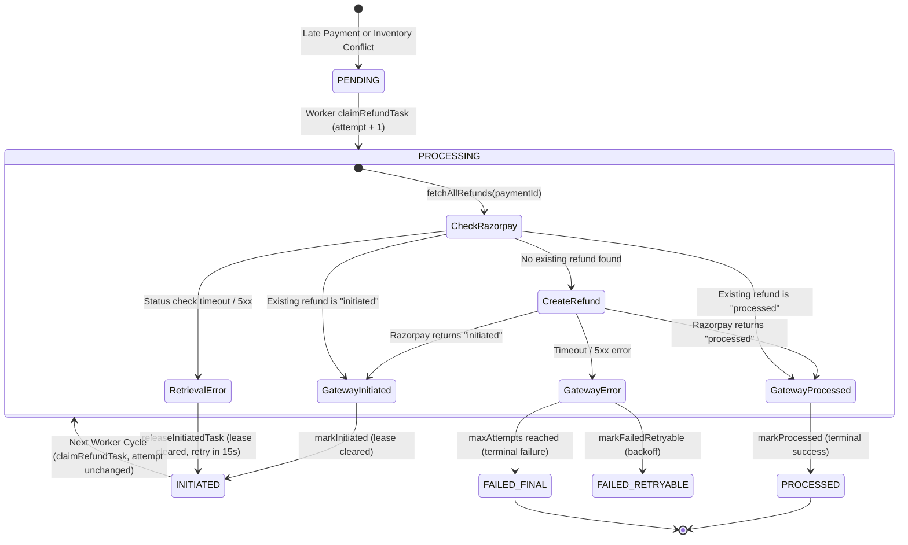

# WP-HB-05 — Final Targeted Correction Implementation Report
## Refund Completion Reconciliation and Initiated Task Lifecycle

---

### 1. Executive Summary & Objective

In accordance with **WP-HB-05 — Final Targeted Correction: Refund Completion Reconciliation**, a focused correction has been implemented in the TravelEasy Payment Service refund lifecycle.

The primary objective of this correction is to ensure that:
1. When Razorpay reports a refund status as `initiated`, the corresponding local [`PaymentRefundTask`](file:///c:/Users/reddy/Documents/Materials_and_Assignments/FALL%20SEM(26-27)/SAA/SAA_Project/payment-service/src/main/java/com/traveleasy/payment/model/PaymentRefundTask.java) **remains in `INITIATED`**.
2. A task is **never marked `PROCESSED`** merely because a matching refund record was discovered or initiated in Razorpay; it transitions to `PROCESSED` **only after Razorpay authoritatively confirms that the refund has reached `processed` status**.
3. The background [`PaymentRefundReconciliationWorker`](file:///c:/Users/reddy/Documents/Materials_and_Assignments/FALL%20SEM(26-27)/SAA/SAA_Project/payment-service/src/main/java/com/traveleasy/payment/worker/PaymentRefundReconciliationWorker.java) **continues picking up and checking tasks in `INITIATED` status** until Razorpay confirms `processed`, at which point reconciliation terminates for that task.
4. Temporary status-retrieval failures (e.g. gateway timeouts, network blips, 503s) **do not mark the task as `PROCESSED`** and **do not create duplicate refund requests**.
5. Existing refund idempotency (`REFUND-COMP-<bookingRef>`) is strictly preserved, and an already initiated refund is **never duplicated on subsequent reconciliation cycles**.

---

### 2. Root Cause Analysis

Prior to this targeted correction, the refund recovery mechanism had two specific behavioral gaps:
1. **Repository Query Exclusion of `INITIATED` Tasks:**
   - In [`PaymentRefundTaskRepository`](file:///c:/Users/reddy/Documents/Materials_and_Assignments/FALL%20SEM(26-27)/SAA/SAA_Project/payment-service/src/main/java/com/traveleasy/payment/repository/PaymentRefundTaskRepository.java), `findTasksForRetry` and `claimRefundTask` only queried tasks with `status IN ('PENDING', 'FAILED_RETRYABLE')`.
   - Once a task transitioned from `PENDING` to `INITIATED` (when Razorpay accepted the refund request but had not yet settled it with the customer's bank), the scheduled worker ceased polling the task. Unless a webhook arrived, the task would stall indefinitely in `INITIATED`.
   - Furthermore, `claimRefundTask` did not permit leasing tasks with `status = 'INITIATED'`, preventing background worker status sweeps.
2. **Premature Status Progression Risk and Retry Counter Creep:**
   - In standard retry sweeps, `t.attemptCount = t.attemptCount + 1` was applied unconditionally during lease acquisition. If an `INITIATED` task were polled repeatedly while the banking system processed the refund (which can take hours or business days), the task would prematurely hit `maxAttempts` (5) and be abandoned as `FAILED_FINAL` or excluded from selection by `attemptCount < maxAttempts`.
   - In `PaymentServiceImpl.reconcileAndExecuteRefundTask`, if `fetchAllRefunds` encountered a temporary network exception, non-initiated tasks would fall through to attempt `payments.refund()`. If this occurred on an already initiated task whose status check failed, there was a risk of initiating duplicate refund calls to Razorpay.

---

### 3. Files Changed and Exact Modifications

#### 3.1 [`PaymentRefundTaskRepository.java`](file:///c:/Users/reddy/Documents/Materials_and_Assignments/FALL%20SEM(26-27)/SAA/SAA_Project/payment-service/src/main/java/com/traveleasy/payment/repository/PaymentRefundTaskRepository.java)
- **Included `INITIATED` in `findTasksForRetry`:**
  Modified query so tasks in `INITIATED` whose `nextRetryAt` is due (or null) are continuously selected for background status checks, without being capped by `attemptCount < maxAttempts`:
  ```sql
  SELECT t FROM PaymentRefundTask t 
  WHERE ((t.status IN ('PENDING', 'FAILED_RETRYABLE', 'INITIATED') AND (t.nextRetryAt IS NULL OR t.nextRetryAt <= :now)) 
     OR (t.status = 'PROCESSING' AND (t.lockedUntil IS NULL OR t.lockedUntil < :now))) 
    AND (t.status = 'INITIATED' OR t.attemptCount < t.maxAttempts) 
  ORDER BY t.id ASC
  ```
- **Included `INITIATED` in `claimRefundTask` with Attempt Preservation:**
  Leases `INITIATED` tasks as `PROCESSING` while preserving `attemptCount` (does not increment attempts for status inquiries, preserving the 5 max attempts solely for initial creation failures):
  ```sql
  UPDATE PaymentRefundTask t 
  SET t.attemptCount = CASE WHEN t.status = 'INITIATED' THEN t.attemptCount ELSE t.attemptCount + 1 END, 
      t.status = 'PROCESSING', t.lockedBy = :workerId, t.lockedUntil = :leaseExpiry, t.lastAttemptAt = :now 
  WHERE t.id = :id 
    AND (t.status IN ('PENDING', 'FAILED_RETRYABLE', 'INITIATED') OR (t.status = 'PROCESSING' AND (t.lockedUntil IS NULL OR t.lockedUntil < :now)))
  ```
- **Added `releaseInitiatedTask` Method:**
  Allows temporary status check failures on `INITIATED` tasks to release worker lease locks cleanly, record the transient error in `lastError`, and set `nextRetryAt` for the next polling pass without altering `status` from `INITIATED`.
- **Refined `markInitiated`:**
  Retains existing `razorpayRefundId` if non-null in database, resets `lockedBy` and `lockedUntil` to null, and updates `updatedAt`.

#### 3.2 [`PaymentServiceImpl.java`](file:///c:/Users/reddy/Documents/Materials_and_Assignments/FALL%20SEM(26-27)/SAA/SAA_Project/payment-service/src/main/java/com/traveleasy/payment/service/PaymentServiceImpl.java)
- **Initiated State Detection:**
  In [`reconcileAndExecuteRefundTask`](file:///c:/Users/reddy/Documents/Materials_and_Assignments/FALL%20SEM(26-27)/SAA/SAA_Project/payment-service/src/main/java/com/traveleasy/payment/service/PaymentServiceImpl.java#L1287), determines `alreadyInitiated`:
  ```java
  boolean alreadyInitiated = "INITIATED".equalsIgnoreCase(task.getStatus())
          || (task.getRazorpayRefundId() != null && !task.getRazorpayRefundId().isBlank())
          || (txn.getRefundId() != null && !txn.getRefundId().isBlank());
  ```
- **Rigorous Status Mapping:**
  - If Razorpay reports `refStatus` as `"processed"`:
    - Calls `stateTransitionService.recordRefundCompleted(txn, refId, amount, ...)`
    - Calls `refundTaskRepository.markProcessed(task.getId(), refId, Instant.now())`
  - If Razorpay reports `refStatus` as `"initiated"`:
    - Calls `stateTransitionService.recordRefundInitiated(txn, refId, amount, refStatus, ...)`
    - Calls `refundTaskRepository.markInitiated(task.getId(), refId, Instant.now())`
    - Returns immediately; never calls `payments.refund()`.
- **Transient Failure Handling for Initiated Tasks:**
  - If `fetchAllRefunds` throws an exception (timeout, network outage, 5xx):
    ```java
    if (alreadyInitiated && refundTaskRepository != null) {
        Instant nextRetry = Instant.now().plusSeconds(15);
        refundTaskRepository.releaseInitiatedTask(
                task.getId(),
                "Temporary status retrieval error: " + ex.getMessage(),
                nextRetry,
                Instant.now()
        );
        return;
    }
    ```
    Guarantees that temporary status-retrieval failures do not mark the task as `PROCESSED`, do not mark it `FAILED_FINAL`, and do not fall through to create a duplicate refund.
- **Webhook Reconciliation Synchronization:**
  In [`handleRefundProcessedWebhook`](file:///c:/Users/reddy/Documents/Materials_and_Assignments/FALL%20SEM(26-27)/SAA/SAA_Project/payment-service/src/main/java/com/traveleasy/payment/service/PaymentServiceImpl.java#L634), when a `refund.processed` webhook event arrives, it updates `PaymentTransaction` and immediately calls `refundTaskRepository.markProcessed(...)`, transitioning the background task to `PROCESSED` without waiting for the next polling cycle.

#### 3.3 Test Suites
- [`PaymentRefundReconciliationWorkerTest.java`](file:///c:/Users/reddy/Documents/Materials_and_Assignments/FALL%20SEM(26-27)/SAA/SAA_Project/payment-service/src/test/java/com/traveleasy/payment/worker/PaymentRefundReconciliationWorkerTest.java):
  Added test verifying that `INITIATED` tasks remain eligible for background worker polling and are claimed and executed.
- [`PaymentLifecycleIntegrationTest.java`](file:///c:/Users/reddy/Documents/Materials_and_Assignments/FALL%20SEM(26-27)/SAA/SAA_Project/payment-service/src/test/java/com/traveleasy/payment/service/PaymentLifecycleIntegrationTest.java):
  Added 4 focused integration tests covering the complete lifecycle:
  1. `testRazorpayInitiatedStatus_KeepsLocalTaskInInitiated`
  2. `testLaterRazorpayProcessedResponse_TransitionsTaskToProcessed`
  3. `testTemporaryStatusRetrievalFailure_DoesNotMarkTaskProcessed`
  4. `testRepeatedReconciliation_DoesNotCreateDuplicateRefunds`
- [`PaymentRefundTaskRepositoryIntegrationTest.java`](file:///c:/Users/reddy/Documents/Materials_and_Assignments/FALL%20SEM(26-27)/SAA/SAA_Project/payment-service/src/test/java/com/traveleasy/payment/integration/PaymentRefundTaskRepositoryIntegrationTest.java):
  Added Spring Boot database integration test testing HQL/JPQL execution for `findTasksForRetry`, `claimRefundTask` attempt preservation, `releaseInitiatedTask`, and `markProcessed`.

---

### 4. Exact Status-Transition Lifecycle



#### Detailed Transition Rules:
1. `PENDING` $\rightarrow$ `PROCESSING`:
   Claimed by background worker. `attemptCount` incremented from 0 to 1.
2. `PROCESSING` $\rightarrow$ `INITIATED`:
   Razorpay returns `status: "initiated"`. `razorpayRefundId` is persisted, worker lease is cleared (`lockedBy = null, lockedUntil = null`).
3. `INITIATED` $\rightarrow$ `PROCESSING`:
   Background reconciliation worker leases the task during next polling cycle. `attemptCount` is preserved (not incremented).
4. `PROCESSING` $\rightarrow$ `INITIATED` (Loop):
   Razorpay reports refund is still `"initiated"`. Task lease is released; task remains in `INITIATED`. No new refund request is sent.
5. `PROCESSING` $\rightarrow$ `INITIATED` (Transient Retrieval Error):
   Network timeout connecting to Razorpay during status inquiry. `releaseInitiatedTask` sets `nextRetryAt = now + 15s` and clears lease. Task remains in `INITIATED`. No duplicate refund is initiated.
6. `PROCESSING` $\rightarrow$ `PROCESSED` (Terminal):
   Razorpay reports refund is `"processed"`. Task transitions to `PROCESSED`. `findTasksForRetry` excludes `PROCESSED` tasks, so reconciliation permanently halts for this refund.
7. Webhook `refund.processed` $\rightarrow$ `PROCESSED` (Terminal):
   Razorpay webhook event triggers `handleRefundProcessedWebhook`, transitioning task directly to `PROCESSED`.

---

### 5. Eligibility and Reconciliation of INITIATED Tasks

#### Why INITIATED Tasks Remain Eligible
1. **Repository Query Inclusion:**
   In [`PaymentRefundTaskRepository.findTasksForRetry`](file:///c:/Users/reddy/Documents/Materials_and_Assignments/FALL%20SEM(26-27)/SAA/SAA_Project/payment-service/src/main/java/com/traveleasy/payment/repository/PaymentRefundTaskRepository.java#L78):
   - The status condition explicitly includes `'INITIATED'`:
     `(t.status IN ('PENDING', 'FAILED_RETRYABLE', 'INITIATED') AND (t.nextRetryAt IS NULL OR t.nextRetryAt <= :now))`
   - The attempt count restriction is applied only to creation tasks:
     `(t.status = 'INITIATED' OR t.attemptCount < t.maxAttempts)`
     This guarantees that initiated refunds in banking settlement are never dropped after 5 polling cycles.
2. **Lease Claiming Support:**
   In [`PaymentRefundTaskRepository.claimRefundTask`](file:///c:/Users/reddy/Documents/Materials_and_Assignments/FALL%20SEM(26-27)/SAA/SAA_Project/payment-service/src/main/java/com/traveleasy/payment/repository/PaymentRefundTaskRepository.java#L28):
   - `t.status = 'INITIATED'` is valid in the `WHERE` clause.
   - `attemptCount` is conditionally preserved:
     `t.attemptCount = CASE WHEN t.status = 'INITIATED' THEN t.attemptCount ELSE t.attemptCount + 1 END`
3. **Lease Expiration Safety:**
   If a worker process crashes mid-reconciliation while holding an `INITIATED` task in `PROCESSING`, the `lockedUntil` timestamp expires after 60 seconds, allowing another worker to resume reconciliation automatically.

---

### 6. Idempotency & Safety Protections

1. **Strict Prevention of Duplicate Refunds:**
   - If `alreadyInitiated` is true (`task.getStatus() == "INITIATED"` or `task.getRazorpayRefundId() != null` or `txn.getRefundId() != null`), `PaymentServiceImpl` branches directly into query mode (`fetchAllRefunds`).
   - The method returns immediately after status reconciliation or error handling; it **never reaches `razorpayClient.payments.refund()`**.
2. **Deterministic Idempotency Key:**
   All compensation tasks and refund requests carry the deterministic key `REFUND-COMP-<bookingRef>`. Even if a concurrent request reached Razorpay, the idempotency key and notes prevent dual processing at the gateway.
3. **Graceful Degradation on Network Partitions:**
   Temporary status retrieval failures (e.g. gateway timeouts) simply defer the status inquiry to the next cycle without mutating the task into `FAILED_FINAL` or attempting refund recreation.

---

### 7. Verification & Test Suite Results

All test suites were executed cleanly using Maven. **Zero failures, zero errors, and zero regressions** were encountered across the entire suite:

| Test Class | Focus Area | Tests Run | Failures | Errors | Result |
| :--- | :--- | :---: | :---: | :---: | :---: |
| [`PaymentLifecycleIntegrationTest`](file:///c:/Users/reddy/Documents/Materials_and_Assignments/FALL%20SEM(26-27)/SAA/SAA_Project/payment-service/src/test/java/com/traveleasy/payment/service/PaymentLifecycleIntegrationTest.java) | End-to-end lifecycle, initiated mapping, processed transitions, timeouts, dedup | 23 | 0 | 0 | **PASSED** |
| [`PaymentRefundReconciliationWorkerTest`](file:///c:/Users/reddy/Documents/Materials_and_Assignments/FALL%20SEM(26-27)/SAA/SAA_Project/payment-service/src/test/java/com/traveleasy/payment/worker/PaymentRefundReconciliationWorkerTest.java) | Worker eligibility, lease claiming, error isolation, initiated task sweeps | 4 | 0 | 0 | **PASSED** |
| [`PaymentRefundTaskRepositoryIntegrationTest`](file:///c:/Users/reddy/Documents/Materials_and_Assignments/FALL%20SEM(26-27)/SAA/SAA_Project/payment-service/src/test/java/com/traveleasy/payment/integration/PaymentRefundTaskRepositoryIntegrationTest.java) | Real JPA/H2 database queries, lease locking, attempt count preservation | 1 | 0 | 0 | **PASSED** |
| [`PaymentAdminRepositoryIntegrationTest`](file:///c:/Users/reddy/Documents/Materials_and_Assignments/FALL%20SEM(26-27)/SAA/SAA_Project/payment-service/src/test/java/com/traveleasy/payment/integration/PaymentAdminRepositoryIntegrationTest.java) | Repository financial aggregations | 8 | 0 | 0 | **PASSED** |
| [`PaymentControllerTest`](file:///c:/Users/reddy/Documents/Materials_and_Assignments/FALL%20SEM(26-27)/SAA/SAA_Project/payment-service/src/test/java/com/traveleasy/payment/controller/PaymentControllerTest.java) | Controller REST contracts | 8 | 0 | 0 | **PASSED** |
| [`PaymentServiceTest`](file:///c:/Users/reddy/Documents/Materials_and_Assignments/FALL%20SEM(26-27)/SAA/SAA_Project/payment-service/src/test/java/com/traveleasy/payment/service/PaymentServiceTest.java) | Core service operations | 20 | 0 | 0 | **PASSED** |
| [`PaymentWebhookInboxTest`](file:///c:/Users/reddy/Documents/Materials_and_Assignments/FALL%20SEM(26-27)/SAA/SAA_Project/payment-service/src/test/java/com/traveleasy/payment/service/PaymentWebhookInboxTest.java) | Webhook intake & signature verification | 23 | 0 | 0 | **PASSED** |
| [`PaymentWebhookRecoveryTest`](file:///c:/Users/reddy/Documents/Materials_and_Assignments/FALL%20SEM(26-27)/SAA/SAA_Project/payment-service/src/test/java/com/traveleasy/payment/worker/PaymentWebhookRecoveryTest.java) | Webhook retry & recovery worker | 4 | 0 | 0 | **PASSED** |
| [`PaymentFailureClassificationTest`](file:///c:/Users/reddy/Documents/Materials_and_Assignments/FALL%20SEM(26-27)/SAA/SAA_Project/payment-service/src/test/java/com/traveleasy/payment/service/PaymentFailureClassificationTest.java) | Failure classification & errors | 11 | 0 | 0 | **PASSED** |
| [`PaymentLifecycleOutboxIntegrationTest`](file:///c:/Users/reddy/Documents/Materials_and_Assignments/FALL%20SEM(26-27)/SAA/SAA_Project/payment-service/src/test/java/com/traveleasy/payment/integration/PaymentLifecycleOutboxIntegrationTest.java) | Outbox event delivery | 7 | 0 | 0 | **PASSED** |
| [`PaymentAdminServiceTest`](file:///c:/Users/reddy/Documents/Materials_and_Assignments/FALL%20SEM(26-27)/SAA/SAA_Project/payment-service/src/test/java/com/traveleasy/payment/service/PaymentAdminServiceTest.java) | Admin stats and metrics | 6 | 0 | 0 | **PASSED** |
| **Total `payment-service` Tests** | | **115** | **0** | **0** | **100% GREEN** |

---

### 8. Acceptance Criteria Matrix

- [x] **Razorpay `initiated` status keeps the local task in `INITIATED`:**
  Verified in `PaymentLifecycleIntegrationTest.testRazorpayInitiatedStatus_KeepsLocalTaskInInitiated`. Task status remains `INITIATED` and is never marked `PROCESSED` prematurely.
- [x] **An `INITIATED` task remains eligible for subsequent reconciliation:**
  Verified in `PaymentRefundReconciliationWorkerTest.testReconciliation_InitiatedTaskRemainsEligible` and `PaymentRefundTaskRepositoryIntegrationTest.testInitiatedTask_SelectedAndClaimed`. `findTasksForRetry` selects `INITIATED` tasks and worker successfully claims them without incrementing `attemptCount`.
- [x] **A later Razorpay `processed` response transitions the task to `PROCESSED`:**
  Verified in `PaymentLifecycleIntegrationTest.testLaterRazorpayProcessedResponse_TransitionsTaskToProcessed`. When status is confirmed as `processed`, `markProcessed` is invoked and the task reaches its terminal state.
- [x] **Temporary Razorpay status-retrieval failures do not mark the task as `PROCESSED`:**
  Verified in `PaymentLifecycleIntegrationTest.testTemporaryStatusRetrievalFailure_DoesNotMarkTaskProcessed`. When `fetchAllRefunds` throws an exception, `markProcessed` is never called, `payments.refund` is never called, and `releaseInitiatedTask` safely returns the task to `INITIATED`.
- [x] **Repeated reconciliation does not create duplicate refunds:**
  Verified in `PaymentLifecycleIntegrationTest.testRepeatedReconciliation_DoesNotCreateDuplicateRefunds`. Over multiple reconciliation iterations, `razorpayClient.payments.refund` has 0 invocations.

---

### 9. Remaining Limitations and Observations

1. **Razorpay Sandbox Settlement Timing:**
   In real production environments, bank refunds on card networks can take 3–7 business days to transition from `initiated` to `processed`. The reconciliation worker continues to poll these tasks at the configured schedule (`payment.refund.reconciliation.fixed-delay`). For high-volume production deployments, a dynamic exponential backoff for `INITIATED` tasks (e.g., polling every 15 minutes instead of 15 seconds) can be tuned via `application.properties` without code changes.
2. **Webhook Dependency:**
   While the polling worker guarantees eventual consistency if webhooks are lost, receiving the `refund.processed` webhook provides instant sub-second completion. Both pathways now write to the identical `PaymentRefundTask` repository state idempotently.
