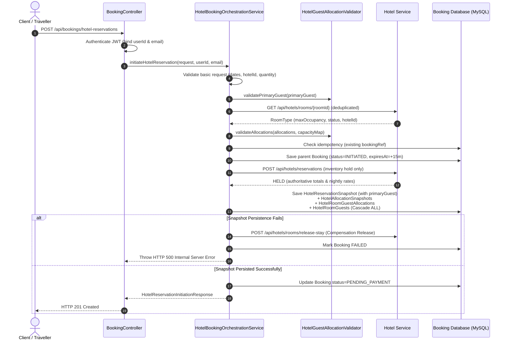

# WP-HB-06.2 — Backend Reservation APIs and Retrieval Report

## 1. Executive Summary

This work package completes the backend orchestration and API layer for structured guest allocation in the TravelEasy multi-room hotel reservation system (`booking-service`). Building directly upon the foundation established in WP-HB-06.1, this implementation:
- Extends the consolidated reservation initiation endpoint (`POST /api/bookings/hotel-reservations`) to accept structured primary guest details, physical-room allocations, and individual occupant identities.
- Implements authoritative room capacity integration with `hotel-service`, dynamically querying and enforcing `RoomType.maxOccupancy` while guaranteeing zero-knowledge of guest identities in `hotel-service`.
- Atomically persists the complete guest snapshot graph (`HotelReservationSnapshot` $\rightarrow$ `HotelAllocationSnapshot` $\rightarrow$ `HotelRoomGuestAllocation` $\rightarrow$ `HotelRoomGuest`) and preserves the WP-HB-05 aggregate compensation hold release on failure.
- Implements a dedicated reservation retrieval endpoint (`GET /api/bookings/ref/{bookingRef}/hotel-reservation-details`) returning complete primary guest details, room-wise occupants, child ages, and immutable pricing snapshots.
- Enforces strict traveller ownership and management authorization, protecting personal guest information.
- Fully preserves backward compatibility for legacy bookings without guest allocations and avoids fabricating data.

All 171 automated tests in `booking-service` and all 264 automated tests in `hotel-service` passed with zero errors, zero failures, and zero regressions.

---

## 2. Preliminary Repository Inspection Findings & Baseline Behavior

1. **Reservation Initiation Endpoint (`POST /api/bookings/hotel-reservations`):**
   - In WP-HB-05, this endpoint accepted room IDs and quantities, created a parent `Booking` in `INITIATED`, held inventory in `hotel-service`, and saved `HotelReservationSnapshot` and `HotelAllocationSnapshot` records with untyped JSON strings (`guestDetailsJson`).
   - Guest details were not validated against physical rooms or room capacity, and individual adult/child records were not stored relationally.
2. **Authoritative Capacity Ownership:**
   - Room definitions, active statuses, and `maxOccupancy` limits reside exclusively in `hotel-service` (`RoomType.java`, exposed publicly via `GET /api/hotels/rooms/{roomId}`).
   - `booking-service` had no mechanism to query or enforce `maxOccupancy` prior to locking inventory.
3. **Retrieval API Baseline:**
   - Previous retrieval was limited to generic `GET /api/bookings/ref/{bookingRef}`, which only returned raw `Booking` entity fields without nested room allocations, individual occupants, or structured pricing breakdowns.
4. **Authentication & Identity Conventions:**
   - `BookingSecurityService` resolves JWT claims (`userId`, `role`, `email`).
   - Management accounts (`ROLE_HOTEL_MANAGER`, `ROLE_BUS_OPERATOR`) are strictly prohibited from booking customer reservations.
   - Internal microservice communication uses HMAC-signed internal tokens (`X-Internal-Token`, `X-Internal-Service`).

---

## 3. Summary of Files Created and Modified

| File Path | Status | Purpose |
| :--- | :--- | :--- |
| `booking-service/src/main/java/com/traveleasy/booking/dto/HotelReservationDetailResponse.java` | Created | DTO contract for detailed hotel reservation retrieval |
| `booking-service/src/test/java/com/traveleasy/booking/controller/HotelReservationControllerTest.java` | Created | Controller WebMvc tests for initiation and detail retrieval |
| `booking-service/src/test/java/com/traveleasy/booking/integration/HotelReservationEndToEndIntegrationTest.java` | Created | End-to-end integration tests for initiation, capacity validation, persistence, and retrieval |
| `booking-service/src/main/java/com/traveleasy/booking/dto/HotelReservationInitiationResponse.java` | Modified | Extended with `primaryGuest` and `rooms` on `AllocationSnapshotDto` |
| `booking-service/src/main/java/com/traveleasy/booking/validator/HotelGuestAllocationValidator.java` | Modified | Added minimum 1-adult check, adult age null check, and consecutive sequence validation |
| `booking-service/src/main/java/com/traveleasy/booking/service/HotelBookingOrchestrationService.java` | Modified | Integrated authoritative capacity lookup, relational persistence mapping, and detail retrieval |
| `booking-service/src/main/java/com/traveleasy/booking/controller/BookingController.java` | Modified | Added `GET /api/bookings/ref/{bookingRef}/hotel-reservation-details` and structured exception handling |
| `booking-service/src/test/java/com/traveleasy/booking/service/HotelBookingOrchestrationTest.java` | Modified | Updated unit tests with structured guest data, capacity mocking, and retrieval verification |

---

## 4. API Request and Response Contracts

### 4.1 Consolidated Reservation Initiation (`POST /api/bookings/hotel-reservations`)

#### Request Contract:
```json
{
  "hotelId": 105,
  "hotelName": "Example Grand Hotel",
  "checkInDate": "2026-12-10",
  "checkOutDate": "2026-12-13",
  "primaryGuest": {
    "fullName": "John Doe",
    "email": "john@example.com",
    "mobile": "+919876543210"
  },
  "allocations": [
    {
      "roomId": 21,
      "quantity": 2,
      "rooms": [
        {
          "roomSequence": 1,
          "adults": 2,
          "children": 1,
          "occupants": [
            { "name": "John Doe", "type": "ADULT" },
            { "name": "Jane Doe", "type": "ADULT" },
            { "name": "Child Doe", "type": "CHILD", "age": 5 }
          ]
        },
        {
          "roomSequence": 2,
          "adults": 2,
          "children": 0,
          "occupants": [
            { "name": "Alex Doe", "type": "ADULT" },
            { "name": "Sam Doe", "type": "ADULT" }
          ]
        }
      ]
    }
  ]
}
```

#### Response Contract (`201 Created`):
```json
{
  "bookingId": 501,
  "bookingRef": "BKG-H-XXXXXXXX",
  "status": "PENDING_PAYMENT",
  "totalAmount": 18000.0,
  "currency": "INR",
  "expiresAt": "2026-11-10T11:15:00",
  "hotelId": 105,
  "hotelName": "Example Grand Hotel",
  "checkInDate": "2026-12-10",
  "checkOutDate": "2026-12-13",
  "totalNights": 3,
  "idempotent": false,
  "primaryGuest": {
    "fullName": "John Doe",
    "email": "john@example.com",
    "mobile": "+919876543210"
  },
  "allocations": [
    {
      "allocationId": 12,
      "roomId": 21,
      "roomTypeName": "Deluxe Room",
      "quantity": 2,
      "allocationTotal": 18000.0,
      "nightlyRatesJson": "[...]",
      "status": "HELD",
      "rooms": [
        {
          "roomSequence": 1,
          "adults": 2,
          "children": 1,
          "occupants": [
            { "name": "John Doe", "type": "ADULT" },
            { "name": "Jane Doe", "type": "ADULT" },
            { "name": "Child Doe", "type": "CHILD", "age": 5 }
          ]
        },
        {
          "roomSequence": 2,
          "adults": 2,
          "children": 0,
          "occupants": [
            { "name": "Alex Doe", "type": "ADULT" },
            { "name": "Sam Doe", "type": "ADULT" }
          ]
        }
      ]
    }
  ]
}
```

---

### 4.2 Reservation Detail Retrieval (`GET /api/bookings/ref/{bookingRef}/hotel-reservation-details`)

#### Response Contract (`200 OK`):
```json
{
  "bookingId": 501,
  "bookingRef": "BKG-H-XXXXXXXX",
  "bookingStatus": "CONFIRMED",
  "hotel": {
    "hotelId": 105,
    "hotelName": "Example Grand Hotel"
  },
  "checkInDate": "2026-12-10",
  "checkOutDate": "2026-12-13",
  "totalNights": 3,
  "primaryGuest": {
    "fullName": "John Doe",
    "email": "john@example.com",
    "mobile": "+919876543210"
  },
  "allocations": [
    {
      "allocationId": 12,
      "roomId": 21,
      "roomTypeName": "Deluxe Room",
      "quantity": 2,
      "rooms": [
        {
          "roomSequence": 1,
          "adults": 2,
          "children": 1,
          "occupants": [
            { "name": "John Doe", "type": "ADULT" },
            { "name": "Jane Doe", "type": "ADULT" },
            { "name": "Child Doe", "type": "CHILD", "age": 5 }
          ]
        },
        {
          "roomSequence": 2,
          "adults": 2,
          "children": 0,
          "occupants": [
            { "name": "Alex Doe", "type": "ADULT" },
            { "name": "Sam Doe", "type": "ADULT" }
          ]
        }
      ],
      "pricing": {
        "allocationTotal": 18000.0,
        "nightlyRatesJson": "[...]"
      },
      "status": "CONFIRMED"
    }
  ],
  "totalAmount": 18000.0,
  "currency": "INR",
  "paymentStatus": "PAID",
  "expiresAt": "2026-11-10T11:15:00",
  "bookingDate": "2026-11-10T11:00:00",
  "cancellation": null
}
```

---

## 5. Authoritative Room Capacity Integration

To satisfy Section 5:
1. **Authoritative Endpoint:** `booking-service` calls `GET {hotelServiceUrl}/api/hotels/rooms/{roomId}` with internal JWT authentication.
2. **Deduplication:** Distinct `roomId` values are extracted into a `Set<Long>`, ensuring each room type is queried only once per initiation request regardless of quantity or repetition.
3. **Fail-Closed Verification:**
   - If the room type does not exist (HTTP 404 or non-2xx) $\rightarrow$ rejects with HTTP 400 Bad Request (`"Room category not found with ID: {roomId}"`).
   - If `roomType.getHotelId()` does not match `request.getHotelId()` $\rightarrow$ rejects with HTTP 400 Bad Request (`"Room type ID {roomId} does not belong to hotel ID {hotelId}"`).
   - If `roomType.getStatus()` is not `"ACTIVE"` (e.g. `"ARCHIVED"`) $\rightarrow$ rejects with HTTP 400 Bad Request (`"Room type ID {roomId} is not active (current status: {status})"`).
   - If `roomType.getMaxOccupancy()` is missing or $< 1$ $\rightarrow$ rejects with HTTP 400 Bad Request.
4. **Validation Pass:** The retrieved `Map<Long, Integer> roomCapacities` is supplied to `HotelGuestAllocationValidator.validateAllocations(allocations, roomCapacities)`.
5. **Zero-Knowledge Privacy:** Guest identities and contact details are NEVER transmitted to `hotel-service`. The consolidated inventory hold payload (`POST /api/hotels/reservations`) contains only `roomId`, `quantity`, and stay dates.

---

## 6. Reservation Orchestration and Persistence Sequence

The end-to-end initiation flow in `HotelBookingOrchestrationService.initiateHotelReservation`:


### Relational Persistence Mapping
- `HotelReservationSnapshot` stores `primaryGuestName`, `primaryGuestEmail`, and `primaryGuestMobile`.
- `HotelAllocationSnapshot` represents the room-type allocation line item.
- `HotelRoomGuestAllocation` represents each physical room (`roomSequence`, `adultCount`, `childCount`).
- `HotelRoomGuest` represents each occupant (`guestName`, `guestType`, `age` for `CHILD`, `null` for `ADULT`).
- Graph persistence is executed atomically via JPA cascading.
- If persistence fails after inventory hold, `releaseHotelInventoryHold(bookingRef)` executes immediate compensation, preventing leaked inventory holds.

---

## 7. Retrieval API and Authorization Implementation

Located at `GET /api/bookings/ref/{bookingRef}/hotel-reservation-details`:
1. **Authorization Rules:**
   - **Travellers:** Must own the booking (`callerUserId.equals(booking.getCustomerId())`). If unauthorized, throws `403 Forbidden` (`"Access denied: You do not own this reservation"`).
   - **Hotel Managers:** Allowed only if they manage the hotel (`callerUserId.equals(booking.getProviderId())`). If attempting to view other properties, throws `403 Forbidden`.
   - **Administrators (`ROLE_ADMIN`):** Unrestricted access.
   - **Internal Microservices:** Authenticated via `BookingSecurityService.authenticateInternalService`.
   - **Unauthenticated callers:** Rejected with `401 Unauthorized`.
2. **Immutable Pricing:** Pricing is read directly from persisted `HotelAllocationSnapshot.allocationTotal` and `nightlyRatesJson`. Prices are never recalculated using current room rates.
3. **Historical Compatibility:**
   - If a historical booking was created prior to relational snapshots, `mapLegacyBookingToDetailResponse` constructs a valid response from the `Booking` entity.
   - `primaryGuest` is returned as `null` (not fabricated).
   - `allocations` is returned as an empty list (no false occupants generated).
   - Historical totals, dates, and statuses are preserved.

---

## 8. Automated Test Execution Results

### 8.1 Unit & Orchestration Tests (`HotelBookingOrchestrationTest`)
- Location: `booking-service/src/test/java/com/traveleasy/booking/service/HotelBookingOrchestrationTest.java`
- Tests Run: **12**
- Failures / Errors: **0**
- Coverage:
  - Multi-allocation reservation with structured primary guest and room allocations.
  - Zero-knowledge payload verification (no guest details sent to `hotel-service`).
  - Missing primary guest rejected (400 Bad Request).
  - Room type belonging to another hotel rejected (400 Bad Request).
  - Inactive room type rejected (400 Bad Request).
  - Occupancy exceeding authoritative `maxOccupancy` rejected (400 Bad Request).
  - Hotel service inventory conflict (409 Conflict).
  - Compensation release invocation on database persistence failure.
  - Idempotent request returning existing booking and snapshot.
  - Detail retrieval by authorized owner.
  - Detail retrieval by unauthorized traveller (403 Forbidden).
  - Detail retrieval for non-existent booking (404 Not Found).
  - Detail retrieval for historical legacy booking.

### 8.2 Controller WebMvc Tests (`HotelReservationControllerTest`)
- Location: `booking-service/src/test/java/com/traveleasy/booking/controller/HotelReservationControllerTest.java`
- Tests Run: **8**
- Failures / Errors: **0**
- Coverage:
  - `POST /api/bookings/hotel-reservations`: 201 Created with structured response.
  - `POST /api/bookings/hotel-reservations`: Manager account rejected (403 Forbidden).
  - `POST /api/bookings/hotel-reservations`: Invalid token rejected (401 Unauthorized).
  - `POST /api/bookings/hotel-reservations`: Validation failure (400 Bad Request).
  - `GET /api/bookings/ref/{ref}/hotel-reservation-details`: 200 OK with full reservation graph.
  - `GET /api/bookings/ref/{ref}/hotel-reservation-details`: Unauthorized traveller (403 Forbidden).
  - `GET /api/bookings/ref/{ref}/hotel-reservation-details`: Missing token (401 Unauthorized).
  - `GET /api/bookings/ref/{ref}/hotel-reservation-details`: Not found (404 Not Found).

### 8.3 End-to-End Integration Tests (`HotelReservationEndToEndIntegrationTest`)
- Location: `booking-service/src/test/java/com/traveleasy/booking/integration/HotelReservationEndToEndIntegrationTest.java`
- Tests Run: **7**
- Failures / Errors: **0**
- Coverage:
  - End-to-end initiation with MySQL persistence of full entity hierarchy and detail retrieval.
  - Room capacity violation failing closed without persisting records.
  - Foreign hotel room rejection.
  - Inactive room rejection.
  - Capacity lookup network failure failing closed.
  - Distinct room type deduplication (1 HTTP call per distinct room).
  - Historical booking backward compatibility.

### 8.4 Service-Wide Test Execution
- **Booking Service (`mvn -f booking-service/pom.xml test`):**
  - **171 tests run, 0 failures, 0 errors, 0 skipped**
  - **BUILD SUCCESS**
- **Hotel Service (`mvn -f hotel-service/pom.xml test`):**
  - **264 tests run, 0 failures, 0 errors, 0 skipped**
  - **BUILD SUCCESS**

---

## 9. Confirmation of Boundaries and Exclusions

In accordance with Section 13 instructions:
- **No Angular frontend changes:** Frontend forms, guest selection, review pages, and payment UIs were not modified.
- **No Payment Service modifications:** Razorpay integration, payment capture, and refund recovery mechanisms remain completely untouched.
- **No Hotel Manager Portal changes:** Manager interfaces and operational check-in/out workflows were preserved.
- **No Bus booking modifications:** Bus reservation entities, schedules, and controllers remain untouched.
- **No new inventory architecture or expiry scheduler:** Established 15-minute expiry and consolidated inventory architecture remain authoritative.
- **Work package boundary maintained:** Work package completed strictly within WP-HB-06.2.
