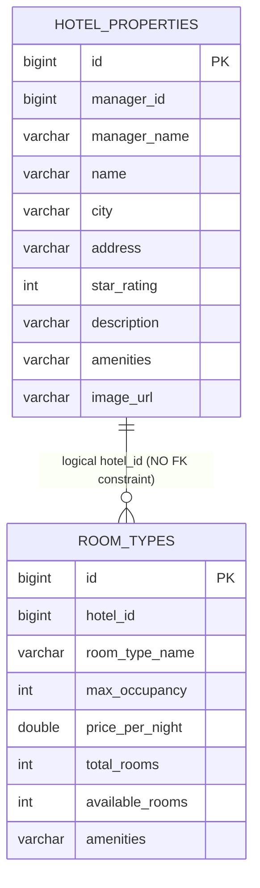

# TravelEasy — Hotel Manager Portal & Hotel-Service Comprehensive Audit Report

## 1. Executive Summary

This report delivers a thorough, evidence-driven audit of the **TravelEasy Hotel Manager Portal** and its backend microservice, **`hotel-service`**. The audit was conducted strictly in read-only mode to establish an authoritative baseline for future system enhancements.

### Major Audit Findings Overview

1. **Frontend Maturity Disparity:** While the **Bus Operator Dashboard** represents a feature-complete, modern administrative console (collapsible shell, unified header, multi-tab workflows, wizard builders, seat layout visualizers), the existing **Hotel Manager Portal** ([`hotel-manager-dashboard.component.ts`](file:///c:/Users/reddy/Documents/Materials_and_Assignments/FALL%20SEM(26-27)/SAA/SAA_Project/frontend/src/app/components/hotel-manager-dashboard/hotel-manager-dashboard.component.ts)) is a rudimentary 259-line prototype. It provides only basic property and room type creation modals, lacks a standard shell, displays no existing room listings, and offers no property editing, inventory control, or reservation actions.
2. **Missing Route Guard Protection:** Unlike `/bus-operator` and `/admin`, the `/hotel-manager` route in [`app.routes.ts`](file:///c:/Users/reddy/Documents/Materials_and_Assignments/FALL%20SEM(26-27)/SAA/SAA_Project/frontend/src/app/app.routes.ts) lacks `canActivate: [roleGuard]`, leaving it accessible to unauthenticated visitors.
3. **Absence of Backend Security & Authorization:** The `hotel-service` microservice ([`pom.xml`](file:///c:/Users/reddy/Documents/Materials_and_Assignments/FALL%20SEM(26-27)/SAA/SAA_Project/hotel-service/pom.xml)) includes **neither Spring Security nor JWT validation**. All 8 REST endpoints in [`HotelController.java`](file:///c:/Users/reddy/Documents/Materials_and_Assignments/FALL%20SEM(26-27)/SAA/SAA_Project/hotel-service/src/main/java/com/traveleasy/hotel/controller/HotelController.java) are completely unauthenticated and lack manager ownership checks (severe IDOR vulnerabilities).
4. **Flawed Date-Agnostic Inventory & Pricing Architecture:** In `hotel-service`, room inventory (`availableRooms`) and pricing (`pricePerNight`) are stored as single static scalar columns directly on the `room_types` table. There are **no date-specific inventory records** or date-range availability structures. When a booking occurs, room count is depleted globally across all past and future dates.
5. **Simulated Frontend Distributed Transaction (Saga):** Hotel room reservation is coordinated entirely in the Angular browser ([`customer-dashboard.component.ts`](file:///c:/Users/reddy/Documents/Materials_and_Assignments/FALL%20SEM(26-27)/SAA/SAA_Project/frontend/src/app/components/customer-dashboard/customer-dashboard.component.ts#L2518-L2600)), calling `hotel-service` directly to hold inventory before invoking `booking-service` and `payment-service`.
6. **Permanent Inventory Leaks on Cancellation:** While `booking-service` coordinates seat restoration for bus bookings upon cancellation, **no room release logic exists for hotel cancellations** ([`BookingController.java`](file:///c:/Users/reddy/Documents/Materials_and_Assignments/FALL%20SEM(26-27)/SAA/SAA_Project/booking-service/src/main/java/com/traveleasy/booking/controller/BookingController.java#L970-L1010)). Cancelled or expired hotel reservations leave hotel room inventory permanently reduced.
7. **Zero Backend Test Coverage:** The `hotel-service` repository contains no test directory (`src/test` does not exist), yielding **0% automated test coverage**.

---

## 2. Existing Application Architecture

The TravelEasy platform utilizes a distributed, microservices-based architecture communicating via an API Gateway.

```mermaid
flowchart TD
    Client["Angular 20 SPA Frontend (:4200)"]
    Gateway["API Gateway (:8080)"]
    Auth["auth-service (:8081)"]
    Bus["bus-service (:8082)"]
    Hotel["hotel-service (:8083)"]
    Booking["booking-service (:8084)"]
    Payment["payment-service (:8085)"]
    Notification["notification-service (:8086)"]
    Review["review-service (:8087)"]

    Client -->|HTTP /api/**| Gateway
    Gateway -->|/api/auth/**, /api/users/**| Auth
    Gateway -->|/api/buses/**| Bus
    Gateway -->|/api/hotels/**| Hotel
    Gateway -->|/api/bookings/**| Booking
    Gateway -->|/api/payments/**| Payment
    Gateway -->|/api/notifications/**| Notification
    Gateway -->|/api/reviews/**| Review

    Booking -.->|HTTP (Bus Seats Only)| Bus
    Booking -.->|HTTP (Payment / Refunds)| Payment
    Booking -.->|HTTP (URL Injected but Unused)| Hotel
```

### Key Architectural Characteristics
- **Frontend:** Angular 20 Standalone Components with Bootstrap 5 and FontAwesome.
- **Backend:** Java 17, Spring Boot 3.2.3, Spring Data JPA, Hibernate, MySQL.
- **Domain Boundaries:** Dedicated database per domain microservice (`traveleasy_hotel_db` on port 3306).
- **Communication Style:** Synchronous REST over HTTP via Spring `RestTemplate`.

---

## 3. Hotel Manager Portal Frontend Audit

### A. Directory Structure & Files
The Hotel Manager Portal frontend files are located in:
- [`hotel-manager-dashboard.component.ts`](file:///c:/Users/reddy/Documents/Materials_and_Assignments/FALL%20SEM(26-27)/SAA/SAA_Project/frontend/src/app/components/hotel-manager-dashboard/hotel-manager-dashboard.component.ts)
- [`hotel-partner-register.component.ts`](file:///c:/Users/reddy/Documents/Materials_and_Assignments/FALL%20SEM(26-27)/SAA/SAA_Project/frontend/src/app/components/register/hotel-partner-register.component.ts)
- [`hotel.service.ts`](file:///c:/Users/reddy/Documents/Materials_and_Assignments/FALL%20SEM(26-27)/SAA/SAA_Project/frontend/src/app/services/hotel.service.ts)
- [`hotel.model.ts`](file:///c:/Users/reddy/Documents/Materials_and_Assignments/FALL%20SEM(26-27)/SAA/SAA_Project/frontend/src/app/models/hotel.model.ts)
- Orphaned / Unused Components:
  - [`hotel-search-panel.component.ts`](file:///c:/Users/reddy/Documents/Materials_and_Assignments/FALL%20SEM(26-27)/SAA/SAA_Project/frontend/src/app/features/traveller/hotel-booking/components/hotel-search-panel/hotel-search-panel.component.ts)
  - [`hotel-result-card.component.ts`](file:///c:/Users/reddy/Documents/Materials_and_Assignments/FALL%20SEM(26-27)/SAA/SAA_Project/frontend/src/app/features/traveller/hotel-booking/components/hotel-result-card/hotel-result-card.component.ts)

### B. Layout & Shell Implementation
- **Missing Navigation Shell:** Unlike `BusOperatorDashboardComponent` and `AdminDashboardComponent`, `HotelManagerDashboardComponent` has **no top header bar (`.shell-header`)**, **no sidebar navigation (`.admin-sidebar`)**, and **no profile dropdown**.
- **Container Structure:** The component renders inside a simple Bootstrap `<div class="container py-4">` with two horizontal tabs: `"Hotel Properties"` and `"Guest Reservations"`.
- **Branding & Consistency:** Uses an isolated yellow/warning theme (`<i class="fa-solid fa-hotel text-warning"></i>`), which deviates from the platform standard `#0284c7` cyan-blue aesthetic.

### C. Authentication & Route Guarding
In [`app.routes.ts`](file:///c:/Users/reddy/Documents/Materials_and_Assignments/FALL%20SEM(26-27)/SAA/SAA_Project/frontend/src/app/app.routes.ts):
```typescript
// Line 39-44 (Bus Operator - Protected)
{
  path: 'bus-operator',
  component: BusOperatorDashboardComponent,
  canActivate: [roleGuard],
  data: { roles: ['ROLE_BUS_OPERATOR', 'ROLE_ADMIN'] }
},
// Line 46 (Hotel Manager - UNPROTECTED!)
{ path: 'hotel-manager', component: HotelManagerDashboardComponent },
```
- Anyone navigating directly to `http://localhost:4200/hotel-manager` can access the component without being logged in.
- In `ngOnInit()` ([line 195](file:///c:/Users/reddy/Documents/Materials_and_Assignments/FALL%20SEM(26-27)/SAA/SAA_Project/frontend/src/app/components/hotel-manager-dashboard/hotel-manager-dashboard.component.ts#L195)), `currentUser` evaluates to `null` if unauthenticated, causing `loadHotels()` and `loadReservations()` to silently exit with an empty dashboard view instead of redirecting to login.

---

## 4. Existing Pages and Functionalities Inventory

| Module / Screen | Route / State | Status | Capabilities Available | Critical Missing Capabilities |
| :--- | :--- | :---: | :--- | :--- |
| **Hotel Partner Registration** | `/register/hotel-partner` | **Complete** | 3-step wizard (Account Details, Business Details, Review & Submit), document metadata capture, submission to Auth Service. | Immediate access without verification (account remains in PENDING until admin approves). |
| **Hotel Properties Tab** | `/hotel-manager` (`tab='properties'`) | **Partial** | List manager's hotels via `GET /api/hotels/manager/{id}`, view card with image, star rating, address, description, trigger Add Hotel Modal, trigger Add Room Modal. | **Cannot edit hotel**, cannot delete/deactivate hotel, **cannot see existing room types or prices**, no image upload (hardcoded Unsplash). |
| **Add Hotel Property Modal** | Inline Modal (`showAddHotelModal`) | **Partial** | Form fields: Hotel Name, City, Full Address, Star Rating (1-5), Description, Amenities (free text). Submits `POST /api/hotels`. | No address validation, no geo-coordinates, no check-in/out times, no photo upload, uses browser `alert()`. |
| **Add Room Category Modal** | Inline Modal (`showAddRoomModal`) | **Partial** | Form fields: Room Category Name, Max Guests, Price/Night (INR), Total Inventory Count. Submits `POST /api/hotels/{id}/rooms`. | **Cannot edit created rooms**, cannot delete rooms, cannot view room inventory, no date-based pricing. |
| **Guest Reservations Tab** | `/hotel-manager` (`tab='reservations'`) | **Partial** | Fetches `GET /api/bookings/provider/{id}`, displays table: Booking Ref, Guest Name/Email, Service Title, Status badge, Total Paid, Booking Date. | **No reservation details modal**, no guest contact button, no check-in/check-out confirmation, no cancellation handling, no search/filter. |
| **Dashboard KPI Metrics** | *N/A* | **Missing** | None. | No revenue cards, no occupancy rates, no active reservations count, no trend charts. |
| **Room Management Module** | *N/A* | **Missing** | None. | No list of rooms, no room status (available, maintenance, occupied), no bed type config. |
| **Pricing & Calendar** | *N/A* | **Missing** | None. | No date-range calendar, no weekend/seasonal pricing, no blackout dates. |
| **Reviews & Ratings** | *N/A* | **Missing** | None. | No integration with `review-service`, no manager reply capability. |
| **Manager Profile / Settings** | *N/A* | **Missing** | None. | No profile editing, business license review, or password management. |

---

## 5. Frontend Workflow Analysis

### A. Hotel Property Onboarding Workflow
1. Manager clicks `+ Add Hotel Property`.
2. Fills out form: Hotel Name, City, Address, Star Rating, Description, Amenities.
3. Submits `POST /api/hotels`.
4. Browser triggers `alert('Hotel Property Registered Successfully!')`.
5. The hotel appears as a card in the dashboard.
- **Workflow Defect:** Once created, there is **zero ability to edit, update, or deactivate the hotel**. If the manager made a typo in the address, name, or amenities, it cannot be corrected from the UI.

### B. Room Configuration Workflow
1. Manager clicks `+ Add Room Type & Pricing` on a hotel card.
2. Modal opens with fields for Room Name, Max Guests, Price per Night, and Total Rooms.
3. Submits `POST /api/hotels/{hotelId}/rooms`.
4. Browser triggers `alert('Room Type Added Successfully!')`.
- **Workflow Defect:** The newly created room type **disappears from the UI**. The dashboard never displays the rooms attached to the hotel. The manager has no way of verifying what room types are listed, what prices are live, or how many rooms remain.

### C. Guest Reservation Workflow
1. Manager switches to `Guest Reservations` tab.
2. Component calls `bookingService.getProviderBookings(this.currentUser.id)`.
3. Table displays bookings where `provider_id == managerId`.
- **Workflow Defect:**
  - No details modal exists. Guest special requests or check-in/check-out dates are crammed into an unformatted `detailsJson` string (`Check-in: 2026-10-09 | Check-out: 2026-10-10`).
  - No operational action buttons exist (e.g. "Mark Checked-In", "Mark No-Show", "Cancel Reservation").

---

## 6. `hotel-service` Architecture Audit

### A. Package & Class Inventory

```
hotel-service/src/main/java/com/traveleasy/hotel/
├── HotelServiceApplication.java
├── controller/
│   └── HotelController.java            (89 lines - all logic directly in controller)
├── model/
│   ├── HotelProperty.java             (JPA entity: hotel_properties)
│   └── RoomType.java                  (JPA entity: room_types)
└── repository/
    ├── HotelPropertyRepository.java   (Spring Data JPA repository)
    └── RoomTypeRepository.java        (Spring Data JPA repository)
```

### B. Architectural Deficiencies
- **Absence of Service Layer:** There are no classes in a `service` package. `HotelController` directly injects and manipulates `HotelPropertyRepository` and `RoomTypeRepository`.
- **Absence of DTO Layer:** Request bodies are bound directly to JPA entity objects (`HotelProperty` and `RoomType`). This exposes database entities directly to clients.
- **Absence of Validation:** Neither the controller methods nor entity fields use Bean Validation annotations (`@Valid`, `@NotNull`, `@NotBlank`, `@Min`, `@Positive`). Invalid data (negative prices, negative room counts) can be persisted.
- **Absence of Global Exception Handling:** No `@ControllerAdvice` exists. Exceptions result in raw Spring Boot stack traces or standard 500 error responses.
- **Absence of Transaction Boundaries:** Controller methods modifying database state (`reserveRooms`, `releaseRooms`, `addRoomType`) lack `@Transactional` annotations.

---

## 7. Database Entities and Relationships

### A. Entity Relationship Diagram (Actual Implementation)



### B. Detailed Field Analysis

#### 1. `HotelProperty` Entity ([`HotelProperty.java`](file:///c:/Users/reddy/Documents/Materials_and_Assignments/FALL%20SEM(26-27)/SAA/SAA_Project/hotel-service/src/main/java/com/traveleasy/hotel/model/HotelProperty.java))
- Table: `hotel_properties` (Database: `traveleasy_hotel_db`)
- `id`: `Long` (Primary Key, Auto-increment)
- `managerId`: `Long` (Reference to `traveleasy_auth_db.users.id`)
- `managerName`: `String` (Denormalized manager name)
- `name`: `String` (Hotel commercial name)
- `city`: `String` (City name)
- `address`: `String` (Street address)
- `starRating`: `Integer` (Self-declared star rating)
- `description`: `String` (Length up to 2000 characters)
- `amenities`: `String` (Comma-delimited string, e.g. `"Swimming Pool, Free Wi-Fi, Restaurant"`)
- `imageUrl`: `String` (Single image URL)
- **Critical Database Gaps:**
  - No `status` field (`ACTIVE`, `INACTIVE`, `SUSPENDED`).
  - No audit fields (`createdAt`, `updatedAt`, `createdBy`).
  - No check-in/out policies, contact phone/email, or geo-coordinates.
  - No JPA `@OneToMany` mapping to `RoomType`.

#### 2. `RoomType` Entity ([`RoomType.java`](file:///c:/Users/reddy/Documents/Materials_and_Assignments/FALL%20SEM(26-27)/SAA/SAA_Project/hotel-service/src/main/java/com/traveleasy/hotel/model/RoomType.java))
- Table: `room_types` (Database: `traveleasy_hotel_db`)
- `id`: `Long` (Primary Key, Auto-increment)
- `hotelId`: `Long` (Logical reference to `hotel_properties.id`, **no database FK constraint**)
- `roomTypeName`: `String` (Category name, e.g. `"Deluxe King Room"`)
- `maxOccupancy`: `Integer` (Guest capacity)
- `pricePerNight`: `Double` (Base nightly price)
- `totalRooms`: `Integer` (Total physical room count)
- `availableRooms`: `Integer` (Remaining inventory counter)
- `amenities`: `String` (Room amenities)
- **Critical Database Gaps:**
  - **No date dimension for inventory:** `availableRooms` is a global scalar counter.
  - **No date dimension for pricing:** `pricePerNight` is a single static double.
  - No room photo URLs, bed configurations, or square footage.
  - No optimistic locking (`@Version`) to guard concurrent inventory decrements.

---

## 8. Complete API Endpoint Inventory

All endpoints reside in [`HotelController.java`](file:///c:/Users/reddy/Documents/Materials_and_Assignments/FALL%20SEM(26-27)/SAA/SAA_Project/hotel-service/src/main/java/com/traveleasy/hotel/controller/HotelController.java) under `@RequestMapping("/api/hotels")`.

| HTTP Method | API Path | Controller Method | Purpose | Request Body / Params | Response Structure | Auth Required | Status |
| :--- | :--- | :--- | :--- | :--- | :--- | :---: | :---: |
| `POST` | `/api/hotels` | `addHotel` | Register new hotel property | `RequestBody HotelProperty` | `HotelProperty` (HTTP 201) | **None** | Complete (Unsecured) |
| `GET` | `/api/hotels` | `getAllHotels` | List all hotels platform-wide | *None* | `List<HotelProperty>` (HTTP 200) | **None** | Complete (Unpaged) |
| `GET` | `/api/hotels/manager/{managerId}` | `getHotelsByManager` | List hotels by manager ID | `@PathVariable Long managerId` | `List<HotelProperty>` (HTTP 200) | **None** | Complete (IDOR Risk) |
| `GET` | `/api/hotels/search` | `searchHotels` | Search hotels by city | `@RequestParam String city`, optional `checkIn`, `checkOut`, `guests` | `List<HotelProperty>` (HTTP 200) | **None** | **Defective** (Ignores dates) |
| `GET` | `/api/hotels/{id}` | `getHotelDetails` | Get hotel & attached rooms | `@PathVariable Long id` | `Map{"hotel": HotelProperty, "rooms": List<RoomType>}` | **None** | Complete |
| `POST` | `/api/hotels/{hotelId}/rooms` | `addRoomType` | Add room type to hotel | `@PathVariable Long hotelId`, `RequestBody RoomType` | `RoomType` (HTTP 201) | **None** | Complete (Unsecured) |
| `PUT` | `/api/hotels/rooms/{roomId}/reserve` | `reserveRooms` | Hold room inventory | `@PathVariable Long roomId`, `@RequestParam Integer count` | `Map{"message": ..., "roomType": RoomType}` | **None** | **Critical Concurrency Flaw** |
| `PUT` | `/api/hotels/rooms/{roomId}/release` | `releaseRooms` | Restore room inventory | `@PathVariable Long roomId`, `@RequestParam Integer count` | `Map{"message": ...}` | **None** | **Critical Overflow Flaw** |

---

## 9. Existing Business Logic Analysis

### A. Hotel Property Search Logic
In [`HotelController.java:38-45`](file:///c:/Users/reddy/Documents/Materials_and_Assignments/FALL%20SEM(26-27)/SAA/SAA_Project/hotel-service/src/main/java/com/traveleasy/hotel/controller/HotelController.java#L38-L45):
```java
@GetMapping("/search")
public ResponseEntity<List<HotelProperty>> searchHotels(
        @RequestParam String city,
        @RequestParam(required = false) String checkIn,
        @RequestParam(required = false) String checkOut,
        @RequestParam(required = false, defaultValue = "1") Integer guests) {
    return ResponseEntity.ok(hotelRepository.findByCityIgnoreCase(city));
}
```
- **Finding:** The endpoint receives `checkIn`, `checkOut`, and `guests`, but completely ignores them. It performs a case-insensitive city string lookup. Hotels with zero available rooms or insufficient guest capacity are returned identically.

### B. Room Reservation Logic
In [`HotelController.java:66-78`](file:///c:/Users/reddy/Documents/Materials_and_Assignments/FALL%20SEM(26-27)/SAA/SAA_Project/hotel-service/src/main/java/com/traveleasy/hotel/controller/HotelController.java#L66-L78):
```java
@PutMapping("/rooms/{roomId}/reserve")
public ResponseEntity<?> reserveRooms(@PathVariable Long roomId, @RequestParam Integer count) {
    RoomType roomType = roomTypeRepository.findById(roomId).orElse(null);
    if (roomType == null) {
        return ResponseEntity.badRequest().body(Map.of("message", "Room type not found"));
    }
    if (roomType.getAvailableRooms() < count) {
        return ResponseEntity.badRequest().body(Map.of("message", "Insufficient room inventory available"));
    }
    roomType.setAvailableRooms(roomType.getAvailableRooms() - count);
    roomTypeRepository.save(roomType);
    return ResponseEntity.ok(Map.of("message", "Rooms reserved successfully", "roomType", roomType));
}
```
- **Finding:**
  1. **Race Condition / Overbooking Risk:** Two concurrent requests reading `availableRooms = 1` simultaneously will both pass the check and decrement the value to `-1` or overwrite each other's updates.
  2. **Global Depletion:** The inventory is reduced permanently regardless of the guest's check-in/check-out dates.

### C. Room Release Logic
In [`HotelController.java:80-88`](file:///c:/Users/reddy/Documents/Materials_and_Assignments/FALL%20SEM(26-27)/SAA/SAA_Project/hotel-service/src/main/java/com/traveleasy/hotel/controller/HotelController.java#L80-L88):
```java
@PutMapping("/rooms/{roomId}/release")
public ResponseEntity<?> releaseRooms(@PathVariable Long roomId, @RequestParam Integer count) {
    RoomType roomType = roomTypeRepository.findById(roomId).orElse(null);
    if (roomType == null) return ResponseEntity.badRequest().build();

    roomType.setAvailableRooms(roomType.getAvailableRooms() + count);
    roomTypeRepository.save(roomType);
    return ResponseEntity.ok(Map.of("message", "Rooms released successfully"));
}
```
- **Finding:** There is no check preventing `availableRooms` from exceeding `totalRooms`. Repeated calls can inflate available inventory beyond physical property limits.

---

## 10. Inter-Microservice Integration Analysis

| Interacting Services | Direction | Mechanism | Data Exchanged | Current Behavior & Deficiencies |
| :--- | :--- | :--- | :--- | :--- |
| **Frontend → hotel-service** | Browser to Service | Direct HTTP via API Gateway | Hotel registration & Room reservation | Frontend initiates holds directly before booking creation. |
| **Booking Service → hotel-service** | `booking-service` to `hotel-service` | Injected URL (`hotel.service.url:8083`) | None | Injected in `BookingExpiryReconciliationService`, but **never called**. |
| **Booking Service → Bus Service** | `booking-service` to `bus-service` | HTTP REST (`RestTemplate`) | Seat release on cancellation | Fully implemented for bus seats; **completely missing for hotel rooms**. |
| **Booking Service → Payment Service** | `booking-service` to `payment-service` | HTTP REST (`RestTemplate`) | Booking ref & refund amount | Triggers refund on cancellation for all booking types. |
| **Review Service → hotel-service** | None | None | Rating & Reviews | `review-service` supports `serviceType="HOTEL"`, but `hotel-service` never synchronizes or displays actual review metrics. |
| **Notification Service → hotel-service** | None | None | Booking alerts | `RecipientRole.HOTEL_PARTNER` enum exists, but no email templates or events are dispatched to hotel managers. |

---

## 11. Security and Authorization Assessment

### A. JWT Validation & Role Enforcement
- **Vulnerability:** `hotel-service` does not include `spring-boot-starter-security`. It does not intercept incoming requests or validate Bearer JWT tokens.
- **Impact:** Any HTTP client capable of reaching port 8083 directly or sending requests through the API Gateway can execute all endpoints without authentication.

### B. Insecure Direct Object References (IDOR)
- **Vulnerability:** `GET /api/hotels/manager/{managerId}` returns hotel properties solely by filtering on the `{managerId}` URL parameter.
- **Impact:** Any authenticated or unauthenticated user can enumerate and view properties of any registered hotel manager by incrementing the ID.

### C. Missing Property Ownership Validation
- **Vulnerability:** `POST /api/hotels/{hotelId}/rooms` binds room categories to `{hotelId}` without validating whether the caller is the registered owner of the hotel.
- **Impact:** Any user can inject arbitrary room types, rates, and inventory into competitors' hotel properties.

---

## 12. Functional Gaps and Incomplete Implementations

1. **Hotel Property Management:**
   - No endpoint or UI to update existing hotel properties (`PUT /api/hotels/{id}`).
   - No endpoint or UI to delete or deactivate a hotel (`DELETE /api/hotels/{id}`).
   - No support for multiple hotel property images or photo galleries.
2. **Room Management:**
   - No endpoint or UI to edit existing room types, update prices, or adjust capacity.
   - No endpoint or UI to remove room types.
   - Room types added by managers are not visible on the manager dashboard.
3. **Reservation Handling:**
   - No dedicated endpoint in `hotel-service` for reservations; portal queries `booking-service` directly.
   - No reservation status updates (Checked-In, Checked-Out, No-Show).
4. **Cancellation Flow:**
   - Room inventory is not released when a hotel reservation is cancelled in `booking-service`.

---

## 13. Business Logic Concerns

1. **Date-Agnostic Inventory Counter:**
   - Rooms cannot be booked across non-overlapping date ranges. If a hotel has 10 rooms and 10 guests book for tonight, tomorrow's inventory is also reduced to 0.
2. **Unbounded Inventory Restoration:**
   - Releasing rooms via `PUT /api/hotels/rooms/{roomId}/release` does not cap `availableRooms` at `totalRooms`.
3. **Search Filters Ignored:**
   - Check-in, check-out, and guest counts submitted by travellers are ignored by `hotel-service`.
4. **Star Rating Self-Declaration:**
   - `starRating` is an unverified integer entered during property creation, with no governance or sync with customer review ratings.

---

## 14. Missing Functionality and Enhancement Opportunities

1. **Date-Specific Inventory System:** Introduce a `room_inventory` table tracking `(room_type_id, date, total_rooms, booked_rooms, available_rooms, price)`.
2. **Dynamic Pricing Management:** Allow managers to configure seasonal, weekend, or holiday rates.
3. **Comprehensive Manager Dashboard Shell:** Align the Hotel Manager Portal layout with the Bus Operator Dashboard (unified header, collapsible sidebar, KPI summary cards).
4. **Operational Analytics:** Add revenue reports, occupancy rate tracking, and average daily rate (ADR) metrics.
5. **Review Management:** Allow hotel managers to view guest reviews and post management replies.
6. **Notification Integration:** Trigger email and in-app notifications to hotel managers upon new bookings or cancellations.

---

## 15. UI/UX Improvement Opportunities

1. **Layout Alignment:** Replace the standalone container with the platform standard `.shell-header` and collapsible sidebar.
2. **Property Card Enrichment:** Display attached room types, active pricing, and inventory counters directly on hotel property cards.
3. **Modal Modernization:** Replace browser `alert()` notifications with inline toast alerts or modal feedback banners.
4. **Reservation Table Enhancements:** Add guest search, date filtering, pagination, and a booking details inspection modal.
5. **Loading & Empty States:** Implement shimmering skeleton loaders and informative empty states for properties and reservations.

---

## 16. Existing Test Coverage Assessment

| Component / Service | Unit Tests | Integration Tests | Security Tests | Coverage Status |
| :--- | :---: | :---: | :---: | :---: |
| **`hotel-service` (Backend)** | 0 | 0 | 0 | **0% (No `src/test` directory exists)** |
| **`HotelManagerDashboardComponent` (Frontend)** | 0 | 0 | 0 | **0% (No `.spec.ts` test file)** |
| **`HotelService` (Frontend Client)** | 0 | 0 | 0 | **0% (No `.spec.ts` test file)** |
| **`BookingService` (Hotel Integration)** | Partial | Partial | None | **Hotel cancellation & release untested** |

---

## 17. Risk and Priority Assessment

```mermaid
quadrantChart
    title Risk & Priority Assessment Matrix
    x-axis Low Complexity --> High Complexity
    y-axis Low Impact --> High Impact
    quadrant-1 High Priority / Architectural Overhaul
    quadrant-2 Critical Immediate Action (P0)
    quadrant-3 Low Priority (P3)
    quadrant-4 Medium Priority (P2)
    "Unsecured hotel-service APIs": [0.25, 0.95]
    "Unprotected /hotel-manager route": [0.15, 0.90]
    "Permanent inventory leak on cancellation": [0.35, 0.88]
    "Date-agnostic inventory & pricing": [0.85, 0.92]
    "Missing room listing & edit UI": [0.45, 0.75]
    "Shell & header alignment": [0.30, 0.45]
    "Missing hotel-service test suite": [0.40, 0.65]
```

---

## 18. Recommended Enhancement Roadmap

| ID | Module | Finding | Current Behavior | Expected Behavior | Priority | Affected Services | Dependencies | Evidence |
| :--- | :--- | :--- | :--- | :--- | :---: | :--- | :--- | :--- |
| **SEC-01** | Security | Unsecured Backend APIs | `hotel-service` has no security or JWT validation. | Require `ROLE_HOTEL_MANAGER` or `ROLE_ADMIN` on all modification endpoints. | **P0** | `hotel-service` | Auth Service JWT | [`HotelController.java:23`](file:///c:/Users/reddy/Documents/Materials_and_Assignments/FALL%20SEM(26-27)/SAA/SAA_Project/hotel-service/src/main/java/com/traveleasy/hotel/controller/HotelController.java#L23) |
| **SEC-02** | Security | Unprotected Frontend Route | `/hotel-manager` has no route guard. | Guard route with `canActivate: [roleGuard]` requiring `ROLE_HOTEL_MANAGER`. | **P0** | Frontend | `roleGuard` | [`app.routes.ts:46`](file:///c:/Users/reddy/Documents/Materials_and_Assignments/FALL%20SEM(26-27)/SAA/SAA_Project/frontend/src/app/app.routes.ts#L46) |
| **SEC-03** | Security | IDOR & Ownership Bypass | Anyone can add rooms to any hotel or view any manager's hotels. | Validate that `hotel.managerId == authenticatedUserId`. | **P0** | `hotel-service` | `SEC-01` | [`HotelController.java:34,58`](file:///c:/Users/reddy/Documents/Materials_and_Assignments/FALL%20SEM(26-27)/SAA/SAA_Project/hotel-service/src/main/java/com/traveleasy/hotel/controller/HotelController.java#L34) |
| **INT-01** | Booking / Inventory | Hotel Inventory Leak | Cancelled hotel bookings never release rooms. | Call `hotel-service` release endpoint upon hotel cancellation. | **P0** | `booking-service`, `hotel-service` | Booking Lifecycle | [`BookingController.java:970`](file:///c:/Users/reddy/Documents/Materials_and_Assignments/FALL%20SEM(26-27)/SAA/SAA_Project/booking-service/src/main/java/com/traveleasy/booking/controller/BookingController.java#L970) |
| **ARC-01** | Inventory & Pricing | Date-Agnostic Inventory | Inventory and price are static numbers on `room_types`. | Introduce date-indexed room inventory and pricing tables. | **P1** | `hotel-service` | DB Schema Migration | [`RoomType.java:23-25`](file:///c:/Users/reddy/Documents/Materials_and_Assignments/FALL%20SEM(26-27)/SAA/SAA_Project/hotel-service/src/main/java/com/traveleasy/hotel/model/RoomType.java#L23-L25) |
| **API-01** | API | Missing CRUD Endpoints | Cannot edit hotels, edit rooms, or delete rooms. | Provide complete `PUT /api/hotels/{id}`, `PUT /api/hotels/rooms/{id}`, `DELETE` endpoints. | **P1** | `hotel-service` | `SEC-01` | [`HotelController.java`](file:///c:/Users/reddy/Documents/Materials_and_Assignments/FALL%20SEM(26-27)/SAA/SAA_Project/hotel-service/src/main/java/com/traveleasy/hotel/controller/HotelController.java) |
| **FE-01** | UI/UX | Missing Shell & Header | Simple container with no sidebar or top navigation. | Implement standard TravelEasy SaaS shell with sidebar and header. | **P1** | Frontend | Bus Operator / Admin Header | [`hotel-manager-dashboard.component.ts:14`](file:///c:/Users/reddy/Documents/Materials_and_Assignments/FALL%20SEM(26-27)/SAA/SAA_Project/frontend/src/app/components/hotel-manager-dashboard/hotel-manager-dashboard.component.ts#L14) |
| **FE-02** | UI/UX | Missing Room View & Edit | Room types disappear after creation; cannot be seen or edited. | Display room cards inside hotel property with edit/delete controls. | **P1** | Frontend | `API-01` | [`hotel-manager-dashboard.component.ts:38-54`](file:///c:/Users/reddy/Documents/Materials_and_Assignments/FALL%20SEM(26-27)/SAA/SAA_Project/frontend/src/app/components/hotel-manager-dashboard/hotel-manager-dashboard.component.ts#L38-L54) |
| **CON-01** | Concurrency | Race Condition on Reserve | No locking on `availableRooms` decrement. | Add optimistic locking (`@Version`) or database pessimistic locks. | **P1** | `hotel-service` | Spring Data JPA | [`HotelController.java:75`](file:///c:/Users/reddy/Documents/Materials_and_Assignments/FALL%20SEM(26-27)/SAA/SAA_Project/hotel-service/src/main/java/com/traveleasy/hotel/controller/HotelController.java#L75) |
| **FE-03** | UI/UX | Reservation Details Modal | Reservations table is plain text with no details view. | Add booking details modal with guest details and check-in actions. | **P2** | Frontend | Booking DTOs | [`hotel-manager-dashboard.component.ts:58-84`](file:///c:/Users/reddy/Documents/Materials_and_Assignments/FALL%20SEM(26-27)/SAA/SAA_Project/frontend/src/app/components/hotel-manager-dashboard/hotel-manager-dashboard.component.ts#L58-L84) |
| **TST-01** | Quality | Zero Backend Tests | No `src/test` directory in `hotel-service`. | Add unit and mock integration test suite for `hotel-service`. | **P2** | `hotel-service` | JUnit 5, Mockito | `hotel-service/pom.xml` |

---

## 19. Questions Requiring Product/Business Clarification

1. **Date-Based Inventory vs. Room Count Model:** Should TravelEasy implement full date-indexed inventory (e.g. night-by-night availability grid), or does the platform target short-term bookings where basic date-window checks suffice?
2. **Multi-Hotel Management:** Can a single hotel partner manage multiple distinct hotel properties across different cities, or is an account restricted to a single property? (Currently, the database supports 1-to-many, but registration treats the account as one business entity).
3. **Hotel Verification Lifecycle:** Should hotel properties require explicit administrator approval before appearing in customer search results, similar to bus operator verification?
4. **Cancellation Policy & Fee Schedules:** What is the refund policy for hotel cancellations (e.g. 100% refund > 24 hours before check-in, 50% within 24 hours)? Currently, `booking-service` triggers a full refund indiscriminately.
5. **Direct Room Availability by Traveller Search:** Should customer hotel search return room types and real-time prices directly on the search results page, or only on property detail selection?

---

## 20. Final Audit Conclusion

The existing **Hotel Manager Portal** and **`hotel-service`** represent an early-stage proof-of-concept that requires significant architectural, functional, and security stabilization before reaching parity with the **Bus Operator** and **Admin** portals.

The highest priority risks to address are:
1. **Security & Ownership:** Unauthenticated REST endpoints and unprotected frontend routes.
2. **Data Integrity:** Missing room release logic on reservation cancellation and concurrency race conditions on room holds.
3. **Functional Completeness:** Enabling hotel managers to view, edit, and maintain their room categories, rates, and inventory within a unified SaaS dashboard shell.

*No source files were modified during this audit. Implementation awaits explicit work package authorization.*
