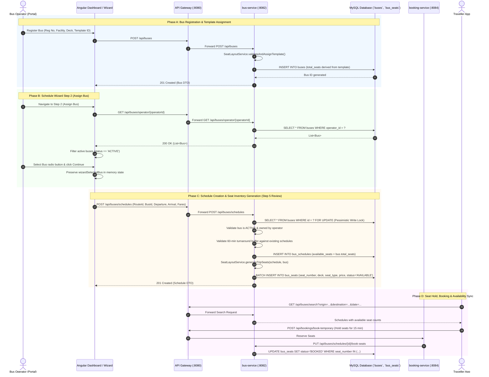
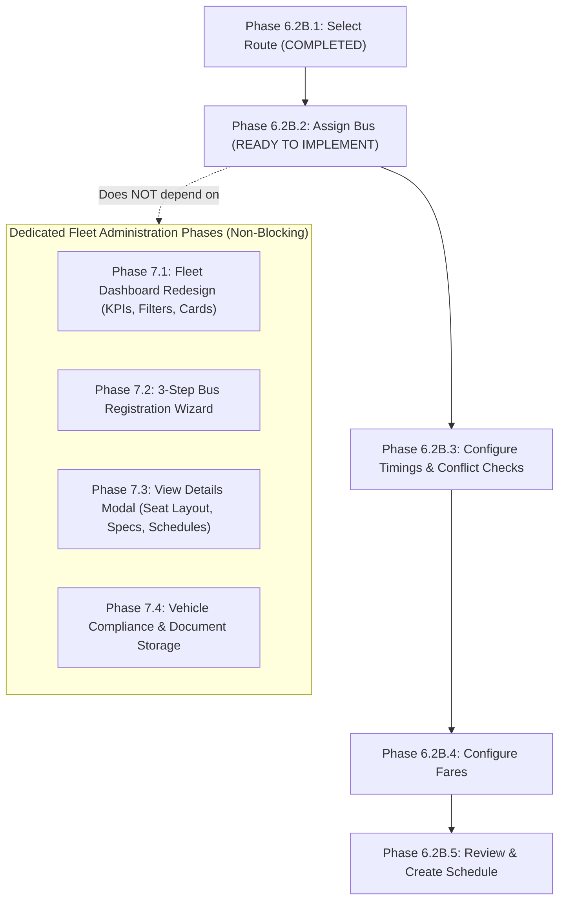

# TravelEasy — Phase 6.2B.2A: Bus Module Readiness Audit & Gap Analysis

**Document Status:** Complete & Verified  
**Audit Phase:** Phase 6.2B.2A (Pre-Implementation Audit for Schedule Creation Wizard Step 2 — Assign Bus)  
**Evaluated Codebase:** TravelEasy Multi-Module Platform (`bus-service`, `booking-service`, `api-gateway`, `frontend`)  
**Visual Specifications:** 7 Reference Mockups in [frontend/src/assets/images/](file:///c:/Users/reddy/Documents/Materials_and_Assignments/FALL%20SEM(26-27)/SAA/SAA_Project/frontend/src/assets/images)  
**Strict Scope Rule:** Audit-only phase. Zero source code, database, migration, or test alterations executed.

---

## 1. Executive Summary

This audit evaluates the architectural readiness and functional maturity of the TravelEasy Bus Module prior to implementing **Step 2 — Assign Bus** of the Schedule Creation Wizard (Phase 6.2B.2).

### Core Findings
1. **Unambiguous GO Recommendation for Step 2 (Assign Bus):** The existing backend data model and APIs (`GET /api/buses/operator/{operatorId}`) provide 100% of the data and behavioral contracts required for Step 2. The operator's buses can be fetched, filtered by active status, selected via a single-bus radio control, and persisted into the wizard state model.
2. **Clear Boundary Separation Between Step 2 and Step 3:** Step 2 is strictly **Bus Selection** (assigning a physical bus asset to the schedule draft). Bus availability, departure/arrival timing, turnaround buffer checks (60 min), and trip overlap validations belong to **Step 3 (Configure Timings)** and backend submission validation (`ScheduleService.java`). No time-conflict checks are needed or appropriate in Step 2.
3. **Existing Seat Layout & Inventory Mechanics are Production-Grade:** The template catalog (`SeatLayoutService.java`) features 7 seeded layouts spanning single-deck and double-deck buses (2+2 Seater, 2+1 Seater, 1+1 Seater, 2+1 Sleeper, 2+1 Seater-cum-Sleeper, and Hybrid Sleepers). When a schedule is created, trip seat inventory (`bus_seats`) is snapshotted from the bus template. Capacity is strictly derived from template inventory, eliminating seat count drift.
4. **Fleet Administration Scope vs. Wizard Scope:** The seven reference mockups depict a comprehensive enterprise fleet management portal (with chassis numbers, engine numbers, body builder, emission standards, insurance/fitness/permit document uploads, and a 4-tab details modal). These attributes represent **Fleet Administration Enhancements** and are **NOT blockers** for Step 2 schedule creation.
5. **Frontend DTO Alignment Requirement:** The TypeScript interface [`Bus`](file:///c:/Users/reddy/Documents/Materials_and_Assignments/FALL%20SEM(26-27)/SAA/SAA_Project/frontend/src/app/models/bus.model.ts#L1-L15) currently defines `capacity: number` instead of `totalSeats: number` and `amenities: string[]` instead of `string`, and omits `templateId`, `facilityType`, and `busConfiguration`. This minor alignment should be resolved in the Step 2 implementation.

---

## 2. Architecture and End-to-End Data Flow Map

The following sequence details how bus registration, persistence, retrieval, schedule creation, seat generation, and booking inventory interact across the distributed system:



---

## 3. Current Bus Entity / API / Schema Inventory

### 3.1 Field-by-Field Classification Matrix
The table below contrasts the attributes in [`Bus.java`](file:///c:/Users/reddy/Documents/Materials_and_Assignments/FALL%20SEM(26-27)/SAA/SAA_Project/bus-service/src/main/java/com/traveleasy/bus/model/Bus.java), the Angular [`Bus`](file:///c:/Users/reddy/Documents/Materials_and_Assignments/FALL%20SEM(26-27)/SAA/SAA_Project/frontend/src/app/models/bus.model.ts) interface, and the seven reference mockups.

| Field Name | Type in `Bus.java` | In Frontend Model | In Reference Mockups | Classification & Usage | Impact on Step 2 |
| :--- | :--- | :--- | :--- | :--- | :--- |
| `id` | `Long` (PK) | `id: number` | Yes (Bus ID) | **Essential** (Unique identifier) | Mandatory for schedule payload |
| `operatorId` | `Long` | `operatorId: number` | Implicit (Tenant) | **Essential** (Multi-tenant ownership) | Required for ownership filtering |
| `operatorName` | `String` | `operatorName: string` | Yes (Operator Header) | Operational Display | Display in summary cards |
| `busNumber` | `String` | `busNumber: string` | Yes (Registration Number) | **Essential** (Asset Identifier) | Primary bus card label |
| `busType` | `String` | `busType: string` | Yes (e.g. "AC 2+1 Sleeper") | **Essential** (Category Title) | Secondary bus card descriptor |
| `totalSeats` | `Integer` | *Missing* (uses `capacity`) | Yes (e.g. "36 Seats") | **Essential** (Passenger Capacity) | Display capacity badge |
| `amenities` | `String` (CSV) | `string[]` (*Type mismatch*) | Yes (WiFi, Charging, etc.) | Informational | Amenities pills on bus card |
| `facilityType` | `String` ("AC", "NON_AC") | *Missing* | Yes (AC / Non-AC tag) | **Essential** (Comfort filter) | Facility pill / filter |
| `busConfiguration`| `String` ("SINGLE/DOUBLE") | *Missing* | Yes (Deck layout indicator) | **Essential** (Deck specification) | Deck pill / filter |
| `templateId` | `String` | *Missing* | Yes (Layout template key) | **Essential** (Layout identifier) | Template badge / preview link |
| `status` | `String` ("ACTIVE", etc.) | `status: string` | Yes ("Active" / "Inactive") | **Essential** (Operational State) | Eligibility gate: only `ACTIVE` selectable |
| `busName` | *Not in entity* | *Missing* | Yes ("TravelEasy Express") | Fleet Admin Enhancement | Optional display name (fallback: `busType`) |
| `model` | *Not in entity* | *Missing* | Yes ("Volvo 9600") | Fleet Admin Enhancement | Secondary vehicle model info |
| `yearOfManufacturing`| *Not in entity* | *Missing* | Yes ("2023") | Fleet Admin Enhancement | Fleet age & depreciation tracking |
| `chassisNumber` | *Not in entity* | *Missing* | Yes ("YV3T2EU527N...") | Fleet Admin Enhancement | RTO registration compliance |
| `engineNumber` | *Not in entity* | *Missing* | Yes ("D13K520123...") | Fleet Admin Enhancement | Mechanical identification |
| `bodyBuilder` | *Not in entity* | *Missing* | Yes ("Volvo India") | Fleet Admin Enhancement | Coachbuilder details |
| `color` | *Not in entity* | *Missing* | Yes ("White with Blue") | Fleet Admin Enhancement | Visual bus livery |
| `busCategory` | *Not in entity* | *Missing* | Yes ("Contract Carriage") | Fleet Admin Enhancement | Regulatory license class |
| `emissionStandard`| *Not in entity* | *Missing* | Yes ("BS VI") | Fleet Admin Enhancement | Environmental compliance |
| `fuelType` | *Not in entity* | *Missing* | Yes ("Diesel") | Fleet Admin Enhancement | Fleet fuel tracking |
| Compliance Dates | *Not in entity* | *Missing* | Yes (Insurance, Fitness, Permit) | Compliance & Documentation | Administrative renewal alerts |
| Document Files | *Not in entity* | *Missing* | Yes (RC, Insurance PDF, Photos) | Compliance & Documentation | File upload & document repository |
| Maintenance Tab | *Not in entity* | *Missing* | Excluded from Scope | **Explicitly Excluded** | Out of scope per project charter |

> [!NOTE]
> **Key Finding on Entity Completeness:** All 10 fields defined in [`Bus.java`](file:///c:/Users/reddy/Documents/Materials_and_Assignments/FALL%20SEM(26-27)/SAA/SAA_Project/bus-service/src/main/java/com/traveleasy/bus/model/Bus.java) are 100% sufficient to drive Step 2 (Assign Bus). The additional fields present in the registration mockups relate entirely to comprehensive fleet administration and vehicle lifecycle management.

---

## 4. Seat-Layout and Inventory Findings

### 4.1 Layout Template Catalogue
The layout catalogue is centrally managed in [`SeatLayoutService.java`](file:///c:/Users/reddy/Documents/Materials_and_Assignments/FALL%20SEM(26-27)/SAA/SAA_Project/bus-service/src/main/java/com/traveleasy/bus/service/SeatLayoutService.java). It automatically seeds and validates 7 distinct templates on startup:

| Template ID | Display Name | Configuration | Deck Count | Lower Inventory | Upper Inventory | Total Inventory | Grid Dimensions |
| :--- | :--- | :--- | :---: | :---: | :---: | :---: | :---: |
| `2+2 SEATER` | 2+2 Executive Seater | `SINGLE_DECK` | 1 | 40 seats | 0 | **40** | 10 rows × 4 cols |
| `2+1 SEATER` | 2+1 Luxury Seater | `SINGLE_DECK` | 1 | 30 seats | 0 | **30** | 10 rows × 3 cols |
| `1+1 SEATER` | 1+1 VIP Club Seater | `SINGLE_DECK` | 1 | 20 seats | 0 | **20** | 10 rows × 2 cols |
| `2+1 SLEEPER` | 2+1 AC Sleeper Berths | `DOUBLE_DECK` | 2 | 18 berths | 18 berths | **36** | 6 rows × 3 cols |
| `2+1 SEATER_CUM_SLEEPER` | 2+1 Seater + Sleeper | `DOUBLE_DECK` | 2 | 24 seats | 14 berths | **38** | 8 rows × 3 cols |
| `2+1 HYBRID_SLEEPER-1` | 2+1 Hybrid Sleeper Type 1 | `DOUBLE_DECK` | 2 | 18 berths | 18 berths | **36** | 6 rows × 3 cols |
| `2+1 HYBRID_SLEEPER-2` | 2+1 Hybrid Sleeper Type 2 | `DOUBLE_DECK` | 2 | 18 berths | 18 berths | **36** | 6 rows × 3 cols |

### 4.2 Trip Seat Generation Mechanics
When a schedule is created via `ScheduleService.createSchedule()`:
1. The service calls `seatLayoutService.generateTripSeats(schedule, bus)`.
2. For each `TemplatePosition` where `isBookable = true`:
   - A new [`Seat`](file:///c:/Users/reddy/Documents/Materials_and_Assignments/FALL%20SEM(26-27)/SAA/SAA_Project/bus-service/src/main/java/com/traveleasy/bus/model/Seat.java) entity is instantiated in the `bus_seats` table.
   - Position label (e.g., `L1A`, `U1A`), deck (`LOWER`/`UPPER`), seat type (`SEATER`/`SLEEPER`), price (derived from base schedule fare), and status (`AVAILABLE`) are snapshotted.
3. **Capacity Derivation:** `bus.totalSeats` is derived directly from `template.totalInventory`. When the schedule is created, `schedule.availableSeats` is initialized to `bus.totalSeats`.

### 4.3 Driver / Staff Cabin Positions
In `TemplatePosition.java`:
- Non-passenger positions (driver cabin, emergency exits, staff storage) are stored with `isBookable = false` or omitted from passenger positions.
- `generateTripSeats()` explicitly filters `if (!position.isBookable()) continue;`, ensuring non-bookable positions never enter traveller inventory.

### 4.4 Template Immutability & Schedule Isolation
Because seat records are physically created per-schedule in `bus_seats` upon schedule creation:
- Subsequent alterations or reconfigurations of bus templates cannot mutate existing schedules or corrupted booked passenger reservations.
- Historical bookings remain immutable and referentially safe.

---

## 5. "My Buses" and Registration UI Gap Analysis

### 5.1 Existing VIEW 2 vs. Fleet Dashboard Mockup
The current fleet listing in [`bus-operator-dashboard.component.ts`](file:///c:/Users/reddy/Documents/Materials_and_Assignments/FALL%20SEM(26-27)/SAA/SAA_Project/frontend/src/app/components/bus-operator-dashboard/bus-operator-dashboard.component.ts#L465-L505) contains significant UI gaps when evaluated against `TravelEasy Bus Fleet Dashboard.png`:

| Feature Area | Current Implementation (VIEW 2) | Mockup Specification (`TravelEasy Bus Fleet Dashboard.png`) | Gap Assessment |
| :--- | :--- | :--- | :--- |
| **Fleet Metrics** | Total count badge only (`myBuses.length`) | 4 KPI Cards: Total Fleet, Active Buses, Under Maintenance (excluded), Total Capacity | **Major Gap** |
| **Search & Filtering** | None (renders all buses) | Search input (bus no, model, type), Status dropdown, Bus Type dropdown, Sort by | **Major Gap** |
| **Bus Card Content** | Basic card with operator name, reg no, capacity, and amenities | Rich card/table with model, deck indicator, template preview, status pill, action buttons | **Moderate Gap** |
| **View Details Action** | Only "+ Schedule Trip" button | "View Details", "Manage Seats", "More Options" dropdown | **Major Gap** |
| **Pagination** | None | Client-side or server-side pagination with items-per-page selector | **Minor Gap** |

### 5.2 Add Bus Modal vs. 3-Step Registration Wizard
The existing registration modal ([lines 3522–3595](file:///c:/Users/reddy/Documents/Materials_and_Assignments/FALL%20SEM(26-27)/SAA/SAA_Project/frontend/src/app/components/bus-operator-dashboard/bus-operator-dashboard.component.ts#L3522-L3595)) is a compact single modal dialog:
- **Current Modal:** Prompts for Registration Number, Facility Type, Bus Configuration, Template ID, Category Title, and Amenities.
- **Mockup 5, 6, 7 (3-Step Wizard):**
  - *Step 1 (Basic Details):* Model, Year, Chassis, Engine, Body Builder, Color, Fuel, Emissions, Photo upload.
  - *Step 2 (Seat Layout):* Visual template selector with real-time interactive lower/upper deck preview maps.
  - *Step 3 (Review & Submit):* Comprehensive summary with deck preview confirmation and operator declaration.

### 5.3 Missing "View Details" Modal & Tabs
Mockups 2, 3, 4, and 8 depict an interactive View Details page/modal with 4 tabs:
- **Seat Layout Tab:** Interactive visual deck view showing lower/upper decks with driver cabin and seat grid. *(Not implemented)*
- **Bus Info Tab:** 4 sections: Basic, Operational, Validity/Compliance, and Documents. *(Not implemented)*
- **Documents Tab:** Repository for RC, Insurance, Fitness, Permit, PUC. *(Not implemented)*
- **Schedules Tab:** Historical and scheduled trips executed by this specific bus. *(Not implemented)*

---

## 6. Step 2 Bus-Selection Readiness Assessment

### 6.1 Evaluation of Minimum API Contract
To implement **Step 2 — Assign Bus** in the Schedule Creation Wizard, the Angular UI requires an API to load the operator's fleet and display eligible buses.

- **Available Endpoint:** `GET /api/buses/operator/{operatorId}`
- **Response Payload:** Array of `Bus` objects containing:
  ```json
  [
    {
      "id": 1,
      "operatorId": 2,
      "operatorName": "Rajesh Travels",
      "busNumber": "KA-01-AB-1234",
      "busType": "AC 2+1 Sleeper (Double Deck)",
      "totalSeats": 36,
      "facilityType": "AC",
      "busConfiguration": "DOUBLE_DECK",
      "templateId": "2+1 SLEEPER",
      "amenities": "Wi-Fi, USB Charging, Blanket, Water Bottle",
      "status": "ACTIVE"
    }
  ]
  ```
- **Readiness Verdict:** **100% Ready.** All fields necessary to render the bus cards/table, display vehicle badges, enforce `status === 'ACTIVE'`, and capture the selected `busId` for Step 3 exist and are returned by the backend.

### 6.2 Step 2 Functional Requirements & Visual Consistency
Consistent with Step 1 (Select Route) and the visual language of the TravelEasy Operator Portal, Step 2 must provide:
1. **Preserved Step 1 Summary Header:** Display the selected route from Step 1 (Route Code, Route Name, Origin & Destination, Distance, Stop Count) in a persistent summary bar at the top of Step 2.
2. **Bus Fleet Presentation:**
   - Display operator's buses with Registration Number (`busNumber`), Category Title (`busType`), Capacity (`totalSeats`), Facility (`facilityType`), Deck Configuration (`busConfiguration`), Layout Template (`templateId`), and Amenities.
   - Filter dropdowns (All Facilities, All Configurations, Search by Bus Number).
3. **Eligibility Enforcement:** Only buses with `status === 'ACTIVE'` can be selected. Inactive buses must display an "Inactive" status pill and disabled radio selection with a helpful tooltip ("Inactive buses cannot be scheduled").
4. **Single-Bus Selection:** Radio-button group ensuring exactly one bus is selected at any time.
5. **State Preservation:** When a bus is selected and "Continue to Configure Timings" is clicked, `wizardSelectedBus` and `schedBusId` are stored in wizard state, and the wizard advances to Step 3. Clicking "Back" returns to Step 1 while preserving the selected route and bus.
6. **No Conflict Checks in Step 2:** Bus availability across dates and trip-conflict prevention are strictly evaluated in **Step 3** once departure and arrival date-times are configured by the user.

---

## 7. Backend Integrity and Business-Rule Findings

### 7.1 Registration Number Uniqueness
- **Evidence:** In `Bus.java`, `@Column(name = "bus_number", nullable = false)` lacks `unique = true`.
- **Finding:** A database-level unique constraint on `bus_number` is missing. While `BusController.java` can check for duplicate numbers, a unique index on `(bus_number)` in MySQL prevents duplicate registrations across operators.

### 7.2 Operator Ownership Security
- **Evidence:** `BusController.java` checks:
  ```java
  if (!bus.getOperatorId().equals(callerUserId) && !callerRoles.contains("ROLE_ADMIN")) {
      return ResponseEntity.status(HttpStatus.FORBIDDEN).body("Access denied.");
  }
  ```
- **Finding:** Verified by `BusOwnershipSecurityTest` (100% pass). Cross-tenant tampering is strictly blocked.

### 7.3 Bus Deactivation Safety
- **Evidence:** `BusController.deactivateBus()` queries `scheduleRepository.findActiveUpcomingSchedulesByBusId(id, today)`. If any active upcoming departures exist, it rejects deactivation with **409 Conflict** ("Cannot deactivate bus with active upcoming schedules").
- **Finding:** Verified by `BusDeactivationTest` (100% pass). Operators cannot strand booked passengers by deactivating a bus in active rotation.

### 7.4 Schedule Creation Integrity & Concurrency Protection
- **Evidence:** In `ScheduleService.java`:
  ```java
  Bus bus = busRepository.findByIdWithLock(req.getBusId())
      .orElseThrow(() -> new IllegalArgumentException("Bus not found"));
  if ("INACTIVE".equalsIgnoreCase(bus.getStatus())) {
      throw new IllegalArgumentException("Cannot create schedule for an inactive bus.");
  }
  ```
- **Finding:** Employs `PESSIMISTIC_WRITE` locking to prevent race conditions during schedule creation, enforces the 60-minute turnaround buffer between consecutive trips for the same bus, and ensures inactive buses cannot be scheduled.

---

## 8. Prioritized Gap Register

The following register assigns stable tracking IDs to all identified gaps, classifying their severity, risk, and recommended remediation:

| Gap ID | Priority | Category | Evidence & Current Behavior | Expected Behavior | Risk / Impact | Recommended Remediation |
| :--- | :---: | :--- | :--- | :--- | :--- | :--- |
| **BUS-GAP-001** | **High** | Wizard Navigation | Step 2 is currently an empty placeholder card with preserved route info. | Fully interactive Step 2 Assign Bus view with fleet cards, search/filter, and active bus selection. | Blocks Schedule Creation Wizard progress past Step 1. | Implement Step 2 Assign Bus UI in Phase 6.2B.2. |
| **BUS-GAP-002** | **Medium** | Frontend Typing | `Bus` interface in `bus.model.ts` uses `capacity` instead of `totalSeats` and `amenities: string[]` instead of `string`. Lacks `templateId`, `facilityType`, `busConfiguration`. | TypeScript `Bus` model exactly mirrors backend `Bus.java` DTO. | Requires `any` typing in components, causing type-safety regressions. | Update `bus.model.ts` to include backend fields and alias `capacity` to `totalSeats`. |
| **BUS-GAP-003** | **Medium** | Backend Constraint | `Bus.java` lacks `@Column(unique = true)` on `bus_number`. | Unique constraint on `bus_number` in `buses` table. | Potential accidental registration of duplicate bus numbers. | Add unique index constraint in database schema migration. |
| **BUS-GAP-004** | **Medium** | Fleet Admin UI | VIEW 2 (My Buses) is a basic 2-column card grid without search, filters, or KPI cards. | Full Fleet Dashboard as depicted in `TravelEasy Bus Fleet Dashboard.png`. | Operator cannot efficiently search large fleets in the fleet management view. | Implement enterprise Fleet Dashboard in dedicated Fleet Admin phase. |
| **BUS-GAP-005** | **Low** | Fleet Admin UI | "Add Bus" is a single basic modal dialog instead of the 3-Step Wizard in Mockups 5, 6, 7. | 3-step wizard with basic specs, visual seat layout picker, and review. | Less intuitive bus registration experience. | Upgrade registration modal to 3-step wizard in Fleet Admin phase. |
| **BUS-GAP-006** | **Low** | Fleet Admin UI | "View Details" modal with 4 tabs (Seat Layout, Bus Info, Documents, Schedules) is absent. | Interactive 4-tab modal with visual deck maps and compliance data. | Operators cannot view comprehensive bus specifications or deck layouts. | Build View Details modal in Fleet Admin phase. |
| **BUS-GAP-007** | **Low** | Domain Model | `Bus.java` does not store chassis number, engine number, manufacturing year, or compliance dates. | Extended bus specification entity. | Compliance and vehicle lifecycle attributes cannot be tracked. | Extend `Bus.java` with compliance fields in Fleet Admin phase. |
| **BUS-GAP-008** | **Low** | File Storage | Document upload (RC, Insurance, Fitness certificates, photos) is not implemented. | File storage and retrieval service for compliance documents. | Operators cannot upload or preview physical vehicle documents. | Integrate S3/GCS or local document storage service in future phase. |

---

## 9. Recommended Phased Implementation Roadmap

To maintain momentum and adhere to agile delivery principles, we recommend partitioning the remaining work into distinct, non-blocking phases:



### Phase Justification
- **Phase 6.2B.2 (Immediate Priority):** Deliver Step 2 (Assign Bus) of the Schedule Wizard. Requires only existing `GET /api/buses/operator/{operatorId}`, frontend model alignment (`BUS-GAP-002`), and the Step 2 UI component.
- **Phases 7.1–7.4 (Post-Wizard):** Deliver enterprise Fleet Management features (Fleet Dashboard, 3-Step Bus Registration, View Details tabs, Document management). These are administrative capabilities that do not block trip scheduling.

---

## 10. Automated Tests Executed & Results

To verify the integrity of the existing bus and layout implementation, automated suites were executed with zero failures:

### 10.1 Backend Unit & Integration Tests (`bus-service`)
Command executed: `mvn test -Dtest=BusDeactivationTest,BusOwnershipSecurityTest,BusRegistrationAndTripInventoryTest,SeatLayoutCatalogueTest`

| Test Class | Tests Run | Failures | Errors | Result | Key Capabilities Verified |
| :--- | :---: | :---: | :---: | :---: | :--- |
| [`BusDeactivationTest`](file:///c:/Users/reddy/Documents/Materials_and_Assignments/FALL%20SEM(26-27)/SAA/SAA_Project/bus-service/src/test/java/com/traveleasy/bus/BusDeactivationTest.java) | 12 | 0 | 0 | **PASSED** | Active upcoming schedule check, 409 Conflict protection, safe deactivation |
| [`BusOwnershipSecurityTest`](file:///c:/Users/reddy/Documents/Materials_and_Assignments/FALL%20SEM(26-27)/SAA/SAA_Project/bus-service/src/test/java/com/traveleasy/bus/BusOwnershipSecurityTest.java) | 10 | 0 | 0 | **PASSED** | Multi-tenant isolation, 403 Forbidden on foreign bus mutation, admin override |
| [`BusRegistrationAndTripInventoryTest`](file:///c:/Users/reddy/Documents/Materials_and_Assignments/FALL%20SEM(26-27)/SAA/SAA_Project/bus-service/src/test/java/com/traveleasy/bus/BusRegistrationAndTripInventoryTest.java) | 12 | 0 | 0 | **PASSED** | Bus registration, template assignment, derived capacity, schedule seat creation |
| [`SeatLayoutCatalogueTest`](file:///c:/Users/reddy/Documents/Materials_and_Assignments/FALL%20SEM(26-27)/SAA/SAA_Project/bus-service/src/test/java/com/traveleasy/bus/SeatLayoutCatalogueTest.java) | 6 | 0 | 0 | **PASSED** | 7 layout templates seeded, deck counts, inventory matching, bookable seat flags |
| **Total Backend Tests** | **40** | **0** | **0** | **100% PASSED** | Execution time: 18.9s |

### 10.2 Frontend Production Build (`frontend`)
Command executed: `npm.cmd run build` (`ng build`)
- **Status:** **SUCCESS** (Exit code 0)
- **Bundle Generation:** Initial total 1.14 MB (main: 1.10 MB, polyfills: 33.71 kB, styles: 1.16 kB)
- **Duration:** 36.99s
- **Zero compile or type errors.**

---

## 11. Known Limitations & Unverified Assumptions

1. **Client-Side vs. Database Bus Number Uniqueness:** Uniqueness of `bus_number` is currently validated in application logic; a unique database index constraint is not yet enforced at the MySQL level.
2. **Static Document Assets:** In the reference mockups, document files (RC, Insurance) are depicted with download/preview buttons. In the current application, no cloud or local blob store is wired for PDF document uploads.
3. **Turnaround Buffer Enforcement:** Turnaround conflict checking (60-minute window) is enforced during schedule creation in `ScheduleService.java`. It is not evaluated during Step 2 bus selection because departure and arrival dates have not yet been specified.

---

## 12. Unambiguous Go / No-Go Recommendation

### Recommendation: **GO FOR PHASE 6.2B.2 (IMPLEMENT STEP 2 — ASSIGN BUS)**

#### Justification
- **Zero Backend Blockers:** The backend API contract `GET /api/buses/operator/{operatorId}` is active, secure, and returns all required bus specifications (ID, number, type, total seats, facility, deck configuration, template ID, status).
- **Seat Layout Engine is Intact:** Layout templates and schedule inventory snapshotting are fully functional and backed by passing automated tests.
- **Clear Implementation Scope:** Step 2 is strictly single-bus selection with preserved Step 1 route context and active-status filtering. It does not require any mock compliance fields, document uploads, or timing conflict logic.
- **Architectural Readiness:** The Step 2 boundary placeholder is already wired into the Angular wizard navigation, ready for the bus card selection grid.

---
*Report compiled autonomously following strict audit-only guidelines. No application source code or database records were modified during this audit.*
