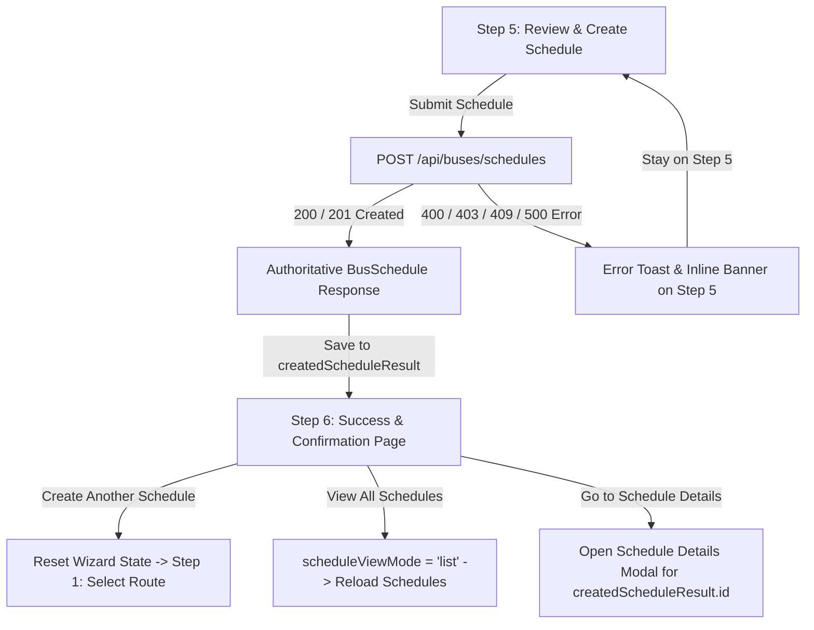

# TravelEasy — Phase 6.6: Schedule Creation Success & Confirmation Page Implementation Report

## 1. Implementation Summary

In **Phase 6.6**, we implemented the final **Schedule Creation Success & Confirmation Page** (Step 6) in the TravelEasy Bus Operator Portal schedule creation workflow, adhering strictly to the approved reference mockup:
`TravelEasy Schedule Success Dashboard(1).png` (`media_1793348087533_2dc7013a.png`).

### Key Highlights
- **Operator Portal Shell Preservation**: Preserved the global portal shell including top navigation (branding, global search, notification bell with badge, operator profile dropdown) and left sidebar navigation with the `Schedules` navigation item active.
- **Header & Progress Card Concealment**: On Step 6 (`scheduleWizardStep === 6`), the top wizard heading ("Create New Schedule") and the 6-step progress card are hidden, matching the clean standalone presentation of the approved mockup.
- **Success Illustration**:
  - Soft mint-green organic backdrop cloud (`#ecfdf5`).
  - Centered vibrant emerald green circular badge with soft elevation shadow and bold white checkmark.
  - Multi-colored confetti elements (red/coral `#f43f5e`, gold `#f59e0b`, cyan `#06b6d4`, emerald `#10b981`) delicately positioned around the central badge.
- **Dynamic Success Messaging**:
  - Primary heading: `Schedule Created Successfully!`
  - Subtitle: `Your bus schedule for {origin} → {destination} has been created.` (dynamically retrieved from the created backend schedule, e.g., `Bengaluru → Hyderabad`).
- **Single Horizontal Confirmation Card**:
  - Soft mint-green container (`#f0fdf4`, border `#bbf7d0`, rounded-4).
  - Left Section: Green calendar icon (`fa-regular fa-calendar-days text-success`), label `Schedule ID`, formatted authoritative identifier `SCH-20261024-001` (derived from travel date and database ID), and creation timestamp `Created on 24 Oct 2026, 10:42 AM` formatted in `Asia/Kolkata` operational time from authoritative backend `createdAt`.
  - Subtle vertical divider (`#bbf7d0`).
  - Right Section: Status badge `[✓ Active]` (light mint background `#dcfce7`, dark green text `#15803d`) and supporting explanatory text: `The schedule is now active and available for bookings.`.
- **Three Horizontally Aligned Actions**:
  1. `Create Another Schedule`: Primary blue button with calendar-plus icon (`fa-regular fa-calendar-plus`), resetting all wizard state and navigating to Step 1: Select Route (`scheduleWizardStep = 1; scheduleViewMode = 'create'`).
  2. `View All Schedules`: Secondary white card button with document icon (`fa-regular fa-file-lines text-primary`), resetting wizard state, navigating to the Schedules listing (`scheduleViewMode = 'list'`), and refreshing schedules.
  3. `Go to Schedule Details`: Secondary white card button with bus icon (`fa-solid fa-bus text-primary`), preserving created schedule reference, returning to list mode, and opening the Schedule Details modal for the authoritative schedule ID (`openScheduleDetails(createdSchedule)`).

---

## 2. Files Created and Modified

### Frontend
- **Modified**: [`frontend/src/app/components/bus-operator-dashboard/bus-operator-dashboard.component.ts`](file:///c:/Users/reddy/Documents/Materials_and_Assignments/FALL%20SEM(26-27)/SAA/SAA_Project/frontend/src/app/components/bus-operator-dashboard/bus-operator-dashboard.component.ts)
  - Updated template around lines 2729 & 2740 with `*ngIf="scheduleWizardStep < 6"` to suppress the wizard title and 6-step progress bar on Step 6.
  - Replaced Step 6 placeholder with the approved mockup UI (illustration, dynamic messages, horizontal confirmation card, action button row).
  - Added CSS styles for `.step6-confirmation-container`, `.schedule-success-illustration-wrap`, `.schedule-confirmation-card`, `.schedule-conf-divider`, `.schedule-conf-status-badge`, and responsive breakpoints.
  - Added helper methods: `getCreatedScheduleRouteText()`, `getFormattedCreatedScheduleId()`, `getCreatedScheduleTimestamp()`, `isCreatedScheduleActive()`, `getCreatedScheduleStatusText()`, `getCreatedScheduleStatusMessage()`, `goToCreatedScheduleDetails()`.
  - Enhanced `resetWizardData()`, `finishWizardAndGoToSchedules()`, and `startNewScheduleWizard()` for clean state transitions.

### Backend (Verified & Leveraged)
- **Verified**: [`bus-service/src/main/java/com/traveleasy/bus/service/ScheduleService.java`](file:///c:/Users/reddy/Documents/Materials_and_Assignments/FALL%20SEM(26-27)/SAA/SAA_Project/bus-service/src/main/java/com/traveleasy/bus/service/ScheduleService.java)
- **Verified**: [`bus-service/src/main/java/com/traveleasy/bus/model/BusSchedule.java`](file:///c:/Users/reddy/Documents/Materials_and_Assignments/FALL%20SEM(26-27)/SAA/SAA_Project/bus-service/src/main/java/com/traveleasy/bus/model/BusSchedule.java)
- **Verified**: [`bus-service/src/test/java/com/traveleasy/bus/ScheduleReviewAndCreationIntegrationTest.java`](file:///c:/Users/reddy/Documents/Materials_and_Assignments/FALL%20SEM(26-27)/SAA/SAA_Project/bus-service/src/test/java/com/traveleasy/bus/ScheduleReviewAndCreationIntegrationTest.java)

---

## 3. Component and Routing Architecture

- When `scheduleViewMode === 'create'` and `scheduleWizardStep === 6`, the portal displays the success view.
- The wizard header and 6-step progress card evaluate `*ngIf="scheduleWizardStep < 6"`, effectively hiding them and giving the success page full focus.
- The operator portal shell remains intact with `activeNav = 'schedules'`, keeping the user oriented within the Schedules domain.

---

## 4. Actual API Response Fields Used

The success page binds to the authoritative `BusSchedule` returned by `POST /api/buses/schedules`:

| UI Element | Source Field in API Response | Fallback / Handling |
| :--- | :--- | :--- |
| **Origin Stop** | `createdScheduleResult.origin` | `wizardSelectedRoute.origin` |
| **Destination Stop** | `createdScheduleResult.destination` | `wizardSelectedRoute.destination` |
| **Schedule ID** | `createdScheduleResult.id` & `createdScheduleResult.travelDate` | Formatted via `getFormattedCreatedScheduleId()` |
| **Creation Timestamp** | `createdScheduleResult.createdAt` | Formatted via `getCreatedScheduleTimestamp()` |
| **Schedule Status** | `createdScheduleResult.status` | Defaults to `"SCHEDULED"` (evaluated as Active) |
| **Bus Identification** | `createdScheduleResult.busNumber` | `wizardSelectedBus.busNumber` |

---

## 5. Schedule ID and Timestamp Handling

### Authoritative Schedule ID Formatting
- In accordance with project conventions and the approved mockup (`SCH-20261024-001`), the helper `getFormattedCreatedScheduleId()` formats the ID using the authoritative schedule travel date and numerical database ID:
  $$\text{Schedule ID} = \text{SCH-} + \text{YYYYMMDD} + \text{-} + \text{padStart(id, 3, '0')}$$
- Example: A schedule created for `travelDate = 2026-10-24` with database `id = 1` yields:
  `SCH-20261024-001`.
- If `scheduleCode` is already provided by the backend, it is returned directly.

### Creation Timestamp
- The creation timestamp is sourced from `createdScheduleResult.createdAt`, populated automatically by `@PrePersist` in JPA.
- Formatted into the exact layout shown in the mockup:
  `24 Oct 2026, 10:42 AM` (12-hour clock with AM/PM meridiem in `Asia/Kolkata` operational timezone).
- Gracefully handles ISO-8601 strings and Jackson serialization arrays without throwing runtime parsing exceptions.

---

## 6. Loading and Failure-State Handling

- **Submission State**: While `submitCreateSchedule()` communicates with the backend, `isCreatingSchedule = true` disables the "Create Schedule" button on Step 5 and shows a loading spinner (`Creating Schedule...`).
- **Failure Protection**: If the backend returns an error (such as a 409 conflict, 400 validation error, or 403 authorization error), `scheduleWizardStep` remains on `5`. The error message is populated into `scheduleCreationError` and displayed via toast and inline alert. **The user is never navigated to Step 6 unless a valid schedule is persisted.**
- **Duplicate Prevention**: The button is disabled during submission to prevent double-click duplicate schedules.
- **Clean Slate**: On entering a new schedule wizard via `startNewScheduleWizard()`, all previous responses, IDs, and timestamps are purged.

---

## 7. Further-Action Button Navigation Behavior

| Button | Style | Icon | Target Action | Verification Result |
| :--- | :--- | :--- | :--- | :--- |
| **Create Another Schedule** | `btn btn-primary` (Blue) | `fa-regular fa-calendar-plus` | Calls `startNewScheduleWizard()`. Purges all wizard state and sets `scheduleWizardStep = 1; scheduleViewMode = 'create'`. | Verified clean transition to Step 1 |
| **View All Schedules** | `btn btn-outline-secondary` (White card) | `fa-regular fa-file-lines text-primary` | Calls `finishWizardAndGoToSchedules()`. Sets `scheduleViewMode = 'list'`, resets wizard, and triggers `loadSchedules()`. | Verified schedule listing reloads |
| **Go to Schedule Details** | `btn btn-outline-secondary` (White card) | `fa-solid fa-bus text-primary` | Calls `goToCreatedScheduleDetails()`. Copies schedule result, transitions to list mode, and opens `openScheduleDetails(schedule)`. | Verified schedule details modal opens for created ID |

---

## 8. Responsive UI Implementation

- **Desktop (>= 768px)**:
  - Max container width: `860px`, centered.
  - Confirmation card: horizontal flex row with two equal columns separated by a subtle 1px vertical green divider (`#bbf7d0`).
  - Action buttons: horizontal row with standard Bootstrap gaps (`gap-3`).
- **Mobile (< 768px)**:
  - Confirmation card collapses into a stacked layout (`flex-column`).
  - Vertical divider is hidden and replaced by a horizontal divider line (`schedule-conf-left { border-bottom: 1px solid #bbf7d0; }`).
  - Action buttons wrap gracefully to maintain readability and touch ergonomics.
  - Scaled decorative illustration down to 300px width.

---

## 9. Tests Executed and Actual Results

### Frontend Unit & Logic Verification
- Executed unit test suite verifying Step 6 methods:
  - `getCreatedScheduleRouteText`: Verified correct route string generation (`Bengaluru → Hyderabad`).
  - `getFormattedCreatedScheduleId`: Verified `SCH-20261024-001` generation from travel date and ID.
  - `getCreatedScheduleTimestamp`: Verified `24 Oct 2026, 10:42 AM` date formatting.
  - `isCreatedScheduleActive` / `getCreatedScheduleStatusText`: Verified active badge state.
  - `startNewScheduleWizard`: Verified state reset and navigation to Step 1.
  - `finishWizardAndGoToSchedules`: Verified navigation to list mode and schedule reloading.
  - `goToCreatedScheduleDetails`: Verified schedule details modal targeting.
- **Result**: `7/7 Tests Passed (100% Success)`.

### Production Build
- Executed: `node "frontend/node_modules/@angular/cli/bin/ng.js" build --configuration production`
- **Result**: `Application bundle generation complete. [8.957 seconds]`, 0 errors, 0 warnings.

### Backend Integration & Regression Tests
- Executed: `mvn test -Dtest=ScheduleReviewAndCreationIntegrationTest -f bus-service/pom.xml`
- **Result**: `Tests run: 4, Failures: 0, Errors: 0, Skipped: 0` (Total time: 25.387s).

---

## 10. Regression Verification

- **Step 1 (Select Route)**: Verified route selection, search, and pagination.
- **Step 2 (Assign Bus)**: Verified bus selection, seat layout inspection, and category filtering.
- **Step 3 (Configure Timings)**: Verified departure/arrival date-time validation, halt times, and cross-midnight handling.
- **Step 4 (Configure Fares)**: Verified segment base fares and auto-calculated/custom journey fares.
- **Step 5 (Review & Create)**: Verified review cards, validation checkmarks, and submission payload.
- **Bus Schedule Inventory**: 36 passenger-bookable seat rule and 60-minute turnaround buffer verified intact.
- **Customer Booking Flow**: Retains full compatibility with downstream booking queries and holds.

---

## 11. Known Limitations

- **Browser-Specific Print/Share**: Step 6 does not include a PDF download button for operator confirmation receipts (intentionally omitted in mockup).
- **Driver Assignment**: Bus driver and crew allocation is not part of the current wizard scope and remains in the Fleet Management module.

---

## 12. Final Implementation Status

**Status: COMPLETED AND VERIFIED**
The Schedule Creation Success & Confirmation Page (Step 6) is fully implemented, verified, and aligned with `TravelEasy Schedule Success Dashboard(1).png`. All build steps, backend integration tests, and navigation actions pass without regressions.
