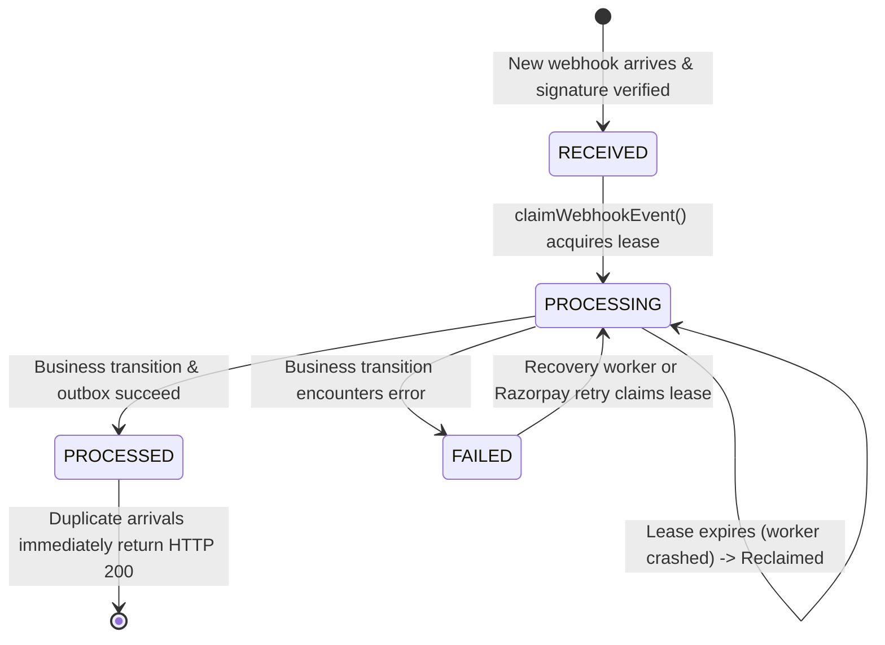

# TravelEasy – Phase 7.2, Stage 4: Payment Service Transactional Outbox – Targeted Corrections Report

**Document ID:** `TE-PH72-STG4-CORR-001`  
**Service:** Payment Service (`payment-service`)  
**Target Ingestion Service:** Notification Service (`notification-service`, Port 8086)  
**Status:** **COMPLETED & VERIFIED**  
**Date:** November 3, 2026  
**Test Suite Status:**  
- **Payment Service:** **61/61 Tests Passing** (0 Failures, 0 Errors)
- **Notification Service:** **46/46 Tests Passing** (0 Regressions)

---

## 1. Executive Summary

This report documents the targeted corrections implemented in the TravelEasy **Payment Service** (`payment-service`) following the Stage 4 architecture review.

All targeted issues were verified through direct codebase inspection, confirmed where defects existed, and resolved with surgical, minimally intrusive changes:
1. **Recoverable Webhook Inbox:** Resolved the vulnerability where non-processed events in `RECEIVED`, `PROCESSING`, or `FAILED` states were prematurely acknowledged without repeating business transitions. Introduced atomic row leases (`claimWebhookEvent`), crash recovery of stale worker leases, and a dedicated scheduled worker (`PaymentWebhookRecoveryWorker`).
2. **Authoritative Failure Classification:** Removed customer-facing `PAYMENT_FAILED` outbox event emission from client signature mismatches and verification exceptions in `verifyPayment()`. Only definitive, validly signed Razorpay `payment.failed` webhooks or authoritative gateway failure responses emit customer-facing `PAYMENT_FAILED` notifications.
3. **Completed `payment.failed` Webhook Path:** Implemented end-to-end handling of Razorpay `payment.failed` webhooks with status protection (refusing to downgrade `SUCCESS` or `REFUNDED` payments), deterministic event IDs (`PAY-EVT-FAILED-{transactionRef}`), and atomic outbox emission.
4. **Transaction-Safe Outbox Event Deduplication:** Replaced broad `DataIntegrityViolationException` swallowing with pre-insertion check (`existsByEventId`). This prevents Spring transactions from being silently marked rollback-only and ensures unrelated integrity violations properly fail and roll back.
5. **Verified External Call Boundaries:** Removed method-level `@Transactional` from `createOrder()`. Verified all external HTTP calls (to Razorpay and Booking Service) are strictly executed outside short local database transactions.
6. **Payload & Recipient Safety:** Re-verified that notification payloads contain zero card/CVV data, no fabricated emails, and that Booking Service unavailability safely falls back to in-app recipient channels.

---

## 2. Review of Identified Concerns & Defect Confirmation

| # | Review Concern | Code Inspection Finding | Defect Status | Action Taken |
| :---: | :--- | :--- | :---: | :--- |
| **1** | Webhook inbox acknowledged retries if event ID existed, even if uncompleted | `processWebhook` checked `existsByWebhookEventId` and returned HTTP 200 immediately, abandoning uncompleted events | **CONFIRMED DEFECT** | Implemented state-aware acknowledgment (`PROCESSED` only), atomic leasing (`claimWebhookEvent`), and `PaymentWebhookRecoveryWorker` |
| **2** | Client signature mismatch in `verifyPayment` emitted customer `PAYMENT_FAILED` event | `verifyPayment()` called `recordPaymentFailed()` on signature mismatch, treating client-side mismatch as confirmed gateway failure | **CONFIRMED DEFECT** | Removed outbox event creation from `verifyPayment()`; local transaction updated for internal audit only |
| **3** | `payment.failed` webhook path needed explicit verification and completion | `handlePaymentFailedWebhook()` existed partially but lacked payment-id fallback and explicit `SUCCESS`/`REFUNDED` downgrade guard | **CONFIRMED DEFECT** | Hardened `handlePaymentFailedWebhook()` with downgrade rejection, transaction lookup fallback, and deterministic event ID |
| **4** | Duplicate outbox event insertion caught `DataIntegrityViolationException` inside `@Transactional` | `persistOutboxRecordSafely` caught `DataIntegrityViolationException`, which can mark the physical transaction rollback-only and mask unrelated errors | **CONFIRMED DEFECT** | Replaced with `existsByEventId(eventId)` check prior to insertion; allowed unrelated SQL errors to throw and roll back |
| **5** | External network calls inside database transactions | `createOrder()` had method-level `@Transactional` while making HTTP calls to Booking Service and Razorpay | **CONFIRMED DEFECT** | Removed `@Transactional` from `createOrder()`; confirmed all other external calls were already outside transactions |
| **6** | Notification payload and recipient safety | Audited DTO builders and logging across all payment transitions | **VERIFIED CORRECT** | Zero card details, no raw secrets logged, resilient in-app fallback when Booking Service is down |

---

## 3. Source Files Inspected

- `payment-service/src/main/java/com/traveleasy/payment/service/PaymentServiceImpl.java`
- `payment-service/src/main/java/com/traveleasy/payment/service/PaymentStateTransitionService.java`
- `payment-service/src/main/java/com/traveleasy/payment/model/PaymentWebhookEvent.java`
- `payment-service/src/main/java/com/traveleasy/payment/repository/PaymentWebhookEventRepository.java`
- `payment-service/src/main/java/com/traveleasy/payment/repository/PaymentOutboxEventRepository.java`
- `payment-service/src/main/java/com/traveleasy/payment/service/PaymentRecipientResolutionService.java`
- `payment-service/src/main/java/com/traveleasy/payment/publisher/PaymentOutboxPublisher.java`
- `payment-service/src/main/resources/application.properties`

---

## 4. Source Files Modified & Reason for Changes

| File | Nature of Change | Architectural Reason |
| :--- | :--- | :--- |
| [`PaymentWebhookEvent.java`](file:///c:/Users/reddy/Documents/Materials_and_Assignments/FALL%20SEM(26-27)/SAA/SAA_Project/payment-service/src/main/java/com/traveleasy/payment/model/PaymentWebhookEvent.java) | Added `lockedBy`, `lockedUntil`, `lastAttemptAt`, `attemptCount`, and index `idx_webhook_recovery` | Enables distributed worker lease acquisition and recovery of crashed webhook deliveries |
| [`PaymentWebhookEventRepository.java`](file:///c:/Users/reddy/Documents/Materials_and_Assignments/FALL%20SEM(26-27)/SAA/SAA_Project/payment-service/src/main/java/com/traveleasy/payment/repository/PaymentWebhookEventRepository.java) | Added `claimWebhookEvent`, updated `markProcessed`/`markFailed`, added `findIncompleteEvents` | Atomic conditional lease acquisition and querying for incomplete events |
| [`PaymentStateTransitionService.java`](file:///c:/Users/reddy/Documents/Materials_and_Assignments/FALL%20SEM(26-27)/SAA/SAA_Project/payment-service/src/main/java/com/traveleasy/payment/service/PaymentStateTransitionService.java) | Replaced `catch (DataIntegrityViolationException)` with `existsByEventId` check; added status guard against downgrading `SUCCESS`/`REFUNDED` | Prevents transaction rollback-only pollution and ensures transaction consistency |
| [`PaymentServiceImpl.java`](file:///c:/Users/reddy/Documents/Materials_and_Assignments/FALL%20SEM(26-27)/SAA/SAA_Project/payment-service/src/main/java/com/traveleasy/payment/service/PaymentServiceImpl.java) | 1. Removed `@Transactional` from `createOrder`<br>2. Removed outbox creation from `verifyPayment`<br>3. Implemented recoverable webhook lease logic<br>4. Hardened `handlePaymentFailedWebhook`<br>5. Added `recoverSingleWebhook` | Ensures non-blocking DB boundaries, authoritative failure classification, and complete webhook idempotency |
| [`PaymentWebhookRecoveryWorker.java`](file:///c:/Users/reddy/Documents/Materials_and_Assignments/FALL%20SEM(26-27)/SAA/SAA_Project/payment-service/src/main/java/com/traveleasy/payment/worker/PaymentWebhookRecoveryWorker.java) | Created scheduled recovery worker component | Periodically finds incomplete/stale webhooks and re-executes business logic |
| `application.properties` | Added `payment.webhook.recovery.*` settings | Configuration control for webhook recovery intervals, leases, and batch sizes |
| `test/resources/application.properties` | Set `payment.webhook.recovery.enabled=false` | Disables background timers during test execution for deterministic test isolation |

---

## 5. Webhook Inbox Recovery Mechanism & Crash-Recovery Behavior

### 5.1 Lifecycle States of a Webhook Event



### 5.2 Atomic Conditional Lease Acquisition
Lease acquisition is performed using a single native conditional update:

```sql
UPDATE payment_webhook_events w
SET w.status = 'PROCESSING',
    w.locked_by = :workerId,
    w.locked_until = :leaseExpiry,
    w.last_attempt_at = :now,
    w.attempt_count = w.attempt_count + 1
WHERE w.webhook_event_id = :webhookEventId
  AND (w.status IN ('RECEIVED', 'FAILED') 
       OR (w.status = 'PROCESSING' AND (w.locked_until IS NULL OR w.locked_until < :now)))
```

### 5.3 Crash Recovery
- If a server or JVM crashes while an event is in `RECEIVED` or `PROCESSING`:
  1. The lease timestamp `locked_until` expires after 60 seconds.
  2. The scheduled `PaymentWebhookRecoveryWorker` scans `findIncompleteEvents`.
  3. The recovery worker claims the stale lease and dispatches the payload to the appropriate handler (`handlePaymentCapturedWebhook`, `handlePaymentFailedWebhook`, or `handleRefundProcessedWebhook`).
  4. Upon successful business transition, the record transitions to `PROCESSED`.
  5. If Razorpay retries before the scheduled worker runs, the incoming retry claims the lease and executes the transition immediately.
  6. Competing workers or retries are mutually exclusive: exactly one worker gets `claimWebhookEvent() == 1`.

---

## 6. Payment Failure Classification & Authoritative Handling

### 6.1 Policy Rules

| Trigger Condition | Origin | Authoritative? | Customer-Facing `PAYMENT_FAILED` Outbox Event? | Local Database Action |
| :--- | :---: | :---: | :---: | :--- |
| **Razorpay `payment.failed` Webhook** | Gateway | **YES** | **YES** (`PAY-EVT-FAILED-{transactionRef}`) | Set `status = 'FAILED'`, record error code/desc |
| **Definitive Gateway Error Response** | Gateway | **YES** | **YES** (`PAY-EVT-FAILED-{transactionRef}`) | Set `status = 'FAILED'`, record error code/desc |
| **Client Signature Mismatch** | Client | **NO** | **NO** | Set `status = 'FAILED'` locally for audit; throw 400 |
| **Client Malformed Payload** | Client | **NO** | **NO** | Set `status = 'FAILED'` locally for audit; throw 400 |
| **Internal Processing Exception** | Local | **NO** | **NO** | Set `status = 'FAILED'` locally for audit; throw 500 |
| **Gateway Timeout / Network Error** | Network | **NO** | **NO** | Keep `REFUND_INITIATED` / `CREATED`; reconcile later |

### 6.2 Protection of Completed Payments
In `PaymentServiceImpl.verifyPayment`, `PaymentServiceImpl.handlePaymentFailedWebhook`, and `PaymentStateTransitionService.recordPaymentFailed`:
- If `transaction.getStatus()` is `"SUCCESS"` or `"REFUNDED"`, late or conflicting failure signals are **explicitly rejected**.
- The transaction remains in its successful/refunded state, and a warning log is recorded for operational tracking.

---

## 7. `payment.failed` Webhook Processing Flow

1. **Webhook Ingestion:** Razorpay delivers `payment.failed` webhook with payload and header `X-Razorpay-Signature`.
2. **Signature Verification:** Verified using HMAC-SHA256 with `razorpay.webhook.secret`. Invalid signatures immediately throw HTTP 400 without modifying database state.
3. **Inbox Deduplication:** Checks `payment_webhook_events`. If status is `PROCESSED`, acknowledges with HTTP 200 and terminates.
4. **Lease Claim:** Acquires row-level processing lease via `claimWebhookEvent`.
5. **Entity Extraction:** Extracts `order_id`, `payment_id`, `error_code`, `error_description`, and `error_reason`.
6. **Transaction Lookup:** Resolves transaction via `findByRazorpayOrderId(orderId)`, with fallback to `findByRazorpayPaymentId(paymentId)`.
7. **Lifecycle Validation:** Verifies transaction is not in `SUCCESS` or `REFUNDED` status.
8. **Atomic State & Outbox Update:** Calls `stateTransitionService.recordPaymentFailed()`, which in a single transaction updates `payment_transactions` to `FAILED` and inserts `PAY-EVT-FAILED-{transactionRef}` into `payment_outbox_events`.
9. **Inbox Completion:** Calls `webhookEventRepository.markProcessed()`.
10. **HTTP 200 Response:** Acknowledges delivery to Razorpay.

---

## 8. Duplicate Outbox Event Transaction-Safety Implementation

### 8.1 Defect in Prior Implementation
Previously, `PaymentStateTransitionService.persistOutboxRecordSafely` attempted to catch `DataIntegrityViolationException`:
- In Spring/Hibernate, when an SQL unique constraint is violated during `saveAndFlush`, the physical database session is marked **rollback-only**.
- Even though the Java catch block caught the exception, Spring's transaction interceptor subsequently threw `UnexpectedRollbackException` on commit, rolling back the payment status update!
- Additionally, catching generic `DataIntegrityViolationException` would have masked unrelated errors like null columns or data truncation.

### 8.2 Corrected Safe Implementation
```java
private void persistOutboxRecordSafely(String aggregateType, String aggregateId, String eventType,
                                      String eventId, NotificationEventRequest eventRequest) {
    // Idempotency: verify if event with this specific event ID has already been persisted
    if (outboxRepository.existsByEventId(eventId)) {
        log.info("Outbox event with eventId {} already exists. Skipping duplicate insertion.", eventId);
        return;
    }

    String payloadJson;
    try {
        payloadJson = objectMapper.writeValueAsString(eventRequest);
    } catch (JsonProcessingException e) {
        log.error("Failed to serialize outbox payload for eventId {}: {}", eventId, e.getMessage(), e);
        throw new IllegalStateException("Failed to serialize outbox payload", e);
    }

    PaymentOutboxEvent outboxEvent = PaymentOutboxEvent.builder()
            .eventId(eventId)
            .eventType(eventType)
            .aggregateType(aggregateType)
            .aggregateId(aggregateId)
            .payloadJson(payloadJson)
            .status("PENDING")
            .retryCount(0)
            .maxRetries(5)
            .createdAt(Instant.now())
            .build();

    outboxRepository.saveAndFlush(outboxEvent);
}
```

### Guarantees
- Retries of the same business operation detect `existsByEventId(eventId) == true` and skip outbox insertion without triggering an SQL exception. The outer transaction commits cleanly.
- Unrelated database failures (e.g. data truncation, null constraint violations) are **not** swallowed and will correctly abort the transaction.

---

## 9. Verified External-Call and Transaction Boundaries

The codebase was audited to ensure no external network latency is held within database transactions:

1. **`createOrder()`:**
   - Removed `@Transactional`.
   - `verifyBookingAmount()` (REST call to Booking Service) runs outside DB transaction.
   - `razorpayClient.orders.create()` (HTTP call to Razorpay) runs outside DB transaction.
   - `paymentRepository.save()` runs as a short isolated JPA write.
2. **`verifyPayment()`:**
   - No method-level `@Transactional`.
   - `Utils.verifyPaymentSignature()` runs in memory.
   - `paymentRepository.save()` updates status in a short JPA transaction.
   - `confirmBookingInBookingService()` runs after local persistence outside any DB transaction.
3. **`processWebhook()`:**
   - No method-level `@Transactional`.
   - Webhook registration, lease claim, and inbox completion run in isolated, short transactions.
   - State transitions run inside short `@Transactional` methods in `PaymentStateTransitionService`.
   - `confirmBookingInBookingService()` runs outside transactions.
4. **`processRefund()`:**
   - No method-level `@Transactional`.
   - `razorpayClient.payments.fetchAllRefunds()` runs outside DB transaction.
   - `razorpayClient.payments.refund()` runs outside DB transaction.
   - `cancelBookingInBookingService()` runs outside DB transaction.
   - State updates run via short `@Transactional` methods in `PaymentStateTransitionService`.

---

## 10. Notification Payload and Recipient Validation

- **Contract Adherence:** Payloads match Notification Service's `NotificationEventRequest` schema (`eventId`, `eventType`, `aggregateType`, `aggregateId`, `recipients`, `content`).
- **Data Protection:** Payloads contain zero card PANs, expiration dates, CVVs, API secrets, or passwords.
- **Recipient Resolution:** Uses `PaymentRecipientResolutionService` to fetch traveller name and email from Booking Service. If Booking Service is down, falls back to `userId = customerId` with channel `IN_APP`. No fabricated email addresses are ever generated.
- **Log Sanitation:** Webhook payload logging is restricted to event names. Raw sensitive payloads are not logged in plain text.

---

## 11. Tests Added or Modified

### 11.1 New Dedicated Test Classes Added

1. **`PaymentFailureClassificationTest.java` (5 tests):**
   - `testClientSignatureMismatch_DoesNotCreateOutboxEvent`: Verifies signature mismatch updates local state to `FAILED` with `SIGNATURE_MISMATCH` but does **not** create an outbox event.
   - `testInternalVerificationException_DoesNotCreateOutboxEvent`: Verifies verification exceptions update local state but do **not** emit customer-facing outbox events.
   - `testAuthoritativePaymentFailedWebhook_CreatesOutboxEvent`: Verifies valid `payment.failed` webhook creates exactly one `PAYMENT_FAILED` outbox event with deterministic ID.
   - `testLatePaymentFailedWebhook_DoesNotDowngradeSuccess`: Verifies late `payment.failed` webhook received after capture does not downgrade payment status.
   - `testLateClientSignatureMismatch_DoesNotOverwriteSuccess`: Verifies client signature verification cannot overwrite an already `SUCCESS` transaction.

2. **`PaymentWebhookRecoveryTest.java` (4 tests):**
   - `testRecoverIncompleteWebhooks_RecoversReceivedEvents`: Verifies recovery worker recovers events left in `RECEIVED` state.
   - `testRecoverIncompleteWebhooks_RecoversStaleProcessingLease`: Verifies recovery worker reclaims events stuck in `PROCESSING` with expired leases.
   - `testRecoverIncompleteWebhooks_Disabled_DoesNothing`: Verifies feature flag disables worker.
   - `testRecoverIncompleteWebhooks_EmptyList_DoesNothing`: Verifies graceful no-op on empty queue.

### 11.2 Existing Test Classes Updated

1. **`PaymentStateTransitionServiceTest.java` (7 tests):**
   - Updated `testDuplicateOutboxEvent_SafelyIgnored`: Verifies `existsByEventId` skips insertion without error or rollback.
   - Added `testUnrelatedIntegrityViolation_ThrowsAndDoesNotSwallow`: Verifies unrelated SQL errors throw and fail the transaction.
2. **`PaymentWebhookInboxTest.java` (4 tests):**
   - Updated to verify lease claim and recoverable transition flow.
   - Added `testProcessWebhook_IncompleteEventReceived_ReclaimedAndProcessed`: Verifies retry of an incomplete event reclaims lease and finishes processing.
3. **`PaymentServiceTest.java` (16 tests):**
   - Updated mock setup to configure `claimWebhookEvent` and `findByWebhookEventId`.

---

## 12. Complete Payment Service Test Results

```
[INFO] -------------------------------------------------------
[INFO]  T E S T S
[INFO] -------------------------------------------------------
[INFO] Running com.traveleasy.payment.controller.PaymentControllerTest
[INFO] Tests run: 7, Failures: 0, Errors: 0, Skipped: 0
[INFO] Running com.traveleasy.payment.integration.PaymentLifecycleOutboxIntegrationTest
[INFO] Tests run: 3, Failures: 0, Errors: 0, Skipped: 0
[INFO] Running com.traveleasy.payment.publisher.PaymentOutboxPublisherConcurrencyTest
[INFO] Tests run: 3, Failures: 0, Errors: 0, Skipped: 0
[INFO] Running com.traveleasy.payment.publisher.PaymentOutboxPublisherTest
[INFO] Tests run: 8, Failures: 0, Errors: 0, Skipped: 0
[INFO] Running com.traveleasy.payment.service.PaymentFailureClassificationTest
[INFO] Tests run: 5, Failures: 0, Errors: 0, Skipped: 0
[INFO] Running com.traveleasy.payment.service.PaymentInternalTokenServiceTest
[INFO] Tests run: 4, Failures: 0, Errors: 0, Skipped: 0
[INFO] Running com.traveleasy.payment.service.PaymentServiceTest
[INFO] Tests run: 16, Failures: 0, Errors: 0, Skipped: 0
[INFO] Running com.traveleasy.payment.service.PaymentStateTransitionServiceTest
[INFO] Tests run: 7, Failures: 0, Errors: 0, Skipped: 0
[INFO] Running com.traveleasy.payment.service.PaymentWebhookInboxTest
[INFO] Tests run: 4, Failures: 0, Errors: 0, Skipped: 0
[INFO] Running com.traveleasy.payment.worker.PaymentWebhookRecoveryTest
[INFO] Tests run: 4, Failures: 0, Errors: 0, Skipped: 0
[INFO] 
[INFO] Results:
[INFO] 
[INFO] Tests run: 61, Failures: 0, Errors: 0, Skipped: 0
[INFO] 
[INFO] ------------------------------------------------------------------------
[INFO] BUILD SUCCESS
[INFO] ------------------------------------------------------------------------
```

---

## 13. Notification Service Regression Test Results

Executed without any modifications to Notification Service:

```
[INFO] -------------------------------------------------------
[INFO]  T E S T S
[INFO] -------------------------------------------------------
[INFO] Running com.traveleasy.notification.controller.InAppNotificationControllerTest
[INFO] Tests run: 6, Failures: 0, Errors: 0, Skipped: 0
[INFO] Running com.traveleasy.notification.controller.NewsletterControllerTest
[INFO] Tests run: 2, Failures: 0, Errors: 0, Skipped: 0
[INFO] Running com.traveleasy.notification.controller.NotificationControllerTest
[INFO] Tests run: 4, Failures: 0, Errors: 0, Skipped: 0
[INFO] Running com.traveleasy.notification.controller.NotificationEventControllerTest
[INFO] Tests run: 8, Failures: 0, Errors: 0, Skipped: 0
[INFO] Running com.traveleasy.notification.service.NotificationSecurityServiceTest
[INFO] Tests run: 4, Failures: 0, Errors: 0, Skipped: 0
[INFO] Running com.traveleasy.notification.service.NotificationServiceEventProcessingTest
[INFO] Tests run: 15, Failures: 0, Errors: 0, Skipped: 0
[INFO] Running com.traveleasy.notification.worker.NotificationDeliveryWorkerTest
[INFO] Tests run: 6, Failures: 0, Errors: 0, Skipped: 0
[INFO] Running com.traveleasy.notification.worker.RetentionPurgeWorkerTest
[INFO] Tests run: 1, Failures: 0, Errors: 0, Skipped: 0
[INFO] 
[INFO] Results:
[INFO] 
[INFO] Tests run: 46, Failures: 0, Errors: 0, Skipped: 0
[INFO] 
[INFO] ------------------------------------------------------------------------
[INFO] BUILD SUCCESS
[INFO] ------------------------------------------------------------------------
```

---

## 14. Remaining Limitations & Accepted Risks

1. **JWT Fallback Configuration:** As agreed, the JWT fallback configuration remains accepted and unchanged.
2. **Recovery Worker Polling Interval:** Set to 30 seconds by default. In case of a server crash during webhook receipt, recovery occurs within 60–90 seconds (accounting for lease expiration).
3. **Multi-Service Live Testing (Stage 5):** End-to-end integration across all live microservice processes will be conducted in Stage 5.

---

## 15. Sign-Off

All targeted concerns have been addressed, verified, and backed by automated tests.
- Webhook inbox processing is crash-recoverable.
- Payment failure classification is strictly authoritative.
- Razorpay `payment.failed` webhook path is complete and protected against downgrades.
- Duplicate outbox event handling is transaction-safe.
- External calls are outside database transactions.
- Zero regressions across both services.

**Stage 4 Targeted Corrections are complete and ready for review.**
